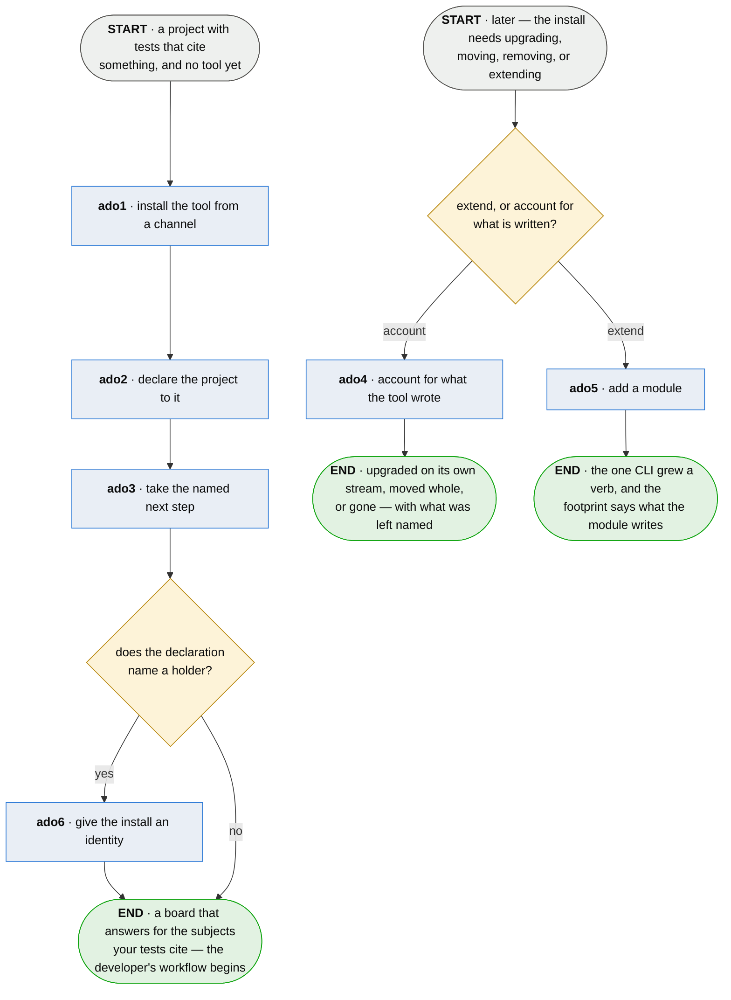

# ado · bring plumb to a project

**Last updated** 2026-09-23 v7

What a team does to get plumb, point it at their project, and keep the install accounted for —
without ever reading plumb's repository. Exits to [A developer's workflow](developer-day.md),
handing over the declaration the whole tree runs on. The channel, artifact and release statement
it consumes are produced by whoever publishes the tool, and arrive here already made.

## Nodes

### ado1 · install the tool from a channel

> **As a team with no access to plumb's repository I want to install it anyway, so that the
> tool's claims are true for people who are not already inside it.**

#### Information

| Information | IO | Description | Required | Provenance |
|---|---|---|---|---|
| ado1-inf1 | In | `channel` | yes | authored |
| ado1-inf2 | In | `artifact` | yes | authored |
| ado1-inf3 | Out | `install` | yes | derived |
| ado1-inf4 | Out | `install.channel` | yes | observed |
| ado1-inf5 | Out | `annotation_artifact` | yes | generated |

#### User Requirements
  * ado1-ur1 - installing runs from a built artifact, and never requires reading, cloning or
    reaching plumb's source
  * ado1-ur2 - one artifact carries every adapter it supports
  * ado1-ur3 - which verification ran is said; turning one off is a named flag, and clearing a
    pin is refused by name
  * ado1-ur4 - a contradiction — a verified signature and no signature at once — is refused
    rather than resolved
  * ado1-ur5 - the installed artifact names the version it was built as, out of itself
  * ado1-ur6 - the channel is a property of the install, written down when it is resolved
  * ado1-ur7 - when the tool cannot supply machinery it ships, it refuses first, names its own
    install as the fault, and says how to repair it

#### System Requirements
  * ado1-sr1 - the citation vocabulary ships as its own artifact — minimal, dependency-free,
    stable across releases
  * ado1-sr2 - the download is staged and removed on any exit
  * ado1-sr3 - every shipped document is reachable from one entry point and leads with what the
    reader gets

#### Non-Functional Requirements
  * ado1-nfr1 - the checksum runs always and the signature runs when it can; silence about not
    checking is worse
  * ado1-nfr2 - every command the install offers is the adopter's to perform

#### Unknowns
  * ado1-u1 - how the tool is present for a build nobody installed it on — CI that provisions
    from nothing — is undecided

---

### ado2 · declare the project to it

> **As a project adopting this I want exactly one file written into my repository, so that
> adopting a verifier is not adopting somebody's workflow.**

#### Information

| Information | IO | Description | Required | Provenance |
|---|---|---|---|---|
| ado2-inf1 | In | `install` | yes | ado1 |
| ado2-inf2 | In | `detection` | yes | observed |
| ado2-inf3 | Out | `config` | yes | generated |
| ado2-inf4 | Out | `adoption.written` | yes | derived |
| ado2-inf5 | Out | `adoption.kept` | yes | derived |

#### User Requirements
  * ado2-ur1 - one declaration and one command, whatever the project is written in
  * ado2-ur2 - the declaration is the whole of what is written
  * ado2-ur3 - what is missing is written, what is there is kept, and the run reports both
  * ado2-ur4 - a file the tool wrote once belongs to the project the moment it lands
  * ado2-ur5 - the declaration carries the version that wrote it

#### System Requirements
  * ado2-sr1 - every adapter is handed values already resolved and reads no configuration format
    of its own

#### Non-Functional Requirements

#### Unknowns
  * ado2-u1 - whether a project authoring a spec is any of this tool's business is undecided;
    nothing blocks a project that keeps none

---

### ado3 · take the named next step

> **As an adopter with a config file and no idea what to do with it I want the concrete next
> command, so that I can continue on my own.**

#### Information

| Information | IO | Description | Required | Provenance |
|---|---|---|---|---|
| ado3-inf1 | In | `adoption.written` | yes | ado2 |
| ado3-inf2 | Out | `next_step` | yes | derived |

#### User Requirements
  * ado3-ur1 - the last thing an adopter is told is the concrete next action, in commands
  * ado3-ur2 - the next step teaches no method

#### System Requirements

#### Non-Functional Requirements

#### Unknowns
  * ado3-u1 - what a citing test is when the artifact is a decision — a document, not code —
    is undecided

---

### ado4 · account for what the tool wrote

> **As an adopter deciding what to back up, carry or delete I want the tool to hold that list,
> so that answering it never means reading somebody's source.**

#### Information

| Information | IO | Description | Required | Provenance |
|---|---|---|---|---|
| ado4-inf1 | In | `install.channel` | yes | observed |
| ado4-inf2 | In | `footprint_entry` | yes | generated |
| ado4-inf3 | In | `release_statement` | optional | authored |
| ado4-inf4 | Out | `footprint` | yes | derived |

#### User Requirements
  * ado4-ur1 - an upgrade stays on the stream the install was on, decided against the statement
    of what changed
  * ado4-ur2 - every footprint entry carries a disposition: rebuilds itself, the repository has
    it, this project's alone, or must never leave the machine
  * ado4-ur3 - the list names which entries are irreplaceable, so somebody can point the backup
    they already run at them

#### System Requirements
  * ado4-sr1 - the footprint list lives beside the code that writes, and the documentation is a
    view of it

#### Non-Functional Requirements
  * ado4-nfr1 - a tool that takes the archive owns what counts as a secret, what a repository
    already carries, and what a restore may refuse — three policies belonging to whoever runs the
    machine, who is already backing it up; holding the list leaves each of them where it is and
    still removes the reason anybody read the source
  * ado4-nfr2 - an archive that silently omitted a credential and one that had nothing to omit are
    the same bytes, and whoever finds out is whoever is restoring after a disk failure — a hazard
    that exists only for a tool that offers the archive

#### Unknowns
  * ado4-u1 - whether the list should be emitted in a form another tool consumes rather than read
    by a person is undecided; the answer decides whether *point your backup at these* is a
    sentence or an integration

### ado5 · add a module

> **As an adopter whose team needs a capability plumb lacks I want to install a module by the
> ordinary package gesture, so that the one CLI grows the verb and nothing else changes.**

#### Information

| Information | IO | Description | Required | Provenance |
|---|---|---|---|---|
| ado5-inf1 | In | `install` | yes | observed |
| ado5-inf2 | In | `module_artifact` | yes | authored |
| ado5-inf3 | Out | `mounted_verbs` | yes | derived |
| ado5-inf4 | Out | `footprint_entry` | optional | generated |

#### User Requirements
  * ado5-ur1 - the module's verbs appear in the one CLI, and `plumb modules` lists every mounted
    module and version
  * ado5-ur2 - a module that fails to import is named as an install fault, never silently absent
  * ado5-ur3 - two modules claiming one verb, or a module claiming a core verb, refuse by name
  * ado5-ur4 - a module speaking a surface version the core does not is refused by name, with
    what the core speaks
  * ado5-ur5 - the module's declared footprint joins the tool's

#### System Requirements
  * ado5-sr1 - discovery reads the installed package's entry-point declaration; installing is
    the whole of enabling

#### Non-Functional Requirements
  * ado5-nfr1 - installing a module is the trust decision, made on its declared verbs, writes
    and reach
  * ado5-nfr2 - the core's own gates run with no modules mounted

#### Unknowns

---

### ado6 · give the install an identity

> **As an adopter whose history will leave the machine I want the install to hold one generated
> secret, so that pseudonymising — and anything that ever signs — derives from something nobody
> had to issue me.**

#### Information

| Information | IO | Description | Required | Provenance |
|---|---|---|---|---|
| ado6-inf1 | In | `config` | yes | ado2 |
| ado6-inf2 | Out | `identity.root` | yes | generated |
| ado6-inf3 | Out | `identity.public` | yes | derived |
| ado6-inf4 | Out | `identity.digest_key` | yes | derived |
| ado6-inf5 | Out | `footprint_entry` | yes | generated |

#### User Requirements
  * ado6-ur1 - the identity is one generated key, made on this machine; nothing is handed to
    anybody
  * ado6-ur2 - creating it is one command that says what it wrote and where, and never prints
    the secret
  * ado6-ur3 - the tool answers offline whether the secret still derives the identity, and exits
    non-zero on *no*
  * ado6-ur4 - a file that is not an identity is read as no identity; absent, unreadable and
    incomplete get the same repair
  * ado6-ur5 - the secret can be exported, removed, and supplied from the environment on every
    run

#### System Requirements
  * ado6-sr1 - it is a key and never a passphrase: nothing is stretched, and nothing crosses a
    terminal
  * ado6-sr2 - every purpose derives from the root under a label, by a published construction
    implemented against its own test vectors, with the purpose encoded unambiguously
  * ado6-sr3 - the key a history is pseudonymised under is derived once and carried, never
    recomputed from whatever root is current
  * ado6-sr4 - the secret and the configuration live in different homes; a change of destination
    is never the same diff as a change of key
  * ado6-sr5 - the secret's file is created with owner-only permission before anything is in it

#### Non-Functional Requirements
  * ado6-nfr1 - the private half never leaves the machine that made it: never transmitted, never
    escrowed, never recoverable
  * ado6-nfr2 - the root never signs and never travels; anything that signs is handed a derived
    key

#### Unknowns

## Glossary

| Term | Meaning |
|---|---|
| Channel | A stream naming one version — a pointer, never a copy. Stable and edge, with the promise published beside the pointer. |
| Install | The resolved fact of the tool on this machine: which version, from which stream. |
| Declaration | `plumb.toml` — the one file adoption writes: the adapter, and where production code lives. |
| Detection | What the init run found already present, so a second run finishes rather than destroys. |
| Footprint | Everything the tool wrote on a machine, each entry with its disposition — module entries included. |
| Module | An installable package that mounts verbs into the one CLI. See [mod · contribute a module](mod-contribute-a-module.md). |
| Root | The install's one secret: generated here, never issued, never transmitted. Every other key derives from it under a label. |
| Digest key | The derived key an adopter's own names are pseudonymised under before a history leaves the machine. Derived once, carried thereafter. |
| Holder | Where a series lives when it lives elsewhere. Declared in the declaration; stood up in [hol · hold a series](hol-hold-a-series.md). |
| Annotation artifact | The kilobyte the project compiles against — the citation vocabulary, and nothing to depend on. |
| Provenance | The fifth column of an Information table: where an input came from, or how an output was made. |
| Authored | Written by a person. An input nothing produces, or an output somebody typed. |
| Derived | Computed by this step from what it took in. |
| Observed | Read off a run, a tree or the world as it stands. |
| Generated | Made by a tool rather than by a person. |
| Parent | On a sub-flow's input: handed in by the chapter this one drills into. |

---

## Working notes — not part of the chapter

**The two-actor split, per o5.** ch9 held two flows in one chapter and said so; the person test
separated them: this chapter is the adopter's, and the publisher's steps are not this corpus's.
`channel` and `artifact` are authored here because whoever publishes the tool supplies them.

**The crossing the map predicted:** ado2 produces `config` — the developer tree's one
authored-with-no-producer input. The END text says where the hand-off goes.

**ch9-18's own finding, kept as ur5's debt:** the declaration is the one owned file without a
stamp today; the requirement stands and the board says unproven.

**Not carried:** the twenty-one-node self-description, the learned-twice histories, the measured
anecdotes — the standards. ch9-16 (the release statement) left with the publishing flow.

**ado6 is the identity's home.** The sixth question applies: an identity exists only for a history
that leaves the machine, so it enters through a question the declaration already answered — the
same shape as dev03-3. The signing mechanics a service would verify are not specified here:
plumb's own holder authenticates nobody, and a module that needs to sign is handed a derived key
(ado6-nfr2), so what it signs is that module's contract.
