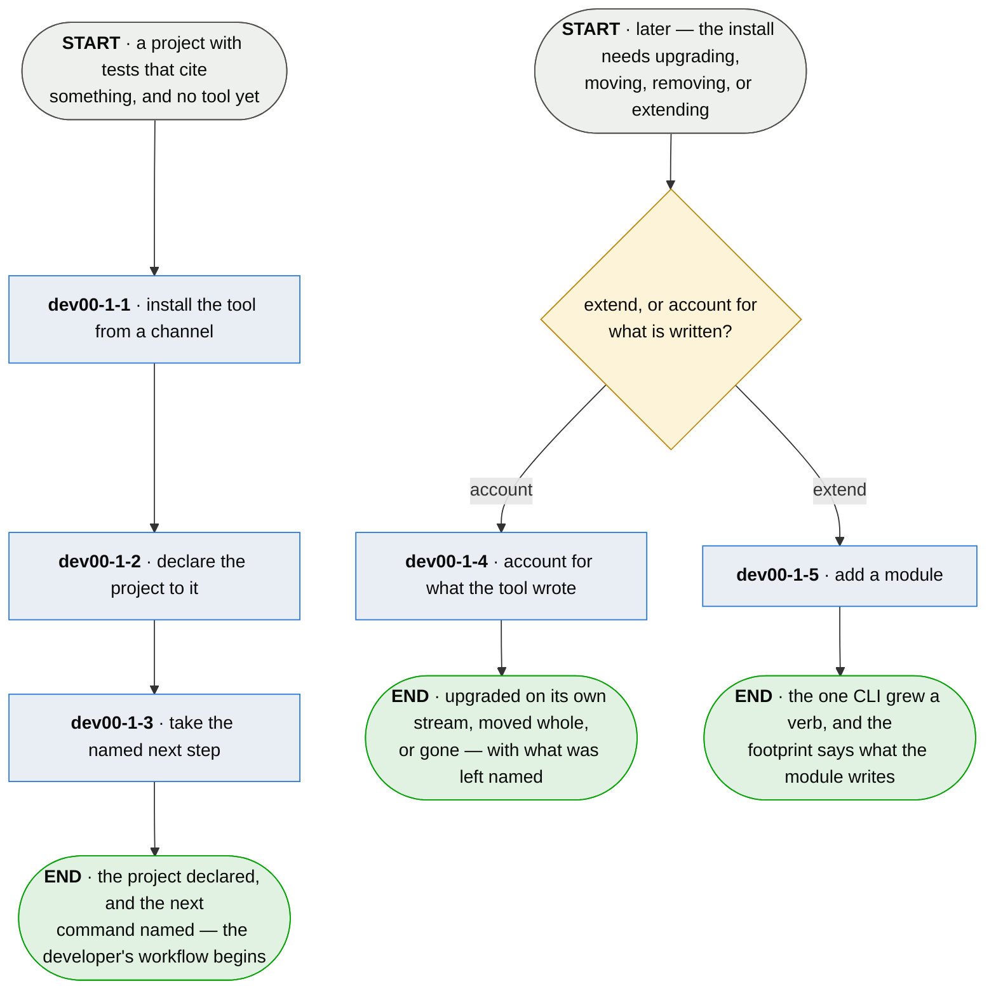

# dev00-1 · bring plumb to a project

**Last updated** 2026-10-26 v13

What a team does to get plumb, point it at their project, and keep the install accounted for —
without ever reading plumb's repository. Exits to [A developer's workflow](developer-day.md),
handing over the project's declaration the workflow runs on. The channel, artifact and release
statement it consumes are produced by whoever publishes the tool, and arrive here already made.

## Nodes

### dev00-1-1 · install the tool from a channel

> **As a team with no access to plumb's repository I want to install it anyway, so that the
> tool's claims are true for people who are not already inside it.**

#### Information

| Information | IO | Description | Required | Provenance |
|---|---|---|---|---|
| dev00-1-1-inf1 | In | `channel` | yes | authored |
| dev00-1-1-inf2 | In | `artifact` | yes | authored |
| dev00-1-1-inf3 | Out | `install` | yes | derived |
| dev00-1-1-inf4 | Out | `install.channel` | yes | observed |
| dev00-1-1-inf5 | Out | `annotation_artifact` | yes | generated |

#### User Requirements
  * dev00-1-1-ur1 - installing runs from a built artifact, and never requires reading, cloning or
    reaching plumb's source
  * dev00-1-1-ur2 - one artifact carries every adapter it supports
  * dev00-1-1-ur3 - which verification ran is said; one is skipped only when the adopter asks for that
    by name, and an emptied key fingerprint is refused by name rather than replaced
  * dev00-1-1-ur4 - a contradiction — a verified signature and no signature at once — is refused
    rather than resolved
  * dev00-1-1-ur5 - the installed artifact names the version it was built as, out of itself
  * dev00-1-1-ur6 - the channel is a property of the install, written down when it is resolved
  * dev00-1-1-ur7 - when the tool cannot supply machinery it ships, it refuses first, names its own
    install as the fault, and says how to repair it

#### System Requirements
  * dev00-1-1-sr1 - the citation vocabulary ships as its own artifact — minimal, dependency-free,
    stable across releases
  * dev00-1-1-sr2 - an install that stops part-way leaves nothing of its download behind
  * dev00-1-1-sr3 - every shipped document is reachable from one index and leads with what the
    reader gets

#### Non-Functional Requirements
  * dev00-1-1-nfr1 - the checksum runs always and the signature runs when it can; silence about not
    checking is worse
  * dev00-1-1-nfr2 - every command the install offers is the adopter's to perform

#### Unknowns
  * dev00-1-1-u1 - how the tool is present for a build nobody installed it on — CI that provisions
    from nothing — is undecided

---

### dev00-1-2 · declare the project to it

> **As a team adopting plumb I want adopting to write exactly one file into my repository, so that
> adopting a verifier is not adopting somebody's workflow.**

#### Information

| Information | IO | Description | Required | Provenance |
|---|---|---|---|---|
| dev00-1-2-inf1 | In | `install` | yes | dev00-1-1 |
| dev00-1-2-inf2 | In | `detection` | yes | observed |
| dev00-1-2-inf3 | Out | `config` | yes | generated |
| dev00-1-2-inf4 | Out | `adoption.written` | yes | derived |
| dev00-1-2-inf5 | Out | `adoption.kept` | yes | derived |

#### User Requirements
  * dev00-1-2-ur1 - one project declaration and one command, whatever the project is written in
  * dev00-1-2-ur2 - adopting writes the project's declaration and nothing else
  * dev00-1-2-ur3 - what is missing is written, what is there is kept, and the run reports both
  * dev00-1-2-ur4 - a file the tool wrote once belongs to the project the moment it lands
  * dev00-1-2-ur5 - the project's declaration carries the version that wrote it
  * dev00-1-2-ur6 - a setting the run cannot use where it is written — a key filed under the wrong
    section, an address, a declaration left in a file no longer read — is named on the board and
    the run carries on; only a declaration that cannot be read at all leaves no board

#### System Requirements
  * dev00-1-2-sr1 - every adapter is handed values already resolved and reads no configuration format
    of its own

#### Non-Functional Requirements

#### Unknowns
  * dev00-1-2-u1 - whether a project authoring a spec is any of this tool's business is undecided;
    nothing blocks a project that keeps none

---

### dev00-1-3 · take the named next step

> **As an adopter with a config file and no idea what to do with it I want the concrete next
> command, so that I can continue on my own.**

#### Information

| Information | IO | Description | Required | Provenance |
|---|---|---|---|---|
| dev00-1-3-inf1 | In | `adoption.written` | yes | dev00-1-2 |
| dev00-1-3-inf2 | Out | `next_step` | yes | derived |

#### User Requirements
  * dev00-1-3-ur1 - the last thing an adopter is told is the concrete next action, in commands
  * dev00-1-3-ur2 - the next step teaches no method

#### System Requirements

#### Non-Functional Requirements

#### Unknowns
  * dev00-1-3-u1 - what a citing test is when the artifact is a decision — a document, not code —
    is undecided

---

### dev00-1-4 · account for what the tool wrote

> **As an adopter deciding what to back up, carry or delete I want the tool to hold that list,
> so that answering it never means reading somebody's source.**

#### Information

| Information | IO | Description | Required | Provenance |
|---|---|---|---|---|
| dev00-1-4-inf1 | In | `install.channel` | yes | observed |
| dev00-1-4-inf2 | In | `footprint_entry` | yes | generated |
| dev00-1-4-inf3 | In | `release_statement` | optional | authored |
| dev00-1-4-inf4 | Out | `footprint` | yes | derived |

#### User Requirements
  * dev00-1-4-ur1 - an upgrade stays on the stream the install was on, decided against the statement
    of what changed
  * dev00-1-4-ur2 - every footprint entry carries a disposition: rebuilds itself, the repository has it,
    this project's alone, or carries a credential
  * dev00-1-4-ur3 - the list names which entries nothing else holds, so somebody can decide what to
    protect without reading the source
  * dev00-1-4-ur4 - each entry says whether it is on this machine now, and an entry kept per project
    names this project's own path, so the list describes this machine rather than the manual

#### System Requirements
  * dev00-1-4-sr1 - the footprint the tool reports and the one its documentation shows are one list,
    never two kept in step

#### Non-Functional Requirements
  * dev00-1-4-nfr1 - the tool lists what it wrote and never archives, copies or deletes it on the
    adopter's behalf
  * dev00-1-4-nfr2 - into the repository the tool writes only the project's declaration, the session
    cursor and, where the project keeps one, a series
  * dev00-1-4-nfr3 - a disposition states what an entry is and never what to do about it; what follows
    from it is the adopter's to judge

#### Unknowns
  * dev00-1-4-u1 - whether the list should be emitted in a form another tool consumes rather than read
    by a person is undecided; the answer decides whether *point your backup at these* is a
    sentence or an integration

### dev00-1-5 · add a module

> **As an adopter whose team needs a capability plumb lacks I want to install a module by the
> ordinary package gesture, so that the one CLI grows the verb and nothing else changes.**

#### Information

| Information | IO | Description | Required | Provenance |
|---|---|---|---|---|
| dev00-1-5-inf1 | In | `install` | yes | observed |
| dev00-1-5-inf2 | In | `module_artifact` | yes | authored |
| dev00-1-5-inf3 | Out | `mounted_verbs` | yes | derived |
| dev00-1-5-inf4 | Out | `footprint_entry` | optional | generated |

#### User Requirements
  * dev00-1-5-ur1 - the module's verbs appear in the one CLI, and the tool lists every mounted module
    and its version
  * dev00-1-5-ur2 - a module that fails to import is named as an install fault, never silently absent
  * dev00-1-5-ur3 - a module the mount refuses, on the grounds in dev08-1-2-ur1 and dev08-1-2-ur5, is named
    whenever its verb is invoked and is never silently absent
  * dev00-1-5-ur4 - a module speaking a surface version the core does not is refused by name, with
    what the core speaks
  * dev00-1-5-ur5 - the module's declared footprint joins the tool's
  * dev00-1-5-ur6 - a module reaches an adopter carried inside the artifact they installed or installed
    separately beside it, and both mount by the module's declaration; what enables one is the name
    its package registers and never where its code came from

#### System Requirements
  * dev00-1-5-sr1 - installing a module is the whole of enabling it: the tool mounts what the installed
    package declares (dev08-1-4-ur1), and there is no second switch
  * dev00-1-5-sr2 - an artifact that carries a module carries what discovery reads, so a channel that
    delivers the tool delivers its modules mounted

#### Non-Functional Requirements
  * dev00-1-5-nfr1 - installing a module is the trust decision, made on the verbs, writes and reach its
    declaration states (dev08-1-2)
  * dev00-1-5-nfr2 - the core's own gates run with no modules mounted

#### Unknowns
  * dev00-1-5-u1 - whether an adopter should be able to tell a module carried in the artifact from one
    installed beside it is undecided; *where did this come from* is the first question anybody
    asks when one needs replacing
  * dev00-1-5-u2 - whether the tool should ever look for a newer core or module is undecided, and it is
    a decision about the guarantee rather than about convenience: a check is a network call in a tool whose promise is that it transmits nothing unless a destination is
    named. The candidates are refusing precisely and leaving the fetching to whoever packages, or
    an opt-in check as explicit as enrolment
  * dev00-1-5-u3 - where an adopter obtains a newer module is answered nowhere; the mount refuses a
    version it cannot speak and says what it speaks, which tells somebody they are stuck without
    telling them where to go

---

## Glossary

| Term | Meaning |
|---|---|
| Channel | A stream naming one version — a pointer, never a copy. Stable and edge, with the promise published beside the pointer. |
| Install | The resolved fact of the tool on this machine: which version, from which stream. |
| Project's declaration | The project's declaration file — the one file adoption writes: the adapter, and where production code lives. |
| Detection | What the init run found already present, so a second run finishes rather than destroys. |
| Footprint | Everything the tool wrote on a machine, each entry with its disposition — module entries included. |
| Annotation artifact | The kilobyte the project compiles against — the citation vocabulary, and nothing to depend on. |

---
