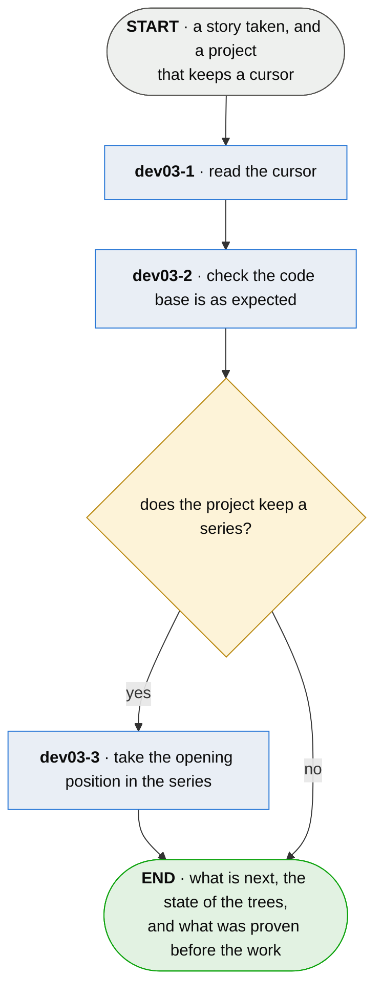

# dev03 · open a session

**Last updated** 2026-10-26 v7

A sub-flow of [A developer's workflow](developer-day.md). Entered from `dev02 · clarify what the
story means`, carrying `story.id`. Exits to `dev04 · pull the working branch`, carrying a cursor, the
state of the trees and — where the project keeps a series — an opening reading.

## Nodes

### dev03-1 · read the cursor

> **As a developer returning to work I want the cursor to say where the last session stopped and
> why, so that I pick up where I left off.**

#### Information

| Information | IO | Description | Required | Provenance |
|---|---|---|---|---|
| dev03-1-inf1 | In | `config.cursor` | yes | parent |
| dev03-1-inf7 | In | `story.id` | yes | parent |
| dev03-1-inf2 | Out | `cursor` | yes | observed |
| dev03-1-inf3 | Out | `cursor.next_task` | yes | observed |
| dev03-1-inf4 | Out | `cursor.ref` | yes | observed |
| dev03-1-inf5 | Out | `cursor.context` | yes | observed |

#### User Requirements
  * dev03-1-ur1 - the cursor carries what is next, where it is specified, and the one line that
    cannot be re-derived by reading
  * dev03-1-ur2 - an absent cursor is reported with both its causes — a first session, and a
    session that did not close — and reconstructed from neither
  * dev03-1-ur3 - `cursor.next_task` names a `story.id`

#### System Requirements

#### Non-Functional Requirements
  * dev03-1-nfr1 - the cursor is read as data and never executed
  * dev03-1-nfr2 - a field of the cursor this version of plumb does not recognise is kept exactly
    as it was when the cursor is next written

#### Unknowns

---

### dev03-2 · check the code base is as expected

> **As a developer opening a session I want to know whether the trees match what the last session
> left, so that I start from a known state.**

#### Information

| Information | IO | Description | Required | Provenance |
|---|---|---|---|---|
| dev03-2-inf1 | In | `config.repos` | yes | parent |
| dev03-2-inf2 | Out | `tree_state` | yes | observed |

#### User Requirements
  * dev03-2-ur1 - the code base is checked against what the last session expected, so the cursor
    is read first
  * dev03-2-ur2 - a declared tree that is not a repository is skipped rather than failed on

#### System Requirements

#### Non-Functional Requirements
  * dev03-2-nfr1 - opening reports; the gate is held at the close

#### Unknowns

---

### dev03-3 · take the opening position in the series

> **As a developer whose project keeps a series I want this session's starting position in it
> recorded, so that the close reports exactly my session's stretch of the history and nothing
> around it.**

#### Information

| Information | IO | Description | Required | Provenance |
|---|---|---|---|---|
| dev03-3-inf1 | In | `config.series` | yes | parent |
| dev03-3-inf2 | In | `board` | optional | parent |
| dev03-3-inf3 | Out | `reading` | yes | observed |
| dev03-3-inf4 | Out | `reading.when` | yes | observed |
| dev03-3-inf5 | Out | `reading.version` | yes | observed |
| dev03-3-inf6 | Out | `reading.series_seq` | yes | observed |

#### User Requirements
  * dev03-3-ur1 - the reading records what the board found, with the version and the moment that
    found it

#### System Requirements
  * dev03-3-sr1 - the reading lives outside the repository and never travels

#### Non-Functional Requirements
  * dev03-3-nfr1 - nothing derives a status from a stored reading
  * dev03-3-nfr2 - a project that declares no series skips this step, and nothing downstream may
    come to depend on it

#### Unknowns
  * dev03-3-u1 - whether a reading taken by another version of plumb is refused, or read and
    flagged, is undecided

## Glossary

| Term | Meaning |
|---|---|
| Cursor | What a session leaves behind saying where it stopped and what is next. |
| Tree state | The state of each declared tree at the open: clean, or holding work, compared against what the last session expected. |
| Reading | The board as it stood at the open, kept so the close has something to difference against. |
