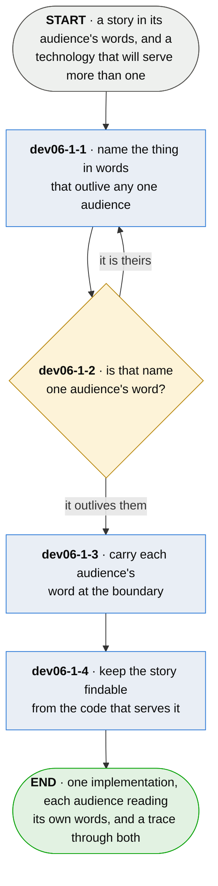

# dev06-1 · say it in the reader's words

**Last updated** 2026-10-26 v3

What somebody implementing a story does where the story's words and the names the code will use
differ: name the inside so it outlives any one audience, and carry each audience's word at the edge.

Entered from [dev06 · do the work](developer-day.md); the words the chapter itself uses are settled
in goldspec's [spe6-2-3-1 · share a word across owners](https://github.com/plumbspec/goldspec/blob/master/spec/diagrams/spe6-2-3-1-share-a-word-across-owners.md),
which is the other half and is about two specs rather than a spec and its code.

**Decision `dev06-1-D1` — the durable name goes inside and the audience's word goes at the edge.**
Renaming a concept in an implementation costs every call site, every test and every neighbouring
system that reads it; renaming a label costs one string. The asymmetry decides which of the two
words is allowed to be wrong later, and it is the one that is cheap to change.

## Nodes

### dev06-1-1 · name the thing in words that outlive any one audience

> **As somebody implementing a story I want the names inside the code chosen for how long they will
> be true, so that a second business unit arriving with its own vocabulary is a day's work at the
> edge rather than a rename of everything.**

#### Information

| Information | IO | Description | Required | Provenance |
|---|---|---|---|---|
| dev06-1-1-inf1 | In | `story.wording` | yes | authored |
| dev06-1-1-inf2 | In | `audience` | yes | authored |
| dev06-1-1-inf3 | Out | `implementation_name` | yes | derived |
| dev06-1-1-inf4 | In | `borrowed` | optional | dev06-1-2 |

#### User Requirements
  * dev06-1-1-ur1 - the name is chosen for how long it stays true, and not for who asked for the work
    first
  * dev06-1-1-ur2 - one name is used at every call site inside, so changing it later is one decision
    rather than a negotiation

#### System Requirements
  * dev06-1-1-sr1 - the implementation keeps one vocabulary across its own modules; a name that differs
    between two of them is two concepts or one mistake, and nothing downstream can tell which

#### Non-Functional Requirements
  * dev06-1-1-nfr1 - the story is still the authority on what the thing *is*; this is a naming decision
    and never a licence to implement something the story did not describe

#### Unknowns
  * dev06-1-1-u1 - how anybody recognises a name that will outlive its audiences before the second one
    arrives is undecided; the ones that failed were obvious only afterwards

---

### dev06-1-2 · is that name one audience's word?

> **As somebody implementing a story I want a name borrowed from whoever asked first to be caught
> before anything is built on it, so that the cost of the borrowing does not fall on whoever
> arrives second.**

#### Information

| Information | IO | Description | Required | Provenance |
|---|---|---|---|---|
| dev06-1-2-inf1 | In | `implementation_name` | yes | dev06-1-1 |
| dev06-1-2-inf2 | In | `audience.words` | yes | observed |
| dev06-1-2-inf3 | Out | `durable_name` | optional | derived |
| dev06-1-2-inf4 | Out | `borrowed` | optional | derived |

#### User Requirements
  * dev06-1-2-ur1 - a name that is one audience's own word is named as such before code is written
    against it
  * dev06-1-2-ur2 - a word the audience happens to share with the trade is not a borrowing; what makes
    one is that the audience could change theirs and the code would then be wrong

#### System Requirements
  * dev06-1-2-sr1 - the comparison is against the words that audience actually uses, gathered from them,
    and never against a list of terms somebody believes are domain-specific

#### Non-Functional Requirements
  * dev06-1-2-nfr1 - a borrowed word is discovered when the second business unit arrives, which is the
    most expensive moment available: the code is written, the tests cite it, neighbouring systems
    read it, and the rename has become a negotiation between two customers rather than a decision
  * dev06-1-2-nfr2 - the same word meaning two things in two business units is the harder case and looks
    like agreement — *done*, *closed*, *approved* — so it is read fluently and wrongly by both

#### Unknowns

---

### dev06-1-3 · carry each audience's word at the boundary

> **As somebody who reads what this system produces I want it to say what I would say, so that I
> can act on it without translating out of somebody else's trade.**

#### Information

| Information | IO | Description | Required | Provenance |
|---|---|---|---|---|
| dev06-1-3-inf1 | In | `durable_name` | yes | dev06-1-2 |
| dev06-1-3-inf2 | In | `audience.words` | yes | observed |
| dev06-1-3-inf3 | Out | `boundary_word` | yes | derived |

#### User Requirements
  * dev06-1-3-ur1 - each audience meets its own word where it meets the system — the label, the
    description, the field a consumer reads — and never the implementation's
  * dev06-1-3-ur2 - adding an audience adds words at the boundary and changes nothing inside, which is
    the whole return on having named the inside durably
  * dev06-1-3-ur3 - two audiences may give one implementation name two different words, and that is
    ordinary

#### System Requirements
  * dev06-1-3-sr1 - one boundary word stands for exactly one implementation name: an audience may not
    be shown one word for two things, because it leaves them unable to say which they mean
  * dev06-1-3-sr2 - the boundary is the only place an audience's word appears; a core that reads one has
    taken the borrowing back

#### Non-Functional Requirements
  * dev06-1-3-nfr1 - an audience reading the implementation's words translates on every reading, and the
    ones who get fastest at it stop noticing — which is when they begin reporting the technology's
    word back as their own and the two vocabularies quietly merge
  * dev06-1-3-nfr2 - the boundary is where a mistake is visible and cheap; a wrong label is argued with
    by whoever reads it, and a wrong internal name is argued with by nobody

#### Unknowns
  * dev06-1-3-u1 - whether a boundary word belongs to the interface's version or moves independently of
    it is undecided; a renamed label is not a breaking change to a program and may be one to a
    person

---

### dev06-1-4 · keep the story findable from the code that serves it

> **As anybody reviewing whether this was built I want to get from the story to the code and back
> without either of them being renamed to match, so that two vocabularies do not cost us the
> trace.**

#### Information

| Information | IO | Description | Required | Provenance |
|---|---|---|---|---|
| dev06-1-4-inf1 | In | `boundary_word` | yes | dev06-1-3 |
| dev06-1-4-inf2 | In | `story.id` | yes | authored |
| dev06-1-4-inf3 | Out | `traceable_implementation` | yes | derived |

#### User Requirements
  * dev06-1-4-ur1 - the code serving a story can be reached from the story, and the story from the code,
    while the two go on using different words for the same thing
  * dev06-1-4-ur2 - nothing is renamed to make the trace work — that is the failure this flow exists to
    avoid, arriving from the other direction

#### System Requirements
  * dev06-1-4-sr1 - the link is the citation a test already carries; no second document is written to
    hold the mapping

#### Non-Functional Requirements
  * dev06-1-4-nfr1 - a mapping kept as its own document is a third home for a fact that already has two,
    and it drifts from whichever of them moves first — usually the code, silently
  * dev06-1-4-nfr2 - without the trace, a reviewer holding a story and a file cannot tell a faithful
    implementation under a different name from an unfaithful one, and the safe-looking response is
    to make the names match

#### Unknowns
  * dev06-1-4-u1 - whether a boundary should also say which story it serves is undecided; it would make
    the trace readable at the edge and would put a spec identifier into shipped surface

## Glossary

| Term | Meaning |
|---|---|
| Audience | A group who reads what the system produces and shares a working vocabulary. Not a department: the unit is shared language |
| Implementation name | What a thing is called inside, chosen to outlive any one audience. The name every call site uses |
| Boundary | Where the system meets an audience — a label, a description, a transfer object's field. The only place an audience's word appears |
| Boundary word | What one audience calls a thing, at the boundary that serves them. Two audiences may have two for one implementation name |
| Borrowing | An implementation name taken from one audience's vocabulary. Works until a second audience arrives, and then costs a rename of everything |
