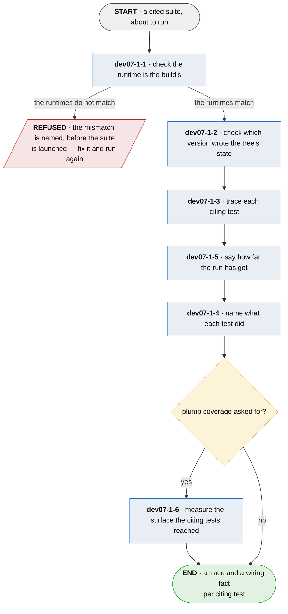

# dev07-1 · run the suite under observation

**Last updated** 2026-10-29 v9

A sub-flow of [dev07 · run plumb](dev07-run-plumb.md). Entered when plumb is run, carrying the
configuration, the annotations and the working tree. Exits to `dev07-3 · collect what the run
did`, carrying the run, a trace per citing test, and a wiring fact each.

## Nodes

### dev07-1-1 · check the runtime is the build's

> **As a developer whose build is green I want plumb's run to be the build's run, so that the
> board reports my code rather than the observation.**

#### Information

| Information | IO | Description | Required | Provenance |
|---|---|---|---|---|
| dev07-1-1-inf1 | In | `config` | yes | parent |
| dev07-1-1-inf2 | In | `working_tree` | yes | parent |
| dev07-1-1-inf3 | In | `build_declaration` | yes | observed |
| dev07-1-1-inf4 | Out | `runtime_report` | optional | derived |

#### User Requirements
  * dev07-1-1-ur1 - the adapter's runtime matches the project's own — for a JVM project, the
    classpath; for a .NET project, the assemblies its build resolved for the test project
  * dev07-1-1-ur2 - a run missing something the build has is refused by name, before the suite
    is launched
  * dev07-1-1-ur3 - a run wider than the build's is noted and runs

#### System Requirements
  * dev07-1-1-sr1 - the adapter borrows the build's own runtime rather than reconstructing it,
    and each build tool is asked for that runtime in its own terms
  * dev07-1-1-sr2 - order is part of the runtime: the run's order is the build's, and equal
    members in another order are refused
  * dev07-1-1-sr3 - the diagnosis names the missing module alone; the remedy is the build's whole
    runtime, in its order, ready to use, never an instruction to add to what is there
  * dev07-1-1-sr4 - a module answered by an installed artifact of itself is said as that, and
    never as a missing directory
  * dev07-1-1-sr5 - the check reads a declared build tool; a project with none is asked nothing

#### Non-Functional Requirements
  * dev07-1-1-nfr1 - a refusal says how to proceed anyway, and what proceeding costs

#### Unknowns

---

### dev07-1-2 · check which version wrote the tree's state

> **As a developer who has just upgraded I want to be told when my tree still holds the last
> version's derived state, so that I read a board the upgrade explains.**

#### Information

| Information | IO | Description | Required | Provenance |
|---|---|---|---|---|
| dev07-1-2-inf1 | In | `config` | yes | parent |
| dev07-1-2-inf2 | In | `stamped_version` | optional | observed |
| dev07-1-2-inf3 | Out | `run_condition` | optional | derived |

#### User Requirements
  * dev07-1-2-ur1 - a version difference is said before the board is read, and names the remedy
  * dev07-1-2-ur2 - plumb offers to clear what it wrote; what the build tool wrote is named and
    never deleted

#### System Requirements
  * dev07-1-2-sr1 - plumb stamps its version on everything it writes
  * dev07-1-2-sr2 - the stamp is compared against the running version before the board renders

#### Non-Functional Requirements
  * dev07-1-2-nfr1 - a version difference is a condition and never a refusal

#### Unknowns

---

### dev07-1-3 · trace each citing test

> **As an adopter I want the evidence gathered by the language I already run, so that adopting
> this costs no coverage tool and no version matrix.**

#### Information

| Information | IO | Description | Required | Provenance |
|---|---|---|---|---|
| dev07-1-3-inf1 | In | `annotation` | yes | parent |
| dev07-1-3-inf2 | In | `adapter.production` | yes | authored |
| dev07-1-3-inf3 | In | `adapter.entry_points` | optional | authored |
| dev07-1-3-inf4 | Out | `trace` | yes | observed |
| dev07-1-3-inf7 | Out | `run` | yes | observed |
| dev07-1-3-inf8 | Out | `citation.elapsed` | optional | observed |
| dev07-1-3-inf5 | Out | `trace.edges` | optional | observed |
| dev07-1-3-inf9 | Out | `trace.sites` | optional | observed |

#### User Requirements
  * dev07-1-3-ur01 - the trace is per test, taken with the runtime's own hooks
  * dev07-1-3-ur02 - the declared entry points are few, stable, and the project's own — never a
    story-to-code map
  * dev07-1-3-ur08 - a frame is named for the source definition it belongs to — the enclosing
    function, method or module — so a name means the same thing on every runtime of its language
  * dev07-1-3-ur09 - an expression a runtime may or may not give a frame of its own — a
    comprehension, a lambda, a generator expression — is named for the definition containing it
  * dev07-1-3-ur10 - one suite observed under two runtimes of one language names one set of
    frames, so a series spanning a runtime upgrade compares like with like
  * dev07-1-3-ur11 - one source names one set of frames whichever toolchain built the artifact,
    so a series spanning a compiler upgrade compares like with like

#### System Requirements
  * dev07-1-3-sr01 - where watching is unaffordable, the production surface reports its own
    execution, at a cost that depends on neither the surface size nor the shape of the test
  * dev07-1-3-sr02 - the observation runs in the process it happens in: no second process, no
    attach, no debugger
  * dev07-1-3-sr03 - what is observed, where, and what is recorded are declared apart from the
    mechanism that puts an observation in place, and that mechanism knows none of them
  * dev07-1-3-sr04 - what is production and what is a test is decided by where its code was
    loaded from, never by its name
  * dev07-1-3-sr05 - the window follows the work to a thread it started and a task it queued, and
    is kept per thread — or per logical flow, where the runtime carries one across its own
    hand-offs, as .NET carries its execution context across an `await`
  * dev07-1-3-sr08 - one naming rule serves the whole adapter: what a trace records, what an entry
    point is matched against and what mutation may scope to are the same names
  * dev07-1-3-sr09 - a frame with no source to place it in keeps the name its runtime gave it
  * dev07-1-3-sr10 - a member the artifact declares as made by its toolchain — by the flags it
    carries or by the declaration naming what encloses it — is named for the source member that
    contains it, and never by matching what it is called

#### Non-Functional Requirements
  * dev07-1-3-nfr1 - running under observation costs about what the tests already cost
  * dev07-1-3-nfr2 - an instrument failure costs the wiring fact and never the run; the board
    says the instrument failed, not the project
  * dev07-1-3-nfr3 - code the adapter cannot instrument is left exactly as it was, and named

#### Unknowns
  * dev07-1-3-u1 - what tracing costs on Python tracks the traced window rather than the
    codebase, and no bound is claimable
  * dev07-1-3-u2 - a runtime-generated class reports the origin of its host, so every one is
    instrumented, and what that costs on a large suite is unmeasured
  * dev07-1-3-u3 - a runtime-made class that declares no enclosing member can be placed only in
    its host, and whether the host is a sufficient name is unsettled
  * dev07-1-3-u4 - a thread that predates the window and takes work by accepting a connection
    is seen by neither adapter; a corpus that needs those threads needs a collector outside them
  * dev07-1-3-u5 - whether .NET can weave an assembly as it loads, in managed code, into a test
    process the adapter did not start — xUnit v3 runs each suite as its own program — is
    unsettled; the runtime's own hook for it, the profiling interface, is native and ships per
    platform

---

### dev07-1-5 · say how far the run has got

> **As a developer waiting on a long suite I want to see how far it has got, so that waiting is a
> decision I make rather than one made for me.**

#### Information

| Information | IO | Description | Required | Provenance |
|---|---|---|---|---|
| dev07-1-5-inf1 | In | `run` | yes | dev07-1-3 |
| dev07-1-5-inf2 | Out | `run_progress` | yes | observed |

#### User Requirements
  * dev07-1-5-ur1 - the run says where it has got to: tests done out of tests discovered,
    coarsely
  * dev07-1-5-ur2 - the position is readable at any moment without following the run's own
    output

#### System Requirements

#### Non-Functional Requirements

#### Unknowns

---

### dev07-1-4 · name what each test did

> **As a developer reading PROVEN I want it to mean the test went in through an entry point, so
> that reaching the code means reaching it the way anybody would.**

#### Information

| Information | IO | Description | Required | Provenance |
|---|---|---|---|---|
| dev07-1-4-inf1 | In | `trace` | yes | dev07-1-3 |
| dev07-1-4-inf2 | In | `adapter.entry_points` | optional | authored |
| dev07-1-4-inf3 | Out | `citation.grounding` | yes | derived |
| dev07-1-4-inf4 | Out | `citation.entered_through` | yes | observed |
| dev07-1-4-inf5 | Out | `citation.reached_outside_entry` | yes | observed |

#### User Requirements
  * dev07-1-4-ur1 - the wiring fact per test is one of five:
    * dev07-1-4-ur1.1 - `grounded` — it drove production code inside an entry point's window
    * dev07-1-4-ur1.2 - `ungrounded` — it ran production code outside every entry point
    * dev07-1-4-ur1.3 - `inert` — it read the artifact and ran nothing
    * dev07-1-4-ur1.4 - `not-checked` — no entry points are declared, so the question could not
      be asked
    * dev07-1-4-ur1.5 - `dispatched` — the work left for a thread that could not be followed; the
      hand-off was seen, never assumed
  * dev07-1-4-ur2 - `inert` is asserted only where every thread was accounted for; otherwise the
    fact is `dispatched`
  * dev07-1-4-ur3 - the entry points a test entered are named — the outermost, so declaring
    another entry point never rewrites the fact for a test that did not change
  * dev07-1-4-ur4 - a test that enters an entry point and also runs code no entry point reaches
    says so
  * dev07-1-4-ur5 - `dispatched` and `not-checked` stay separate answers, because the reader's
    next move differs
  * dev07-1-4-ur6 - with no entry points declared the board prompts — declare entry points to
    catch orphaned code — never a silent skip
  * dev07-1-4-ur7 - an entry point is matched against the names a trace records, so a declared
    entry point holds whichever runtime observed it

#### System Requirements
  * dev07-1-4-sr1 - `grounded` is read from the window, kept as dev07-1-3-sr05 keeps it:
    production code is recorded only while the window is open
  * dev07-1-4-sr2 - a hand-off is observed on the side that knows the window: a started thread
    is marked by its starter, and a queued task carries the window and releases it on every
    exit path
  * dev07-1-4-sr3 - an entry point is recorded when entered while no window is open, which is
    what makes the fact the outermost
  * dev07-1-4-sr4 - thread accounting is sampled at the window's two ends, and both of its error
    directions read as `dispatched` — the answer that can cost a status and never grant one

#### Non-Functional Requirements
  * dev07-1-4-nfr1 - a fact that cannot be gathered degrades and surfaces; the run never fails
    for it

#### Unknowns
  * dev07-1-4-u1 - what counts as a production frame is the adapter's to settle, and a cold and
    a warm run may report different facts
  * dev07-1-4-u2 - whether a declared entry point is legitimate cannot be checked, only recorded
    — an entry point opened for one subject is open to every subject
  * dev07-1-4-u3 - a test that runs the tool in another process reads as having run nothing;
    whether the hand-off is the right fact for a process boundary is open
  * dev07-1-4-u4 - static dead-code detection — code reachable from no entry point regardless of
    any test — is a separate question, undecided

---

### dev07-1-6 · measure the surface the citing tests reached

> **As a developer deciding where the next test goes I want to see which of the declared surface
> my citing tests never reached through an entry point, so that the gap is something I can point
> at.**

#### Information

| Information | IO | Description | Required | Provenance |
|---|---|---|---|---|
| dev07-1-6-inf1 | In | `trace` | yes | dev07-1-3 |
| dev07-1-6-inf2 | In | `trace.sites` | optional | dev07-1-3 |
| dev07-1-6-inf3 | In | `adapter.entry_points` | optional | authored |
| dev07-1-6-inf4 | Out | `plumb_coverage` | optional | derived |

#### User Requirements
  * dev07-1-6-ur1 - what the instrument knew of and did not reach is reported beside what it
    reached; the unreached part is the measurement
  * dev07-1-6-ur2 - the figure is the declared surface this run's citing tests drove through an
    entry point, never the lines a suite executed, and is named so the two are not compared
  * dev07-1-6-ur3 - the figure is asked for, never on by default, and moves no status

#### System Requirements
  * dev07-1-6-sr1 - an instrument that cannot enumerate its own sites says the figure could not
    be measured, as any other question this method could not ask is said
  * dev07-1-6-sr2 - the figure is kept beside the manifest by the observer that made it and
    enters neither the manifest nor the board, so no interface widens to carry it

#### Non-Functional Requirements
  * dev07-1-6-nfr1 - it costs a run nothing it does not already pay: a site's ends are settled
    before the program starts, and reaching one is already recorded

#### Unknowns
  * dev07-1-6-u1 - what it costs an instrument that must enumerate its sites by reading source,
    rather than by keeping what it instrumented, is unmeasured

## Glossary

| Term | Meaning |
|---|---|
| Window | The stretch of one thread's execution from entering an entry point until leaving the outermost one entered. Production code run while it is open was reached through that entry point. |
| Build declaration | What the build tool itself says its test runtime is. |
| Definition | The named function, method or module a frame belongs to, whatever the runtime chose to give a frame of its own. |
| Site | One join the instrument knew of before the run: a call from one named piece of production code to another. |
| Plumb coverage | How much of the declared surface this run's citing tests reached through an entry point. Not line coverage — a different numerator, a different denominator, and only the citing tests. |

---
