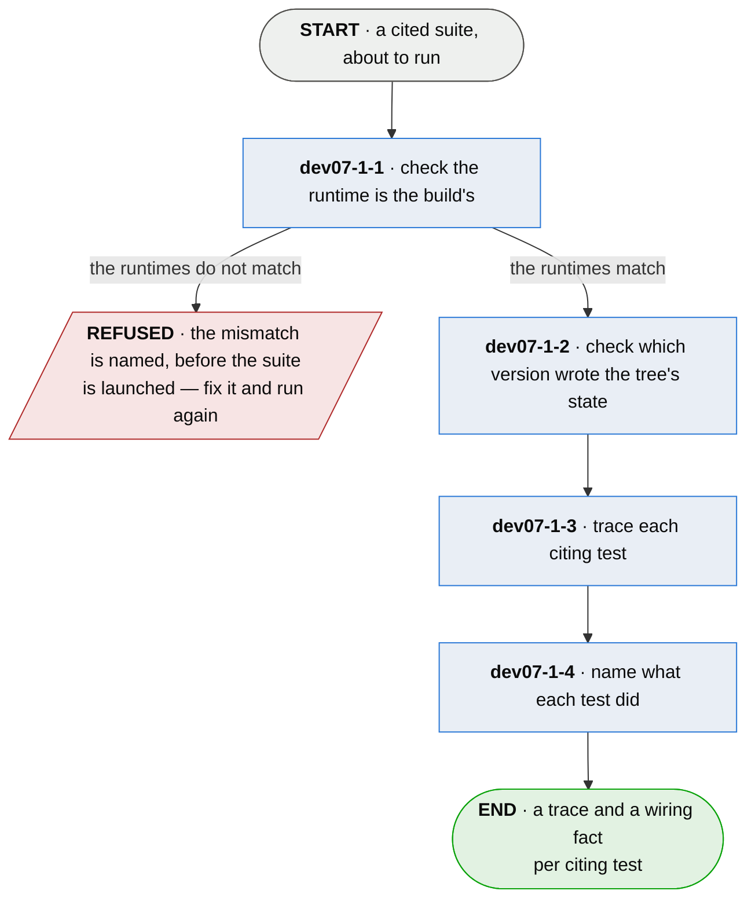

# dev07-1 · run the suite under observation

**Last updated** 2026-09-22 v6

A sub-flow of [dev07 · run plumb](dev07-run-plumb.md). Entered from the command, carrying the
configuration, the citations and the working tree. Exits to `dev07-3 · collect what the run
did`, carrying the run, a trace per citing test, and a wiring fact each.

## Nodes

### dev07-1-1 · check the runtime is the build's

> **As a developer whose build is green I want plumb's run to be the build's run, so that the
> board reports my code rather than the observation.**

#### Information

| Information | IO | Description | Required | Provenance |
|---|---|---|---|---|
| dev07-1-1-inf1 | In | `config` | yes | parent |
| dev07-1-1-inf2 | In | `working_tree` | yes | parent |
| dev07-1-1-inf3 | In | `build_declaration` | yes | observed |
| dev07-1-1-inf4 | Out | `runtime_report` | optional | derived |

#### User Requirements
  * dev07-1-1-ur1 - the adapter's runtime matches the project's own — for a JVM project, the
    classpath
  * dev07-1-1-ur2 - a run missing something the build has is refused by name, before the suite
    is launched
  * dev07-1-1-ur3 - a run wider than the build's is noted and runs

#### System Requirements
  * dev07-1-1-sr1 - the adapter borrows the build's own runtime rather than reconstructing it,
    and each build tool is told how to produce its own classpath
  * dev07-1-1-sr2 - order is part of the runtime: test outputs come before main outputs, the
    order the build runs — equal members in the wrong order are refused
  * dev07-1-1-sr3 - the diagnosis names the missing module alone; the remedy is a whole
    classpath in build order, ready to paste, never an instruction to append
  * dev07-1-1-sr4 - a module answered by an installed artifact of itself is said as that, and
    never as a missing directory
  * dev07-1-1-sr5 - the check reads a declared build tool; a project with none is asked nothing

#### Non-Functional Requirements
  * dev07-1-1-nfr1 - a refusal names the flag that proceeds anyway (`check_classpath = false`),
    with what proceeding costs

#### Unknowns

---

### dev07-1-2 · check which version wrote the tree's state

> **As a developer who has just upgraded I want to be told when my tree still holds the last
> version's derived state, so that I read a board the upgrade explains.**

#### Information

| Information | IO | Description | Required | Provenance |
|---|---|---|---|---|
| dev07-1-2-inf1 | In | `config` | yes | parent |
| dev07-1-2-inf2 | In | `stamped_version` | optional | observed |
| dev07-1-2-inf3 | Out | `run_condition` | optional | derived |

#### User Requirements
  * dev07-1-2-ur1 - a version difference is said before the board is read, and names the remedy
  * dev07-1-2-ur2 - plumb offers to clear what it wrote; what the build tool wrote is named and
    never deleted

#### System Requirements
  * dev07-1-2-sr1 - plumb stamps its version on everything it writes
  * dev07-1-2-sr2 - the stamp is compared against the running version before the board renders

#### Non-Functional Requirements
  * dev07-1-2-nfr1 - a version difference is a condition and never a refusal

#### Unknowns

---

### dev07-1-3 · trace each citing test

> **As an adopter I want the evidence gathered by the language I already run, so that adopting
> this costs no coverage tool and no version matrix.**

#### Information

| Information | IO | Description | Required | Provenance |
|---|---|---|---|---|
| dev07-1-3-inf1 | In | `annotation` | yes | parent |
| dev07-1-3-inf2 | In | `adapter.production` | yes | authored |
| dev07-1-3-inf3 | In | `adapter.entry_points` | optional | authored |
| dev07-1-3-inf4 | Out | `trace` | yes | observed |
| dev07-1-3-inf7 | Out | `run` | yes | observed |
| dev07-1-3-inf8 | Out | `citation.elapsed` | optional | observed |
| dev07-1-3-inf5 | Out | `trace.edges` | optional | observed |
| dev07-1-3-inf6 | Out | `run_progress` | yes | observed |
| dev07-1-3-inf9 | Out | `trace.sites` | optional | observed |
| dev07-1-3-inf10 | Out | `plumb_coverage` | optional | derived |

#### User Requirements
  * dev07-1-3-ur1 - the trace is per test, taken with the runtime's own hooks
  * dev07-1-3-ur2 - the declared doors are few, stable, and the project's own — never a
    story-to-code map
  * dev07-1-3-ur3 - a long run says where it has got to — done out of discovered, coarsely — so
    waiting is a decision
  * dev07-1-3-ur4 - the position is written to a file and rewritten in place, readable at any
    moment without following the stream
  * dev07-1-3-ur5 - what the instrument knew of and did not reach is reported beside what it
    reached; the unreached half is the measurement
  * dev07-1-3-ur6 - the figure is the declared surface this run's citing tests drove through a
    door, never the lines a suite executed, and is named so the two are not compared
  * dev07-1-3-ur7 - the figure is asked for, never on by default, and moves no status
  * dev07-1-3-ur8 - a frame is named for the source definition it belongs to — the enclosing
    function, method or module — so a name means the same thing on every runtime of its language
  * dev07-1-3-ur9 - an expression a runtime may or may not give a frame of its own — a
    comprehension, a lambda, a generator expression — is named for the definition containing it
  * dev07-1-3-ur10 - one suite observed under two runtimes of one language names one set of
    frames, so a series spanning a runtime upgrade compares like with like
  * dev07-1-3-ur11 - one source names one set of frames whichever toolchain built the artifact,
    so a series spanning a compiler upgrade compares like with like

#### System Requirements
  * dev07-1-3-sr1 - where watching is unaffordable, the production surface reports its own
    execution — measured at 0.49ns a call, a cost that depends on neither the surface size nor
    the shape of the test
  * dev07-1-3-sr2 - the observation runs in the process it happens in: no second process, no
    attach, no debugger
  * dev07-1-3-sr3 - the instrument is a join point, a pointcut and an advice; the weaver knows
    none of them, and an advice declares its width so alignment is never an advice's job
  * dev07-1-3-sr4 - what is production and what is a test is decided by where a class was
    loaded from, never by its name
  * dev07-1-3-sr5 - the window carries to a thread it started and a task it queued, and the
    entry depth is counted per thread
  * dev07-1-3-sr6 - an instrument that cannot enumerate its own sites reports not-checked, as
    any other question this method could not ask is reported
  * dev07-1-3-sr7 - the figure is written beside the manifest by the observer that made it and
    enters neither the manifest nor the board, so no interface widens to carry it
  * dev07-1-3-sr8 - one naming rule serves the whole adapter: what a trace records, what a door
    is matched against and what mutation may scope to are the same names
  * dev07-1-3-sr9 - a frame with no source to place it in keeps the name its runtime gave it
  * dev07-1-3-sr10 - a member the artifact declares as made by its toolchain — by the flags it
    carries or by the declaration naming what encloses it — is named for the source member that
    contains it, and never by matching what it is called

#### Non-Functional Requirements
  * dev07-1-3-nfr1 - running under observation costs about what the tests already cost —
    measured at +0.6%
  * dev07-1-3-nfr2 - an instrument failure costs the wiring question and never the run; the
    board says the instrument failed, not the project
  * dev07-1-3-nfr3 - a class the adapter cannot rewrite is left exactly as it was, and surfaced
  * dev07-1-3-nfr4 - it costs a run nothing it does not already pay: a site's ends are settled
    before the program starts, and reaching one is already recorded

#### Unknowns
  * dev07-1-3-u1 - what tracing costs on Python tracks the traced window rather than the
    codebase, and no bound is claimable
  * dev07-1-3-u2 - a runtime-generated class reports the origin of its host, so every one is
    woven, and what that costs on a large suite is unmeasured
  * dev07-1-3-u3 - a runtime-made class that declares no enclosing member can be placed only in
    its host, and whether the host is a sufficient name is unsettled
  * dev07-1-3-u4 - what it costs an instrument that must enumerate its sites by reading source,
    rather than by holding what it wove, is unmeasured
  * dev07-1-3-u5 - a thread that predates the window and takes work by accepting a connection
    is seen by neither adapter; a corpus that needs those threads needs a collector outside them

---

### dev07-1-4 · name what each test did

> **As a developer reading PROVEN I want it to mean the test went in through the front door, so
> that reaching the code means reaching it the way anybody would.**

#### Information

| Information | IO | Description | Required | Provenance |
|---|---|---|---|---|
| dev07-1-4-inf1 | In | `trace` | yes | dev07-1-3 |
| dev07-1-4-inf2 | In | `adapter.entry_points` | optional | authored |
| dev07-1-4-inf3 | Out | `citation.grounding` | yes | derived |
| dev07-1-4-inf4 | Out | `citation.entered_through` | yes | observed |
| dev07-1-4-inf5 | Out | `citation.reached_outside_entry` | yes | observed |

#### User Requirements
  * dev07-1-4-ur1 - the answer per test is one of five:
    * dev07-1-4-ur1.1 - `grounded` — it drove code under a declared door
    * dev07-1-4-ur1.2 - `ungrounded` — it ran production code under no door
    * dev07-1-4-ur1.3 - `inert` — it read the artifact and ran nothing
    * dev07-1-4-ur1.4 - `not-checked` — no doors are declared
    * dev07-1-4-ur1.5 - `dispatched` — the work left for a thread that could not be followed
  * dev07-1-4-ur2 - `inert` is asserted only where every thread was accounted for; otherwise the
    fact is `dispatched`
  * dev07-1-4-ur3 - the doors a test entered are named — the outermost, so declaring another
    door never rewrites the fact for a test that did not change
  * dev07-1-4-ur4 - a test that enters a door and also runs code no door reaches says so
  * dev07-1-4-ur5 - `dispatched` and `not-checked` stay separate answers, because the reader's
    next move differs
  * dev07-1-4-ur6 - with no doors declared the board prompts — declare entry points to catch
    orphaned code — never a silent skip
  * dev07-1-4-ur7 - a door is matched against the names a trace records, so a declared door
    holds whichever runtime observed it

#### System Requirements
  * dev07-1-4-sr1 - `grounded` is read from a per-thread window: the door's wrapper counts
    depth, and a production frame records only while the count is above zero
  * dev07-1-4-sr2 - a hand-off is observed on the side that knows the window: a started thread
    is marked by its starter, and a queued task carries the window and releases it on every
    exit path
  * dev07-1-4-sr3 - a door is recorded when entered from outside any open window, which is what
    makes the fact the outermost
  * dev07-1-4-sr4 - thread accounting is sampled at the window's two ends, and both of its error
    directions read as `dispatched` — the answer that can cost a status and never grant one

#### Non-Functional Requirements
  * dev07-1-4-nfr1 - a fact that cannot be gathered degrades and surfaces; the run never fails
    for it

#### Unknowns
  * dev07-1-4-u1 - what counts as a production frame is the adapter's to settle, and a cold and
    a warm run may report different facts
  * dev07-1-4-u2 - whether a declared door is legitimate cannot be checked, only recorded — a
    door opened for one subject is open to every subject
  * dev07-1-4-u3 - a test that runs the tool in another process reads as having run nothing;
    whether the hand-off is the right fact for a process boundary is open
  * dev07-1-4-u4 - static dead-code detection — code reachable from no door regardless of any
    test — is a separate question, undecided

## Glossary

| Term | Meaning |
|---|---|
| Door | A declared point where the real system begins doing work — a CLI command, an HTTP route, a handler, a job. Declared once by the project; the form is the adapter's. |
| Trace | The runtime's own per-test record of what the test drove. |
| Annotation | The marker on a test naming the story it evidences. |
| Grounded | The schema's name for *drove code under a declared door*. |
| Ungrounded | Ran production code under no door — the orphaned-done fake, mechanically caught. |
| Inert | Read the artifact and ran nothing — the positive proof a structural story needs. |
| Not-checked | No doors are declared, so the question could not be asked. |
| Dispatched | The work left for a thread that could not be followed — a hand-off that was seen, never assumed. |
| Build declaration | What the build tool itself says its test runtime is. |
| Definition | The named function, method or module a frame belongs to, whatever the runtime chose to give a frame of its own. |
| Site | One join the instrument knew of before the run: a call from one named piece of production code to another. |
| Plumb coverage | How much of the declared surface this run's citing tests reached through a door. Not line coverage — a different numerator, a different denominator, and only the citing tests. |
| Provenance | The fifth column of an Information table: where an input came from, or how an output was made. |
| Authored | Written by a person. An input nothing produces, or an output somebody typed. |
| Derived | Computed by this step from what it took in. |
| Observed | Read off a run, a tree or the world as it stands. |
| Generated | Made by a tool rather than by a person. |
| Parent | On a sub-flow's input: handed in by the chapter this one drills into. |

---

## Working notes — not part of the chapter

**Moved out, to land elsewhere.** `ch3-6 · refute a wired rung` judges a depth claim against the
wiring fact and writes a verdict condition — that is deciding, and it converts with ch1 into
`dev07-n4`, taking the `wired_rung` set with it. `ch3-4`'s emission into the manifest is the
hand-off to `dev07-3 · collect`, and its claims about the fact vocabulary live here at n4.

**Withdrawal candidate.** `ch3-9` (finish the suite without the observer) describes a
debugger-based observer the in-process instrument retires; its three citing tests hold until the
debugger is actually gone. The claim survives here only as n3-nfr2.

**Seam analysis, dropped.** n3-u4 offered seam analysis and dead-edge detection as candidates.
The second is now `plumb_coverage`. The first was taken up, researched and put down (2026-09-18):
it needs a specification of what a module is, which is neither this tool's business nor this
chapter's.

**Schema names.** `citation.grounding`, `grounded`, `inert`, `dispatched` are manifest schema
values with 53 citing marks; the prose now says what they mean in plain words, and renaming the
schema itself is a version change for the operator to rule on, not a prose edit.

**ch3 subjects not carried:** the essays (history, measurements of the debugger's cost, the
instrument's discovery narrative), per the standards — the surviving claims are the requirements
above. `run_progress` detail rows (`discovered`, `finished`, `at`) fold into `run_progress`.
