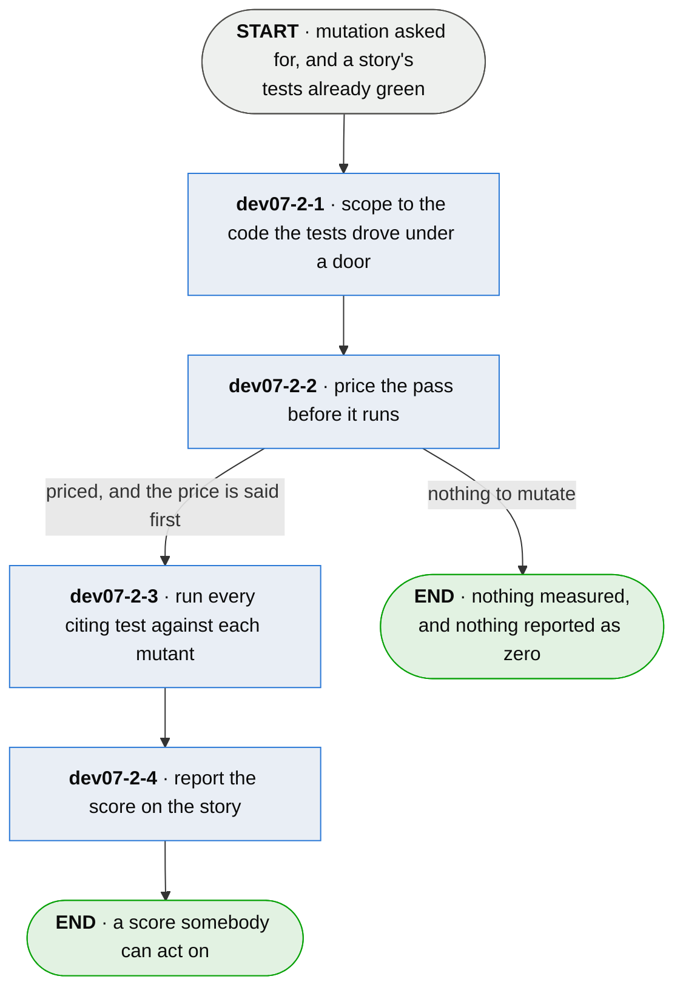

# dev07-2 · check the tests bite

**Last updated** 2026-09-11 v4

A sub-flow of [dev07 · run plumb](dev07-run-plumb.md). Entered when the configuration or the
command asks for mutation, carrying the trace, the citations and the story. Exits to
`dev07-3 · collect what the run did`, carrying a score per story — or nothing at all, which is
an answer and never a zero.

## Nodes

### dev07-2-1 · scope to the code the tests drove under a door

> **As a developer reading a mutation score I want it to be about the code this story's tests
> actually wired, so that the number distinguishes my stories.**

#### Information

| Information | IO | Description | Required | Provenance |
|---|---|---|---|---|
| dev07-2-1-inf1 | In | `trace.executed_under_entry` | yes | parent |
| dev07-2-1-inf2 | In | `story.id` | yes | parent |
| dev07-2-1-inf3 | In | `annotation` | yes | parent |
| dev07-2-1-inf4 | In | `adapter.production` | yes | authored |
| dev07-2-1-inf8 | In | `adapter.sources` | optional | authored |
| dev07-2-1-inf6 | Out | `mutation_plan` — the story, its passing tests, its targets, its mutant count | yes | derived |
| dev07-2-1-inf7 | Out | `mutation_plan.mutants` | yes | derived |

#### User Requirements
  * dev07-2-1-ur1 - only code the story's tests drove under a declared door is mutated, never the
    whole call tree
  * dev07-2-1-ur2 - the scope is the union over every citing test, grouped by file, named the way
    the runtime names a frame
  * dev07-2-1-ur3 - only the story's passing citing tests enter the plan
  * dev07-2-1-ur4 - a frame the declared roots cannot resolve to a file is not a target — a
    project that declares nothing gets no mutants, never a guess
  * dev07-2-1-ur5 - the plan runs only with both tests and mutants in it; otherwise the pass
    reports nothing at all, because a score out of zero reads like an answer

#### System Requirements
  * dev07-2-1-sr1 - the scope is recomputed from the trace every run; no story-to-code map is
    written down
  * dev07-2-1-sr2 - targets resolve against the declared source roots (`adapter.sources`),
    distinct from production because mutation rewrites source, which a compiled language does
    not run

#### Non-Functional Requirements

#### Unknowns
  * dev07-2-1-u1 - narrowing further to only what changed needs a definite diff, and the
    mechanism is the adapter's to fix

---

### dev07-2-2 · price the pass before it runs

> **As a developer about to start this I want the price before I pay it, so that deciding whether
> it is worth an hour is a decision I can make.**

#### Information

| Information | IO | Description | Required | Provenance |
|---|---|---|---|---|
| dev07-2-2-inf1 | In | `mutation_plan.mutants` | yes | dev07-2-1 |
| dev07-2-2-inf2 | In | `citation.elapsed` | optional | parent |
| dev07-2-2-inf3 | Out | `mutation_cost` | yes | observed |

#### User Requirements
  * dev07-2-2-ur1 - the price is reported before any mutant runs
  * dev07-2-2-ur2 - the price is per story, so a caller picks a subject they can afford
  * dev07-2-2-ur3 - the price is a floor and says so, and is revised from the first completed
    mutant — while stopping is still free

#### System Requirements
  * dev07-2-2-sr1 - the count comes from one parse, never from generating the mutants
  * dev07-2-2-sr2 - the dominant term is what the story's citing tests just cost in this run's
    board phase — measured moments earlier, never assumed

#### Non-Functional Requirements

#### Unknowns

---

### dev07-2-3 · run every citing test against each mutant

> **As a developer whose story has four tests I want all four run against a mutant, so that
> *unnoticed* means no test of this story caught it.**

#### Information

| Information | IO | Description | Required | Provenance |
|---|---|---|---|---|
| dev07-2-3-inf1 | In | `mutation_plan` | yes | dev07-2-1 |
| dev07-2-3-inf2 | In | `mutation_operator` | yes | authored |
| dev07-2-3-inf3 | Out | `mutant.noticed` | yes | observed |
| dev07-2-3-inf4 | Out | `parked_original` | optional | derived |

#### User Requirements
  * dev07-2-3-ur1 - every test citing the story runs against each mutant
  * dev07-2-3-ur2 - a run that does not finish inside its bound counts as killed — tests that
    never complete against broken code are the opposite of passing over it unmoved
  * dev07-2-3-ur3 - the original is parked before the mutant goes down, restored before the next
    run's tests, and the recovery is said by file name

#### System Requirements
  * dev07-2-3-sr1 - exactly one site changes per mutant, enumerated from a fresh parse each
    time, so a survivor means one difference
  * dev07-2-3-sr2 - a mutation that changes nothing is never generated: a comparison flips to
    its negation, a return swaps for a different value
  * dev07-2-3-sr3 - the mutants are the adapter's own transform of the language's parse tree —
    no third-party engine, no version matrix
  * dev07-2-3-sr4 - mutation edits the real source in place, which is what lets the tests run
    against the project as it is — its own imports, plugins and configuration
  * dev07-2-3-sr5 - each mutant runs the citing tests in a fresh interpreter, because the mutant
    must be imported the way the project would import it

#### Non-Functional Requirements
  * dev07-2-3-nfr1 - off by default because a mutant costs a test run and a project has
    thousands; the check finds defects a fully green suite has signed off

#### Unknowns
  * dev07-2-3-u1 - where the operator set should stop is a cost and catch tradeoff, and is not
    fixed
  * dev07-2-3-u2 - while the pass runs, the file on disk is a mutant, and every other reader of
    the tree — a commit, a CI checkout, an editor — sees it; the window is measured as real,
    nothing notices it, and what closes it is unsettled

---

### dev07-2-4 · report the score on the story

> **As a developer reading the result I want a proportion rather than a word, so that a story
> checked three ways out of forty reads apart from one checked thirty-nine.**

#### Information

| Information | IO | Description | Required | Provenance |
|---|---|---|---|---|
| dev07-2-4-inf1 | In | `mutant.noticed` | yes | dev07-2-3 |
| dev07-2-4-inf2 | In | `mutation_plan.mutants` | yes | dev07-2-1 |
| dev07-2-4-inf3 | Out | `story.mutation` | yes | observed |
| dev07-2-4-inf4 | Out | `story.mutation.survivors` | optional | observed |
| dev07-2-4-inf5 | Out | `story.mutation.survived` | yes | derived |

#### User Requirements
  * dev07-2-4-ur1 - the score is killed out of total, on the story, because the mutant faced
    every citing test
  * dev07-2-4-ur2 - a story that drove nothing wired reports nothing at all, never a zero
  * dev07-2-4-ur3 - each survivor is named — operator, where, file, line — because the reader's
    next move differs per survivor
  * dev07-2-4-ur4 - a survivor no test reached is said apart from one no test noticed
  * dev07-2-4-ur5 - a shortfall is a candidate for triage and never a failure; whether one
    blocks is the opting team's policy, never the core's
  * dev07-2-4-ur6 - a survivor cannot move a story's status — the gate is the wiring fact, and
    mutation sits beside it

#### System Requirements
  * dev07-2-4-sr1 - the proportion is checked at the manifest's edge: more killed than run is
    corrupt, never stricter; more names than shortfall is refused, fewer is degradation and the
    count stays the authority

#### Non-Functional Requirements

#### Unknowns
  * dev07-2-4-u1 - an equivalent mutant is killed by nothing and cannot be told from a real
    survivor, which is why the score stays advisory

## Glossary

| Term | Meaning |
|---|---|
| Mutant | A small mechanical change to the story's wired code — flip a comparison, negate a branch, swap a return — one site at a time. |
| Killed / unnoticed | Killed if any citing test fails against it; unnoticed if every one passes. A run that never finishes counts as killed. |
| Equivalent mutant | Semantically identical to the original; nothing can kill it, so its survival is a false positive. |
| Parked original | The pre-mutation bytes of a file, kept beside the project while a mutant stands in for it; what an interrupted run recovers from. |
| Scope | The qualified names a story's tests were seen to run under a door — what gets mutated, and nothing wider. |
| Provenance | The fifth column of an Information table: where an input came from, or how an output was made. |
| Authored | Written by a person. An input nothing produces, or an output somebody typed. |
| Derived | Computed by this step from what it took in. |
| Observed | Read off a run, a tree or the world as it stands. |
| Generated | Made by a tool rather than by a person. |
| Parent | On a sub-flow's input: handed in by the chapter this one drills into. |

---

## Working notes — not part of the chapter

**From the rebuild test** (guide §15): five rules were in the citing tests and not in ch4's own
nodes — the union-by-file scope, the identity-mutant refusal, the corrupt-proportion check at the
manifest's edge, unreached-apart-from-unnoticed, and *a survivor cannot move a story's status*.
All are requirements above.

**Naming, recorded not fixed.** `story.mutation` is right to sit on the story and its prefix
reads like a citation field; the name is ch2's to change, and it converts with ch2 into dev07-3.

**u3 resolved by the retrofit sweep** (2026-09-11): the source-root declaration ch4 called
*defined nowhere* is `adapter.sources`, in the configuration with its rationale beside it — now
sr2 of the scope node.

**Dropped as history:** ch4-U4's incident narrative (the committed mutants, the compounded
parking) — the exposure it proved survives as dev07-2-3-u2; ch4-2's pricing essays — the claims
survive as 2-2's requirements.
