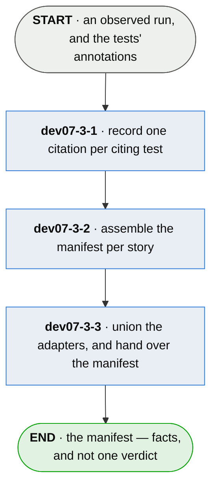

# dev07-3 · collect what the run did

**Last updated** 2026-10-26 v8

A sub-flow of [dev07 · run plumb](dev07-run-plumb.md). Entered from the observed run, carrying the
run, the traces, the wiring facts and — where mutation ran — the scores. Exits to
`dev07-4 · decide whether it is proven`, carrying the manifest: the one document the core reads.

## Nodes

### dev07-3-1 · record one citation per citing test

> **As a developer reading a citation I want it to carry what the test claimed beside what the
> run observed of it, so that every fact on it can be checked rather than taken on trust.**

#### Information

| Information | IO | Description | Required | Provenance |
|---|---|---|---|---|
| dev07-3-1-inf01 | In | `annotation` | yes | parent |
| dev07-3-1-inf02 | In | `run` | yes | parent |
| dev07-3-1-inf03 | In | `citation.grounding` | yes | parent |
| dev07-3-1-inf04 | In | `citation.entered_through` | optional | parent |
| dev07-3-1-inf05 | In | `citation.reached_outside_entry` | optional | parent |
| dev07-3-1-inf06 | In | `citation.elapsed` | optional | parent |
| dev07-3-1-inf07 | In | `story.mutation` | optional | parent |
| dev07-3-1-inf08 | Out | `citation` — test · depth · result · wiring fact, and the optional facts | yes | derived |
| dev07-3-1-inf09 | Out | `citation.result` | yes | observed |
| dev07-3-1-inf10 | Out | `observer` | yes | observed |
| dev07-3-1-inf11 | Out | `citation.ref` | optional | authored |
| dev07-3-1-inf12 | Out | `citation.about` | optional | authored |
| dev07-3-1-inf13 | Out | `adapter.floor` | yes | authored |

#### User Requirements
  * dev07-3-1-ur01 - the minimum citation is test, depth and result; an adapter that knows nothing
    of wiring still emits a valid document
  * dev07-3-1-ur02 - the result is the runner's own signal normalized to passed, skipped or
    failed; the runner's word is used and never carried, so one outcome has one vocabulary
  * dev07-3-1-ur03 - a green setup is not a pass, and a teardown error is not one either — the
    result is the test body's
  * dev07-3-1-ur04 - the wiring fact and the mutation facts are slots, filled by the steps that
    produce them and defined there
  * dev07-3-1-ur05 - `citation.ref` is the consumer's own key — minted, owned and joined by their
    system; plumb never parses it, and it rides the citation so one test citing two stories may
    carry two
  * dev07-3-1-ur06 - where a subject declares aspects, each citation names the one it is about; a
    citation naming none counts nowhere rather than everywhere, and on a one-aspect subject
    absent means the only one
  * dev07-3-1-ur07 - a citation on a decision carries no depth; one written there is not carried
  * dev07-3-1-ur08 - the observer rides the fact and never the document, and a half-named
    instrument names none — mechanism is the load-bearing field
  * dev07-3-1-ur09 - the measurement time rides the fact, and absent is never now
  * dev07-3-1-ur10 - each citation carries what the observed run spent on it, so cost attributes
    to a subject; cost is evidence and moves no status
  * dev07-3-1-ur11 - the mechanism names the rule a frame was named by, so two facts a reader is
    told to compare were made comparable by the same rule
  * dev07-3-1-ur12 - an adapter declares the oldest runtime it runs on, so an adopter reads
    whether it fits their project before installing rather than after a failure
  * dev07-3-1-ur13 - the tool's floor and an adapter's floor are separate declarations, so
    upgrading the tool never asks a project to upgrade the runtime its tests run under
  * dev07-3-1-ur14 - a runtime below the declared floor is refused by name, so an adopter reads
    their own version back rather than a fault that looks like their project's

#### System Requirements
  * dev07-3-1-sr1 - the floor is held by reading what the adapter ships, in that language's own
    terms, so the declaration and the artifact cannot disagree
  * dev07-3-1-sr2 - the check covers everything the adapter loads in the project's runtime and
    nothing beyond it, because that is the only part the project's runtime has to satisfy
  * dev07-3-1-sr3 - a capability the floor cannot carry is declared unavailable at that floor,
    and the rest of the adapter runs

#### Non-Functional Requirements
  * dev07-3-1-nfr1 - the adapter records facts and stamps no verdict, so it can neither grant
    nor revoke *done* — writing an adapter is not a position of trust

#### Unknowns

---

### dev07-3-2 · assemble the manifest per story

> **As a team whose ids are spreadsheet rows I want them carried untouched, so that adopting
> this does not mean re-minting a corpus.**

#### Information

| Information | IO | Description | Required | Provenance |
|---|---|---|---|---|
| dev07-3-2-inf1 | In | `citation` | yes | dev07-3-1 |
| dev07-3-2-inf2 | In | `story.id` | yes | parent |
| dev07-3-2-inf3 | In | `story.archetype` | yes | authored |
| dev07-3-2-inf4 | Out | `manifest` | yes | generated |
| dev07-3-2-inf5 | Out | `manifest.extent` | optional | observed |
| dev07-3-2-inf6 | Out | `manifest.schema_version` | yes | generated |
| dev07-3-2-inf7 | In | `namespace` | optional | authored |

#### User Requirements
  * dev07-3-2-ur1 - citations group under the story id, and the id stays opaque — no catalog is
    needed and none is kept
  * dev07-3-2-ur2 - a subject is placed by the namespace its id declares, never by a directory
  * dev07-3-2-ur3 - the subject's declared archetype rides beside its citations — the one field
    the adapter is handed rather than measures
  * dev07-3-2-ur4 - the extent of the observation is recorded, so a run that saw no tests is
    never read as a run that found nothing wrong
  * dev07-3-2-ur5 - absent means *not reported* and is never read as zero; a count nobody
    measured is refused rather than coerced
  * dev07-3-2-ur6 - the manifest answers for the subjects the tests cite and carries no
    denominator — what a project has left to do lives in the project

#### System Requirements
  * dev07-3-2-sr1 - the manifest is kept outside the project's tree and begins empty every run,
    so no run reads another run's facts
  * dev07-3-2-sr2 - the document declares the schema shape it was written against

#### Non-Functional Requirements

#### Unknowns
  * dev07-3-2-u1 - whether reporting the extent becomes a hard requirement of the adapter
    contract or stays optional is undecided; what is decided is that the blind spot is never
    silent

---

### dev07-3-3 · union the adapters, and hand over the manifest

> **As a developer on a polyglot project I want a missing language named and a disagreement
> reported, so that a board covering three of my four languages never reads as whole.**

#### Information

| Information | IO | Description | Required | Provenance |
|---|---|---|---|---|
| dev07-3-3-inf1 | In | `manifest` | yes | dev07-3-2 |
| dev07-3-3-inf2 | In | `adapter.ran` | yes | observed |
| dev07-3-3-inf3 | Out | `manifest` — the union of every adapter's | yes | derived |
| dev07-3-3-inf4 | Out | `adapter_disagreement` | optional | derived |
| dev07-3-3-inf5 | Out | `absent_adapter` | optional | derived |

#### User Requirements
  * dev07-3-3-ur1 - the board derives from the union of every adapter's manifest, never from one
    of them
  * dev07-3-3-ur2 - two manifests asserting different facts about one subject are a defect to
    report, never a difference to average, order or reconcile
  * dev07-3-3-ur3 - an adapter that could not run is named, so a partial board never reads as a
    whole one; with one adapter, its failure is the run's failure
  * dev07-3-3-ur4 - the union is assembled from what the run produced, never from a list of what
    was expected
  * dev07-3-3-ur5 - the edge is checked by name: a citation missing a required field, a field
    the declared version does not define, a retired field, an unknown story field, a document
    with no declared version, or a value in the wrong shape is refused rather than coerced
  * dev07-3-3-ur6 - an older shape inside the window is migrated and then read, and a field it
    could not express is filled only with *not reported* — never a substantive default; where it
    cannot be carried honestly it is read as its own version or refused

#### System Requirements
  * dev07-3-3-sr1 - the manifest is the sole hand-off between language-specific and
    language-neutral components, and the one document the core reads
  * dev07-3-3-sr2 - the manifest's shape is published as the adapter contract, versioned, and
    this chapter carries no second copy of its fields
  * dev07-3-3-sr3 - the supported schema majors are a window, and each major's required fields
    are its own

#### Non-Functional Requirements
  * dev07-3-3-nfr1 - nothing in the core depends on an adapter

#### Unknowns
  * dev07-3-3-u1 - the manifest is read and written whole; whether the document gains a streamable shape or the merge learns to stream is
    worth deciding rather than defaulting into
  * dev07-3-3-u2 - two adapters observing the same production code — a polyglot module both can
    watch — may be the one case two instruments legitimately disagree; the comparability rule
    decides it and does not yet say
  * dev07-3-3-u3 - a union whose manifests come from two repositories has no owner: nothing says
    who holds the board or how a run in one tree learns the other exists — and whatever answers
    it is assembled from manifests actually produced, never from a list of the expected

## Glossary

| Term | Meaning |
|---|---|
| Observer | Which adapter, at what version, on which runtime, by what mechanism, made a fact. Absent means not reported and is never inferred. |
| Floor | The oldest runtime an adapter runs on. Declared by the adapter, held against what it ships. |
| Extent | How many tests the run observed at all, cited or not — the one fact about the run itself. Zero means it looked and found none; absent means it could not say. |
| Ref | The consumer's own external key on a citation — a ticket id, a spreadsheet row. Never minted or validated here. |

---
