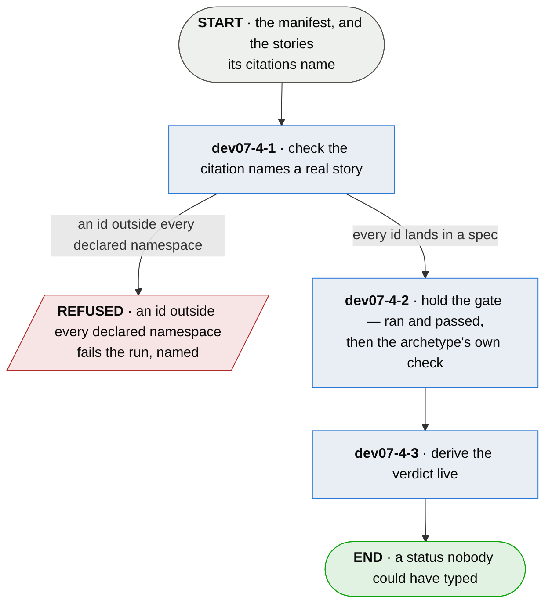

# dev07-4 · decide whether it is proven

**Last updated** 2026-09-14 v4

A sub-flow of [dev07 · run plumb](dev07-run-plumb.md). Entered from the manifest, carrying the
stories' facts. Exits to `dev07-5 · report it`, carrying a verdict per story that nobody could
have typed.

## Nodes

### dev07-4-1 · check the citation names a real story

> **As a reader of a board I want a typo'd id to fail the run, so that it never lands beside a
> real story looking exactly as authoritative.**

#### Information

| Information | IO | Description | Required | Provenance |
|---|---|---|---|---|
| dev07-4-1-inf1 | In | `manifest` | yes | parent |
| dev07-4-1-inf2 | In | `story.id` | yes | parent |
| dev07-4-1-inf3 | In | `namespace` | optional | authored |

#### User Requirements
  * dev07-4-1-ur1 - a citation naming a story that does not exist fails rather than landing
    beside a real one
  * dev07-4-1-ur2 - an id matching none of the declared namespaces fails the run, named; the
    question is asked only where the project declared namespaces at all
  * dev07-4-1-ur3 - the check reads the shape of the id, never whether a document exists behind
    the namespace

#### System Requirements
  * dev07-4-1-sr1 - the declared namespaces are the configuration's `specs`

#### Non-Functional Requirements
  * dev07-4-1-nfr1 - the check is a scan over ids and declarations, needing no further run, so
    it costs nothing and always runs

#### Unknowns

---

### dev07-4-2 · hold the gate — ran and passed, then the archetype's own check

> **As somebody trusting a green story I want two checks in series with no exemption in either,
> so that there is no weaker branch for a fake to hide in.**

#### Information

| Information | IO | Description | Required | Provenance |
|---|---|---|---|---|
| dev07-4-2-inf1 | In | `citation.result` | yes | parent |
| dev07-4-2-inf2 | In | `citation.grounding` | yes | parent |
| dev07-4-2-inf3 | In | `citation.depth` | yes | parent |
| dev07-4-2-inf4 | In | `story.archetype` | yes | authored |
| dev07-4-2-inf5 | In | `wired_rung` | yes | authored |
| dev07-4-2-inf6 | Out | `gate_outcome` | yes | derived |
| dev07-4-2-inf7 | Out | `refused_grounding` | optional | derived |

#### User Requirements
  * dev07-4-2-ur01 - two checks in series, fail-fast: a citing test ran and passed, and then the
    check the story's archetype selects
  * dev07-4-2-ur02 - no citing test at all, a skip, an abort or a failure is a claim and never a
    proof
  * dev07-4-2-ur03 - the second check is mirrored and never waived: each archetype gets its own
    positive check over the same fact, so an exemption exists for neither
  * dev07-4-2-ur04 - a behavioural story is proved by `grounded`; `ungrounded` and `inert`
    refuse it, and `not-checked` and `dispatched` yield *passed — wiring not verified*, because
    a missing declaration is a fact about the setup and not about the test
  * dev07-4-2-ur05 - a behavioural story gets no partial credit for touching nothing
  * dev07-4-2-ur06 - a structural story is proved by `inert` — the artifact was read and none of
    it ran; every executing fact refuses it, `not-checked` included, and a test that touched the
    artifact in no way proves nothing
  * dev07-4-2-ur07 - the archetype selects a check and can never grant a pass
  * dev07-4-2-ur08 - the archetype is declared per subject in the project's configuration,
    defaults to behavioural, and is never written on the test or inferred from it
  * dev07-4-2-ur09 - one execution yields one grounding fact, so no test serves both archetypes;
    a test citing both fails on the side its execution did not serve
  * dev07-4-2-ur10 - a claimed wired rung — wiring, standards-integration, smoke, e2e — whose
    execution never grounded is refuted; unit and component claim isolation and are never
    refuted for it
  * dev07-4-2-ur11 - which arm refused is said, from the citations that actually decided the
    verdict, so a story refused by one arm is never explained by another's fact

#### System Requirements
  * dev07-4-2-sr1 - the depth vocabulary is the core's own — unit · component · wiring ·
    standards-integration · smoke · smoke/e2e · e2e — and a claimed depth outside it raises the
    named condition `depth.unsupported`, never a guess
  * dev07-4-2-sr2 - the wired rungs are a fixed set the refutation reads; no project declaration
    widens or narrows it
  * dev07-4-2-sr3 - a condition is three separately-addressable parts — a code, a next step and
    an example — and only the code is a promise; the prose may be reworded freely
  * dev07-4-2-sr4 - the gate judges a claim against the project's own configuration — the
    archetype, the entry points, the reduction — so a wrong depth or type is corrected there,
    which is the loop the parent flow draws to `dev08`

#### Non-Functional Requirements
  * dev07-4-2-nfr1 - grounding is on the critical path and mutation never is; the deeper check
    informs and cannot block
  * dev07-4-2-nfr2 - non-functional is not a third archetype: availability, degradation and
    removability are behavioural claims whose entry point is the assembled artifact

#### Unknowns
  * dev07-4-2-u1 - the structural mirror is stronger than one adapter can see: an observer that
    watches execution alone cannot assert a read, emits the older schema major, and its
    structural stories are proved today by the weaker fact
  * dev07-4-2-u2 - component versus wiring intent is not derivable; the claimed depth is trusted
    where the wired-rung refutation cannot reach it, and the remainder is named rather than
    hidden
  * dev07-4-2-u3 - archetype honesty is a spec-review residue: nothing derives that a claim *is*
    structural, and the mis-declaration costs its author the behavioural proof rather than
    granting a free one
  * dev07-4-2-u4 - assertion meaningfulness is not mechanizable: a test can run the code and
    assert nothing, and mutation does not close this — it checks the code as written, not the
    claim

---

### dev07-4-3 · derive the verdict live

> **As anybody reading a status I want it computed by the run I am looking at, so that no stale
> *done* survives the thing that made it true stopping being true.**

#### Information

| Information | IO | Description | Required | Provenance |
|---|---|---|---|---|
| dev07-4-3-inf1 | In | `gate_outcome` | yes | dev07-4-2 |
| dev07-4-3-inf2 | In | `refused_grounding` | optional | dev07-4-2 |
| dev07-4-3-inf3 | In | `citation.depth` | yes | parent |
| dev07-4-3-inf9 | In | `config.reduce` | optional | authored |
| dev07-4-3-inf4 | Out | `verdict` | yes | derived |
| dev07-4-3-inf5 | Out | `verdict.status` | yes | derived |
| dev07-4-3-inf6 | Out | `verdict.achieved` | yes | derived |
| dev07-4-3-inf7 | Out | `verdict.conditions` | yes | derived |
| dev07-4-3-inf8 | Out | `verdict.aspects` | optional | derived |

#### User Requirements
  * dev07-4-3-ur01 - a subject's citations reduce under its declared reduction: *best* for a
    story, so one passing citation is enough beside a failing one; *worst* for a subject every
    citation must hold
  * dev07-4-3-ur02 - a proof that later fails un-proves its story
  * dev07-4-3-ur03 - the status is computed live each run and never stored — a stored status is a
    claim about a past run read as a claim about this one
  * dev07-4-3-ur04 - the achieved vector reports the rungs that actually passed; required depth is
    the team's policy, lives in the overlay, and never gates
  * dev07-4-3-ur05 - a subject with declared aspects gets a verdict per aspect and no aggregate,
    so no reader is shown a green no aspect earned
  * dev07-4-3-ur06 - the conditions say why the verdict reads as it does, in codes a reader's
    next move differs by
  * dev07-4-3-ur07 - cited-and-unproven says which kind: evidence that failed, evidence nobody
    observed — a citation that never ran is no evidence at all, and a flaky runner is not a
    broken claim — or evidence that never existed
  * dev07-4-3-ur09 - a decision's standing is its own vocabulary — it holds or it is breached, and
    it never reads proven: proven is a claim about the past, and a decision is a claim about the
    future that no evidence about the past can support
  * dev07-4-3-ur10 - a decision nothing has measured and nothing is scheduled to review is
    surfaced as its own condition, because silence and health look identical and the silence is
    the finding
  * dev07-4-3-ur08 - a grounded story that also reached code no door serves is surfaced whatever
    its status

#### System Requirements
  * dev07-4-3-sr1 - the achieved vector is the depths of the story's passing citations,
    deduplicated and sorted
  * dev07-4-3-sr2 - both reductions are one rule — minimum by position over a ranked outcome
    order — so adding a subject kind is a row in a table, never a branch in the core

#### Non-Functional Requirements
  * dev07-4-3-nfr1 - the gate proves the shape of a proof and never its meaning: PROVEN reads
    *somebody wrote a test for this, and the test really ran the real thing* — stated as a
    boundary so it can be held against the tool
  * dev07-4-3-nfr2 - the core forces only what it can verify; process, priority and required
    depth are policy, and a rule nobody can check is a rule people satisfy on paper
  * dev07-4-3-nfr3 - nothing authored depends on anything derived
  * dev07-4-3-nfr4 - a breached, expired or unwatched decision informs and never fails a run —
    surfacing is this tool's part and what a breach costs is the adopter's to decide, exactly as
    an unproven story is

#### Unknowns
  * dev07-4-3-u1 - status rollup to a chapter or an invariant is unsolved, and whatever closes
    it must recompute from the stories every run — a cached rollup would violate the claim it
    hangs off
  * dev07-4-3-u2 - the achieved vector does not describe a structural story: an inert test
    reached no rung by design, and leaving the vector empty is the leaning
  * dev07-4-3-u3 - a proof does not know when its claim moved: a story can be rewritten, keep
    every old proof, and read PROVEN while nothing it now claims has been tested. No field yet
    carries a claim version, and what one *is* — a digest, a revision, a lineage — changes what
    a citation means

## Glossary

| Term | Meaning |
|---|---|
| Gate | The two checks in series: ran and passed, then the archetype's own check over the wiring fact. |
| Archetype | What kind of claim a subject makes — behavioural or structural. Declared by the project, never by the test being judged. |
| Rung | One level of the proof pyramid: unit · component · wiring · standards-integration · smoke/e2e. |
| Achieved vector | The rungs a story is actually proven at, as opposed to the depth its citations claimed. |
| Gate outcome | One citation's own answer — proven, passed-wiring-not-verified, unproven, not-passed — before the story's citations reduce. |
| Passed — wiring not verified | The first check held and the wiring fact could not answer; the condition says which of its two causes, because the remedies differ. |
| Verdict | Per story: status, achieved vector, conditions, and aspects where declared. Derived, live, stored nowhere. |
| Provenance | The fifth column of an Information table: where an input came from, or how an output was made. |
| Authored | Written by a person. An input nothing produces, or an output somebody typed. |
| Derived | Computed by this step from what it took in. |
| Observed | Read off a run, a tree or the world as it stands. |
| Generated | Made by a tool rather than by a person. |
| Parent | On a sub-flow's input: handed in by the chapter this one drills into. |

---

## Working notes — not part of the chapter

**The gate folded in, per the operator's o2.** ch1.2's four subjects are ur01, ur04, ur06 and
ur11; its three unknowns and the JVM read-gap are u1–u4. The four `ch1-2-*` ids retire with ch1.

**Landed here as promised from dev07-1's conversion:** the wired-rung refutation (was ch3-6) as
ur10, with `wired_rung` as its authored input.

**ch1-9's missing element.** The claim-version comparison is specified with no element to compare
— no field in a citation, story or manifest carries one, and nothing produces one. Kept as u3 on
the verdict node rather than a requirement, because choosing what a claim version *is* changes
what a citation means.

**From the rebuild test:** the reduction rule (ur1 — one passing citation is enough beside a
failing one) was pinned by a test and stated in no chapter; likewise *no partial credit for
touching nothing* (ur05) and *authored-in-derived-out* (nfr3).

**Became requirements, not steps:** ch0-8 (grounding on the critical path) as nfr1; ch1-8 (shape
never meaning) and ch1-5 (gate only the verifiable) as the verdict node's nfr1/nfr2 — all three
were produce-nothing prohibition nodes.
