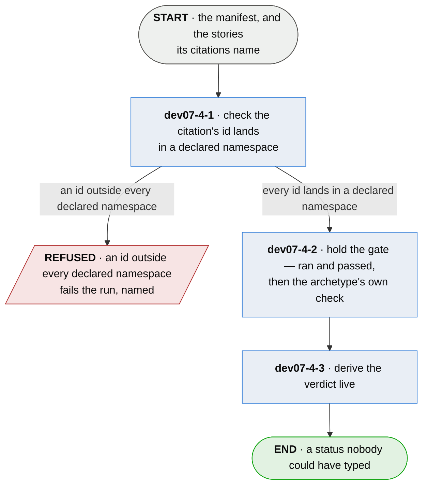

# dev07-4 · decide whether it is proven

**Last updated** 2026-10-26 v5

A sub-flow of [dev07 · run plumb](dev07-run-plumb.md). Entered from the manifest, carrying the
stories' facts. Exits to `dev07-5 · report it`, carrying a verdict per story that nobody could
have typed.

## Nodes

### dev07-4-1 · check the citation's id lands in a declared namespace

> **As a reader of a board I want an id outside every namespace the project declared to fail the
> run, so that a mistyped id never lands beside a real story looking just as real.**

#### Information

| Information | IO | Description | Required | Provenance |
|---|---|---|---|---|
| dev07-4-1-inf1 | In | `manifest` | yes | parent |
| dev07-4-1-inf2 | In | `story.id` | yes | parent |
| dev07-4-1-inf3 | In | `namespace` | optional | authored |

#### User Requirements
  * dev07-4-1-ur1 - a citation whose id lies in none of the declared namespaces fails the run,
    named, rather than landing beside a real story
  * dev07-4-1-ur2 - the question is asked only where the project declared namespaces at all
  * dev07-4-1-ur3 - the check reads the shape of the id, never whether a document exists behind
    the namespace

#### System Requirements

#### Non-Functional Requirements
  * dev07-4-1-nfr1 - the check is a scan over ids and declarations, needing no further run, so
    it costs nothing and always runs

#### Unknowns

---

### dev07-4-2 · hold the gate — ran and passed, then the archetype's own check

> **As somebody trusting a green story I want no kind of claim to have an easier way to pass than
> any other, so that a fake has no branch to hide in.**

#### Information

| Information | IO | Description | Required | Provenance |
|---|---|---|---|---|
| dev07-4-2-inf1 | In | `citation.result` | yes | parent |
| dev07-4-2-inf2 | In | `citation.grounding` | yes | parent |
| dev07-4-2-inf3 | In | `citation.depth` | yes | parent |
| dev07-4-2-inf4 | In | `story.archetype` | yes | authored |
| dev07-4-2-inf5 | In | `wired_rung` | yes | authored |
| dev07-4-2-inf6 | Out | `gate_outcome` | yes | derived |
| dev07-4-2-inf7 | Out | `refused_grounding` | optional | derived |

#### User Requirements
  * dev07-4-2-ur01 - two checks in series, fail-fast: a citing test ran and passed, and then the
    check the story's archetype selects
  * dev07-4-2-ur02 - no citing test at all, a skip, an abort or a failure is a claim and never a
    proof
  * dev07-4-2-ur03 - the second check is mirrored and never waived: each archetype gets its own
    positive check over the same fact, so an exemption exists for neither
  * dev07-4-2-ur04 - a behavioural story is proved by `grounded`; `ungrounded` and `inert`
    refuse it, and `not-checked` and `dispatched` yield *passed — wiring not verified*, because
    a missing declaration is a fact about the setup and not about the test
  * dev07-4-2-ur05 - a behavioural story gets no partial credit for touching nothing
  * dev07-4-2-ur06 - a structural story is proved by `inert` — the artifact was read and none of
    it ran; every executing fact refuses it, `not-checked` included, and a test that touched the
    artifact in no way proves nothing
  * dev07-4-2-ur07 - the archetype selects a check and can never grant a pass
  * dev07-4-2-ur08 - the archetype is declared per subject in the project's configuration,
    defaults to behavioural, and is never written on the test or inferred from it
  * dev07-4-2-ur09 - one execution yields one wiring fact, so no test serves both archetypes;
    a test citing both fails on the side its execution did not serve
  * dev07-4-2-ur10 - a claimed wired rung (`dev07-4-2-sr1`) whose wiring fact is `ungrounded` or
    `inert` is refuted; unit and component claim isolation and are never refuted for it
  * dev07-4-2-ur11 - which arm refused is said, from the citations that actually decided the
    verdict, so a story refused by one arm is never explained by another's fact

#### System Requirements
  * dev07-4-2-sr1 - the depth vocabulary is the core's own — unit · component · wiring ·
    standards-integration · smoke · smoke/e2e · e2e — of which the wired rungs are wiring,
    standards-integration, smoke, smoke/e2e and e2e; a claimed depth outside the vocabulary
    raises the named condition `depth.unsupported`, never a guess
  * dev07-4-2-sr2 - the wired rungs are a fixed set the refutation reads; no project declaration
    widens or narrows it
  * dev07-4-2-sr3 - the gate judges a claim against the project's own configuration — the
    archetype, the entry points, the reduction — so a wrong depth or archetype is corrected there,
    which is the loop [A developer's workflow](developer-day.md) draws through `dev08`

#### Non-Functional Requirements
  * dev07-4-2-nfr1 - the wiring fact is on the critical path and mutation never is; the deeper
    check informs and cannot block
  * dev07-4-2-nfr2 - availability, degradation and removability are behavioural claims, and
    their entry point is the assembled artifact
  * dev07-4-2-nfr3 - whether a claim is structural is the project's declaration, held at spec
    review and never derived; a mis-declaration costs its author the behavioural proof rather
    than granting a free one

#### Unknowns
  * dev07-4-2-u1 - an observer that watches execution alone cannot assert a read; what a
    structural story is proved by under such an observer is undecided
  * dev07-4-2-u2 - component versus wiring intent is not derivable; the claimed depth is trusted
    where the wired-rung refutation cannot reach it, and the remainder is named rather than
    hidden

---

### dev07-4-3 · derive the verdict live

> **As anybody reading a status I want it computed by the run I am looking at, so that no stale
> *done* survives the thing that made it true stopping being true.**

#### Information

| Information | IO | Description | Required | Provenance |
|---|---|---|---|---|
| dev07-4-3-inf1 | In | `gate_outcome` | yes | dev07-4-2 |
| dev07-4-3-inf2 | In | `refused_grounding` | optional | dev07-4-2 |
| dev07-4-3-inf3 | In | `citation.depth` | yes | parent |
| dev07-4-3-inf9 | In | `config.reduce` | optional | authored |
| dev07-4-3-inf4 | Out | `verdict` | yes | derived |
| dev07-4-3-inf5 | Out | `verdict.status` | yes | derived |
| dev07-4-3-inf6 | Out | `verdict.achieved` | yes | derived |
| dev07-4-3-inf7 | Out | `verdict.conditions` | yes | derived |
| dev07-4-3-inf8 | Out | `verdict.aspects` | optional | derived |

#### User Requirements
  * dev07-4-3-ur01 - a subject's citations reduce under its declared reduction: *best* for a
    story, so one passing citation is enough beside a failing one; *worst* for a subject every
    citation must hold
  * dev07-4-3-ur02 - a proof that later fails un-proves its story
  * dev07-4-3-ur03 - the status is computed live each run and never stored — a stored status is a
    claim about a past run read as a claim about this one
  * dev07-4-3-ur04 - the achieved vector reports the rungs that actually passed; required depth is
    the team's policy, kept outside the core, and never gates
  * dev07-4-3-ur05 - a subject with declared aspects gets a verdict per aspect and no aggregate,
    so no reader is shown a green no aspect earned
  * dev07-4-3-ur06 - the conditions say why the verdict reads as it does, in codes a reader's
    next move differs by
  * dev07-4-3-ur07 - cited-and-unproven says which kind: evidence that failed, evidence nobody
    observed — a citation that never ran is no evidence at all, and a flaky runner is not a
    broken claim — or evidence that never existed
  * dev07-4-3-ur08 - a story whose tests also reached production code outside every entry point is
    surfaced whatever its status
  * dev07-4-3-ur09 - a decision's standing is its own vocabulary — it holds or it is breached, and
    it never reads proven
  * dev07-4-3-ur10 - a decision nothing has measured and nothing is scheduled to review is
    surfaced as its own condition, because silence and health look identical and the silence is
    the finding
  * dev07-4-3-ur11 - a parameter is derived as a decision is and read in its own words —
    supported, unvalidated, refuted or unmeasured — and never as held or breached, because a value
    is not held and an estimate that loses to its own placebo is refuted

#### System Requirements
  * dev07-4-3-sr1 - the achieved vector is the depths of the story's passing citations,
    deduplicated and sorted
  * dev07-4-3-sr2 - both reductions are one rule — minimum by position over a ranked outcome
    order — so adding a subject kind is a row in a table, never a branch in the core

#### Non-Functional Requirements
  * dev07-4-3-nfr1 - the gate proves the shape of a proof and never its meaning: PROVEN reads
    *somebody wrote a test for this, and the test really ran the real thing*; a test that runs
    the code and asserts nothing passes it, and mutation does not close this, because it checks
    the code as written and not the claim
  * dev07-4-3-nfr2 - the core forces only what it can verify; process, priority and required
    depth are policy, and a rule nobody can check is a rule people satisfy on paper
  * dev07-4-3-nfr3 - nothing authored depends on anything derived
  * dev07-4-3-nfr4 - a breached, expired or unwatched decision informs and never fails a run —
    surfacing is this tool's part and what a breach costs is the adopter's to decide, exactly as
    an unproven story is

#### Unknowns
  * dev07-4-3-u1 - status rollup to a chapter or an invariant is unsolved, and whatever closes
    it must recompute from the stories every run — a cached rollup would violate the claim it
    hangs off
  * dev07-4-3-u2 - the achieved vector does not describe a structural story: an inert test
    reached no rung by design, and leaving the vector empty is the leaning
  * dev07-4-3-u3 - a proof does not know when its claim moved: a story can be rewritten, keep
    every old proof, and read PROVEN while nothing it now claims has been tested. No field yet
    carries a claim version, and what one *is* — a digest, a revision, a lineage — changes what
    a citation means

## Glossary

| Term | Meaning |
|---|---|
| Gate | The two checks in series: ran and passed, then the archetype's own check over the wiring fact. |
| Archetype | What kind of claim a subject makes — behavioural or structural. Per subject, never per citation; declared by the project, never by the test being judged. |
| Rung | One level of the proof pyramid. The levels, and which of them are wired, are `dev07-4-2-sr1`'s. |
| Wired rung | A rung whose claim is that the test reached the production system through an entry point. |
| Depth | The rung a citation claims its test works at, as opposed to the rungs it achieved. |
| Achieved vector | The rungs a story is actually proven at, as opposed to the depth its citations claimed. |
| Gate outcome | One citation's own answer — proven, passed-wiring-not-verified, unproven, not-passed — before the story's citations reduce. |
| Passed — wiring not verified | The first check held and the wiring fact could not answer; the condition says which of its two causes, because the remedies differ. |

---
