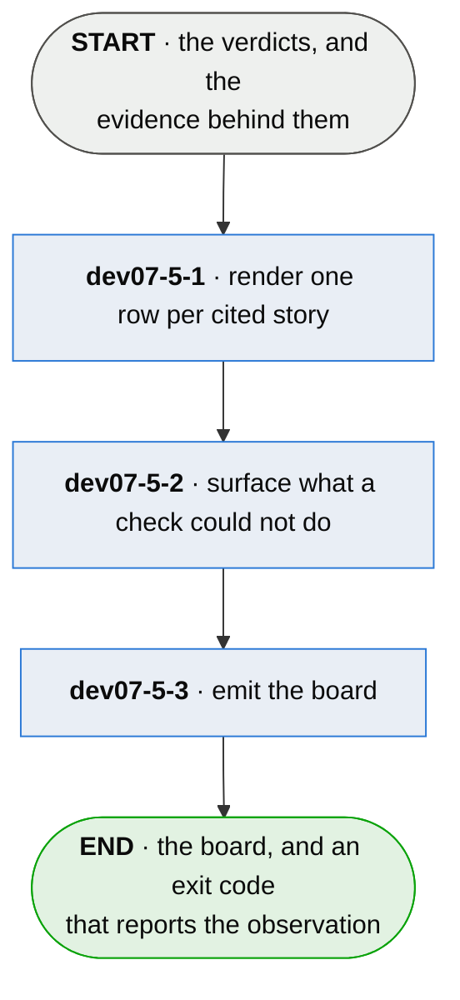

# dev07-5 · report it

**Last updated** 2026-09-11 v2

A sub-flow of [dev07 · run plumb](dev07-run-plumb.md). Entered from the verdicts and the
citations behind them. Exits with the board — the one thing that leaves, for any tool to consume
and a person to read.

## Nodes

### dev07-5-1 · render one row per cited story

> **As a reviewer I want the citing tests and what each of them actually reached, so that I act
> on evidence rather than taking a verdict on trust.**

#### Information

| Information | IO | Description | Required | Provenance |
|---|---|---|---|---|
| dev07-5-1-inf1 | In | `verdict` | yes | parent |
| dev07-5-1-inf2 | In | `citation` | yes | parent |
| dev07-5-1-inf3 | In | `scope` | optional | authored |
| dev07-5-1-inf4 | Out | `board.story` | yes | derived |
| dev07-5-1-inf5 | Out | `board.label` | yes | derived |
| dev07-5-1-inf6 | Out | `board.evidence` | yes | derived |

#### User Requirements
  * dev07-5-1-ur1 - one row per cited story: its status, the rungs its tests reached, and its
    named residue
  * dev07-5-1-ur2 - every word rendered above a status is a restatement of what the gate
    derived, never an addition — a rendering that overstates is indistinguishable from proof
  * dev07-5-1-ur3 - the evidence restates the citing tests with what each claimed and what
    the run found, carrying its cost and its measurement time on each entry
  * dev07-5-1-ur4 - the board totals nothing: there is no denominator to divide by, and a
    reader's arithmetic is done on figures whose scope they know because they made the run
  * dev07-5-1-ur5 - a lexicon gives a kind of subject its own word for a derived status; where
    it has no word it says the status's own name rather than inventing one
  * dev07-5-1-ur6 - a subject with aspects renders one verdict per aspect and no aggregate; a
    single-field reader is held at unproven rather than shown an average
  * dev07-5-1-ur7 - the view narrows to a namespace and never the derivation: a story reads the
    same in every scope containing it, and run-level facts survive every scope
  * dev07-5-1-ur8 - the graph runs at whatever input level there is, degrades, and surfaces
    what is missing — a project that declares nothing gets a partial answer, never an error

#### System Requirements
  * dev07-5-1-sr1 - rows sort by the natural order of the story ids
  * dev07-5-1-sr2 - the input level is worked out inside the step and never emitted — a
    completeness number would be a status about the project rather than about a claim
  * dev07-5-1-sr3 - the scope filter is a prefix match over ids the run observed; a mistyped
    scope reports an empty view rather than a refusal, and that the value is unheld is said

#### Non-Functional Requirements
  * dev07-5-1-nfr1 - the board is evidence a person acts on; it renders no opinion

#### Unknowns

---

### dev07-5-2 · surface what a check could not do

> **As an adopter I want to be told what was skipped and what I would get by fixing it, so that
> nothing about my setup is silently absent.**

#### Information

| Information | IO | Description | Required | Provenance |
|---|---|---|---|---|
| dev07-5-2-inf1 | In | `verdict.conditions` | yes | parent |
| dev07-5-2-inf2 | In | `manifest.extent` | optional | parent |
| dev07-5-2-inf3 | Out | `condition` | optional | derived |
| dev07-5-2-inf4 | Out | `run_condition` | optional | derived |
| dev07-5-2-inf5 | Out | `unlock` | optional | derived |

#### User Requirements
  * dev07-5-2-ur01 - nothing is silently skipped: what a check could not do is surfaced with
    what would make it possible
  * dev07-5-2-ur02 - every condition carries a stable code beside its prose, from a finite set;
    a consumer branches on the code and never on a sentence somebody will improve
  * dev07-5-2-ur03 - the prose is three separately-renderable parts — the diagnosis, the
    instruction, the example — and an example is the part advice cannot act without
  * dev07-5-2-ur04 - every code resolves to its prose locally, wherever it was defined — a
    board explains itself where there is no network
  * dev07-5-2-ur05 - a code this build has never seen still emits rather than vanishing
  * dev07-5-2-ur06 - a passing citation that still did not prove says which of the three
    reasons: never reached the wired system, executed nothing at all, or executed what a
    structural claim needed read
  * dev07-5-2-ur07 - the advice says which branch advances the story and which only ends the
    complaint
  * dev07-5-2-ur08 - a run that observed nothing is its own run-level condition, never a board
    with no stories — an empty board is what a correct first run looks like, which is the
    perfect disguise for a run that never happened
  * dev07-5-2-ur09 - a run that saw tests and read no citation is its own condition; it does
    not guess which cause, and it does not fail the run — a project between init and its first
    citation is doing the tutorial in order
  * dev07-5-2-ur10 - an internal error of the runner is never reported as the project's fault
  * dev07-5-2-ur11 - an unlock is counted from the run's own output and withdrawn once the
    source already carries the fact; an empty run advertises nothing

#### System Requirements
  * dev07-5-2-sr1 - every code a build can emit resolves to a registry entry; what is
    guaranteed is resolution, never that the three fields are populated
  * dev07-5-2-sr2 - every condition code and every exit code the board can emit is documented

#### Non-Functional Requirements

#### Unknowns

---

### dev07-5-3 · emit the board

> **As any tool at all I want to read this without knowing plumb's internals, so that consuming
> it is a parse rather than an integration.**

#### Information

| Information | IO | Description | Required | Provenance |
|---|---|---|---|---|
| dev07-5-3-inf1 | In | `board.story` | yes | dev07-5-1 |
| dev07-5-3-inf2 | In | `condition` | optional | dev07-5-2 |
| dev07-5-3-inf3 | In | `run_condition` | optional | dev07-5-2 |
| dev07-5-3-inf4 | In | `absent_adapter` | optional | parent |
| dev07-5-3-inf5 | In | `emit_format` | optional | authored |
| dev07-5-3-inf6 | Out | `board` | yes | derived |
| dev07-5-3-inf7 | Out | `board.version` | yes | generated |
| dev07-5-3-inf8 | Out | `exit_code` | yes | derived |
| dev07-5-3-inf9 | Out | `rendering` | yes | derived |

#### User Requirements
  * dev07-5-3-ur1 - one documented, versioned, neutral format; stdout carries exactly that one
    projection and the runner's own chatter goes to stderr
  * dev07-5-3-ur2 - the board versions apart from the manifest — an internal refactor never
    reaches a consumer who pinned
  * dev07-5-3-ur3 - a breaking change is a new version and never a silent shift, symmetric
    with the inbound edge
  * dev07-5-3-ur4 - the board stamps what rendered it and when — render time, and never a
    measurement time, which stays on each fact
  * dev07-5-3-ur5 - the exit code reports whether a board was derived, never whether it is
    proven: an all-unproven board exits zero, and the runner's own failing suite is the
    runner's exit to give
  * dev07-5-3-ur6 - an aborted run cannot board — a session that never finished is not a run
    that observed nothing

#### System Requirements
  * dev07-5-3-sr1 - a SARIF envelope is a free, default-off opt-in; JSON is the documented
    default
  * dev07-5-3-sr2 - platform bindings translate the neutral format opt-in, outside the core,
    and never change it

#### Non-Functional Requirements
  * dev07-5-3-nfr1 - every shape the page can print is exercised by a check, because a person
    is the only instrument that reads that projection and a shape can vanish while the emitted
    bytes stay identical

#### Unknowns
  * dev07-5-3-u1 - whether and how the board is published beyond the desk — a dashboard, a
    shared place — without making CI the gate is a distribution question, opt-in

## Glossary

| Term | Meaning |
|---|---|
| Board | The derived, tool-facing report: per story, its status, achieved rungs, and named residue. The one thing that leaves. |
| Rendering | The page a person reads — the second projection of the same derivation, and the only one no other gate reads. |
| Condition code | The stable identifier on a surfaced gap or unlock. The prose beside it may be reworded; the code may not. |
| Unlock | What this run earned the right to suggest next — counted from its own output, withdrawn once the source carries the fact. |
| Run-level condition | A condition about the run itself, because what it names leaves no story to attach to. |
| Exit code | Whether a board was derived from an observation — never whether it is proven. |
| Lexicon | A kind of subject's own words for derived statuses — a projection, never a second place standing is authored. |
| Scope | A namespace asked for at the boundary, narrowing the view and never a status. |
| Provenance | The fifth column of an Information table: where an input came from, or how an output was made. |
| Authored | Written by a person. An input nothing produces, or an output somebody typed. |
| Derived | Computed by this step from what it took in. |
| Observed | Read off a run, a tree or the world as it stands. |
| Generated | Made by a tool rather than by a person. |
| Parent | On a sub-flow's input: handed in by the chapter this one drills into. |

---

## Working notes — not part of the chapter

**From the three-source pass:** ur7's run-level-facts clause, ur10 (an internal runner error is
never the project's fault), ur5-3-ur6 (an aborted run cannot board) and sr1's natural ordering
were in tests and mechanisms only; sr2's documentation gates likewise.

**Became requirements, not steps:** ch5-6, ch5-9, ch5-17, ch5-5 and ch0-12 — the five
produce-nothing nodes — and ch0-11's input levels, folded into 5-1-ur8/sr2.

**Two of ch5's unknowns die here, on the operator's rulings (2026-09-11).** ch5-U3 claimed a
spec defect found downstream is neither friction nor a story and has no route back; the operator
reads the support channel as carrying it fine, so the premise fails and the crossing lands with
the support flow's conversion. ch5-U4 (what a published board says about a subject it may not
name) is dropped as nonsense. The ids u2 and u3 are retired, not reused.
