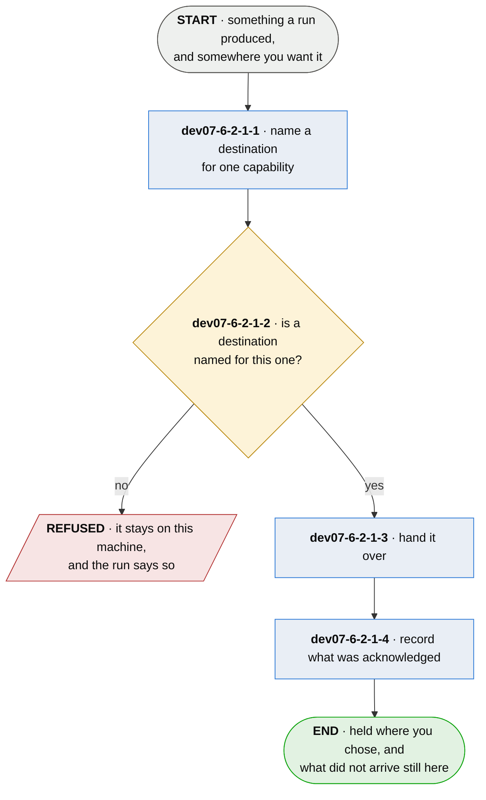

# dev07-6-2-1 · send what a run produced

**Last updated** 2026-10-26 v4

What a developer does to get what their run produced somewhere they chose — a history to a holder
their team runs, a record to a service they chose. The holder this reaches is
[dev07-6-2-2 · hold a series](dev07-6-2-2-hold-a-series.md); what is sent to it is appended in
[dev07-6 · append the run to the series](dev07-6-append-the-run-to-the-series.md). This flow is the
part between having something and it being held elsewhere, and it is the same part whichever
capability is doing the sending.

**Decision `dev07-6-2-1-D1` — a destination belongs to a capability, not to the machine.** Known and
restricting: each capability's destination is read from the environment of the run, with an
enrolment file answering only where the environment names none, and nothing in a project's
configuration names one.

## Nodes

### dev07-6-2-1-1 · name a destination for one capability

> **As a developer I want to say where one kind of thing goes and who I am there, so that sending
> one kind somewhere decides nothing about where the others go.**

#### Information

| Information | IO | Description | Required | Provenance |
|---|---|---|---|---|
| dev07-6-2-1-1-inf1 | In | `capability` | yes | authored |
| dev07-6-2-1-1-inf2 | In | `destination.url` | yes | authored |
| dev07-6-2-1-1-inf3 | In | `destination.credential` | yes | authored |
| dev07-6-2-1-1-inf4 | Out | `destination` | yes | derived |

#### User Requirements
  * dev07-6-2-1-1-ur1 - a destination is named for one capability; a run that sends several kinds of thing
    has one for each
  * dev07-6-2-1-1-ur2 - naming one is the whole of enabling it, and there is no second setting that turns
    sending on
  * dev07-6-2-1-1-ur3 - every field of a destination can be given in the environment, so a run can name a
    destination without writing a file

#### System Requirements
  * dev07-6-2-1-1-sr1 - a destination carries where to send, the credential to send with, and which store
    that credential owns
  * dev07-6-2-1-1-sr2 - a destination says nothing about a relationship with whoever runs it; who the sender
    is to a service is the service's to decide from the credential it authenticated
  * dev07-6-2-1-1-sr3 - two capabilities naming the same address are two destinations that happen to agree,
    and neither reads the other's

#### Non-Functional Requirements
  * dev07-6-2-1-1-nfr1 - a credential in a file in a working tree is collectable by an artifact upload or a
    cache step written for something else, so the environment is how a run is given one

#### Unknowns
  * dev07-6-2-1-1-u1 - whether a project's own configuration should be able to name a destination is
    undecided; a repository that pushes to its team's holder and one that pushes nowhere can share
    one machine and one environment

---

### dev07-6-2-1-2 · is a destination named for this one?

> **As a developer I want nothing to leave this machine unless I said where it goes, so that
> installing the tool is not a decision about my data.**

#### Information

| Information | IO | Description | Required | Provenance |
|---|---|---|---|---|
| dev07-6-2-1-2-inf1 | In | `destination` | optional | dev07-6-2-1-1 |
| dev07-6-2-1-2-inf2 | In | `outgoing` | yes | observed |
| dev07-6-2-1-2-inf3 | Out | `addressed` | optional | derived |
| dev07-6-2-1-2-inf4 | Out | `refusal` | optional | derived |

#### User Requirements
  * dev07-6-2-1-2-ur1 - with no destination named for a capability, what that capability produced stays on
    this machine and the run says so
  * dev07-6-2-1-2-ur2 - a destination named for one capability never addresses another's

#### System Requirements
  * dev07-6-2-1-2-sr1 - the absence of a destination is the ordinary state and is never an error
  * dev07-6-2-1-2-sr2 - what is addressed is what has not been acknowledged, and never what a run happened
    to produce most recently

#### Non-Functional Requirements
  * dev07-6-2-1-2-nfr1 - *nothing leaves without being told where* is a guarantee only while absence is the
    default; a default address would make it a promise about somebody's configuration instead
  * dev07-6-2-1-2-nfr2 - a run that transmits silently and a run that transmits nothing look identical from
    the outside, so the one that transmitted nothing is the one that has to say so

#### Unknowns

---

### dev07-6-2-1-3 · hand it over

> **As a developer I want what I send to go with the credential its destination names, so that
> where something goes and what it is sent under are decided in one place.**

#### Information

| Information | IO | Description | Required | Provenance |
|---|---|---|---|---|
| dev07-6-2-1-3-inf1 | In | `addressed` | yes | dev07-6-2-1-2 |
| dev07-6-2-1-3-inf2 | Out | `handover` | yes | derived |

#### User Requirements
  * dev07-6-2-1-3-ur1 - what is handed over is presented with the credential of the destination it is
    addressed to

#### System Requirements

#### Non-Functional Requirements

#### Unknowns

---

### dev07-6-2-1-4 · record what was acknowledged

> **As a developer I want a retry to send what did not arrive and nothing else, so that a service
> that was down for an hour does not become a service holding six copies of everything.**

#### Information

| Information | IO | Description | Required | Provenance |
|---|---|---|---|---|
| dev07-6-2-1-4-inf1 | In | `handover` | yes | dev07-6-2-1-3 |
| dev07-6-2-1-4-inf2 | Out | `acknowledgement` | yes | observed |
| dev07-6-2-1-4-inf3 | Out | `outstanding` | yes | derived |

#### User Requirements
  * dev07-6-2-1-4-ur1 - what the receiver acknowledged is recorded against what was sent, so a retry carries
    only what is outstanding
  * dev07-6-2-1-4-ur2 - a receiver that has stopped answering is distinguishable from having nothing to send
  * dev07-6-2-1-4-ur3 - a destination that cannot be reached, or refuses, leaves what is outstanding where it
    is and never fails the run that produced it — a board is complete without the network

#### System Requirements
  * dev07-6-2-1-4-sr1 - an acknowledgement is keyed on something the receiver honours; where a receiver
    assigns its own name for what it took, that name is what is recorded
  * dev07-6-2-1-4-sr2 - a second arrival of one thing is the same thing sent twice and is not an error

#### Non-Functional Requirements
  * dev07-6-2-1-4-nfr1 - an acknowledgement keyed on something the receiver does not honour leaves an outbox
    that never clears and a sender that re-sends what already arrived, and the duplicates land on
    whoever runs the destination
  * dev07-6-2-1-4-nfr2 - an outbox that never empties reads as a service that has stopped answering, so the
    reader draws the wrong conclusion about somebody else's system

#### Unknowns
  * dev07-6-2-1-4-u1 - whether an outstanding item should expire is undecided; something unacknowledged for
    a month is either a receiver that moved or a sender nobody will read again

## Glossary

| Term | Meaning |
|---|---|
| Capability | One thing the tool can send — a run history, a record for a service. Named, so a destination can belong to it rather than to the whole installation |
| Destination | Where one capability's output goes, the credential it goes with, and which store there it owns. Not a relationship with whoever runs it |
| Handover | What is actually sent: the content and its credential, addressed to one destination |
| Outstanding | What was handed over and not acknowledged. The only thing a retry carries |
