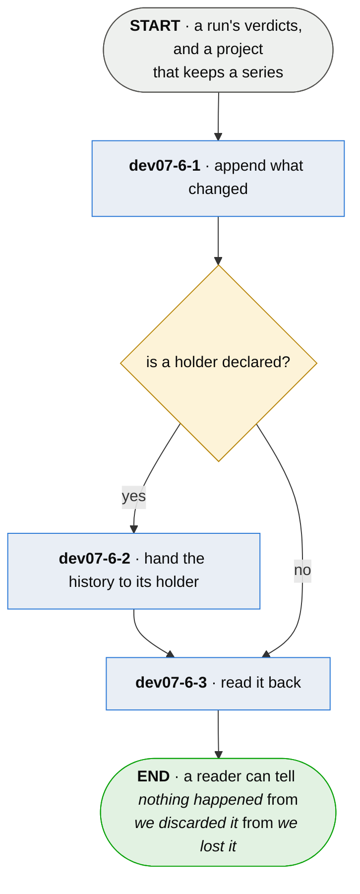

# dev07-6 · append the run to the series

**Last updated** 2026-10-26 v5

A sub-flow of [dev07 · run plumb](dev07-run-plumb.md). Entered where the project keeps a series,
carrying the run's verdicts. Exits with the run in the history — and the history readable, which
is what the close differences and a reader asks *when* of.

One interface — read and write series data — with local and remote implementations behind it.
Where the history lives is the project's declaration, never a second kind of history. The
holder's own side — standing one up, and what it may spend of its host — is
[hol · hold a series](hol-hold-a-series.md). Handing the history over (`dev07-6-2`) is done the way
everything a run produced is sent, in [snd · send what a run produced](snd-send-what-a-run-produced.md).

## Nodes

### dev07-6-1 · append what changed

> **As a developer asking when this broke I want every run to leave its mark in a history, so
> that the questions one run cannot answer have somewhere to be answered from.**

#### Information

| Information | IO | Description | Required | Provenance |
|---|---|---|---|---|
| dev07-6-1-inf1 | In | `verdict` | yes | parent |
| dev07-6-1-inf2 | In | `config.series` | yes | parent |
| dev07-6-1-inf3 | Out | `series` | yes | derived |
| dev07-6-1-inf4 | Out | `run_marker` | yes | observed |

#### User Requirements
  * dev07-6-1-ur1 - the series accumulates what changed and never what stayed the same — an
    unchanged run writes no transition
  * dev07-6-1-ur2 - a marker is written for every run whether or not anything changed, so
    *nothing moved* and *nobody looked* stay different answers
  * dev07-6-1-ur3 - a fact that disappears is recorded as gone — absence is a transition, never
    a silent stop
  * dev07-6-1-ur4 - the origin is stamped when the series is created; a history carrying no
    stamp is reported as one of unknown extent, never as a short one
  * dev07-6-1-ur5 - a line the store cannot be read as is refused by file, line and shape; an
    unreadable store is an outcome, never a traceback

#### System Requirements
  * dev07-6-1-sr1 - the local implementation is an append-only log in the project's own tree;
    transitions, run markers and discard notes share one file, told apart by shape, because the
    ordering between them is the point
  * dev07-6-1-sr2 - the sequence is dense and monotonic, so a jump with no discard note beside
    it means a record was lost rather than let go
  * dev07-6-1-sr3 - what a fact cost rides as payload and never decides a transition — a
    duration moves every run, and admitting it would write an entry per citation per run
  * dev07-6-1-sr4 - the origin stamp is generated and never recomputed — a stamp that could be
    recomputed after a loss would prove nothing about surviving one

#### Non-Functional Requirements
  * dev07-6-1-nfr1 - a history reports and never grades

#### Unknowns
  * dev07-6-1-u1 - nothing bounds a store, and nothing has measured what a series costs to
    keep; what is measurable now is what a run emits — bytes per transition at a real cadence

---

### dev07-6-2 · hand the history to its holder

> **As an adopter whose history outgrows one machine I want it held for me and handed back, so
> that the history is custodial — mine, kept elsewhere, returned.**

#### Information

| Information | IO | Description | Required | Provenance |
|---|---|---|---|---|
| dev07-6-2-inf1 | In | `series` | yes | dev07-6-1 |
| dev07-6-2-inf2 | In | `holder` | yes | authored |
| dev07-6-2-inf3 | In | `holder.spec` | optional | observed |
| dev07-6-2-inf4 | Out | `mark` | yes | observed |

#### User Requirements
  * dev07-6-2-ur1 - only what the holder has not been given is handed over, and the mark moves
    on acceptance, only ever forwards
  * dev07-6-2-ur2 - a backlog too large for one request splits into ordered batches; a failed
    batch stops the rest, and an outage partway keeps the batches that landed
  * dev07-6-2-ur3 - a hand-over has three outcomes and never two — accepted, retry, refused —
    because *it arrived* and *stop trying* are different facts
  * dev07-6-2-ur4 - what would go over the wire can be printed with nothing sent
  * dev07-6-2-ur5 - an unreachable or refusing holder leaves the backlog and never fails the
    run — a board is complete without the network
  * dev07-6-2-ur6 - a discarded range comes back as discarded and never as a gap, and it is the
    first thing a reader is told
  * dev07-6-2-ur7 - the subject a history is filed under is read from the project asked for, or
    from the project that owns the series file, and never from where the shell stands; finding
    no owner, the push refuses rather than guessing — a correctly delivered history must not
    land under somebody else's name

#### System Requirements
  * dev07-6-2-sr1 - the wire is the whole promise: the holder's layout and backend are working
    state, promised to nobody, and an adopter reads the same answers from either
  * dev07-6-2-sr2 - the batch budget is bytes, deliberately under the holder's published limit,
    because the two ends version separately and will drift
  * dev07-6-2-sr3 - the backlog is derived by comparing the mark to the log, never kept in a
    queue beside it — a queue beside a log is a copy free to disagree with it

#### Non-Functional Requirements
  * dev07-6-2-nfr1 - custodial, never telemetry: the adopter is the primary consumer, and what
    is held is held for them

#### Unknowns
  * dev07-6-2-u1 - one set of behaviours is owed by every backend, and who runs the conformance
    suite is unsettled — a permanent database in the test environment, or a file layout that is
    the only exercised choice
  * dev07-6-2-u2 - whether the client pins a holder's key and refuses a changed one is
    undecided — specified once, never built, and against a holder run for oneself the case is
    thinner
  * dev07-6-2-u3 - whether encrypting the payload to the holder's key buys anything beside the
    transport is undecided; if it is ever built, it lands as a standard construction named as
    one — this is the part of a protocol that goes wrong quietly

---

### dev07-6-3 · read it back

> **As a developer holding a board I want the history to answer *when* — when it changed, when
> we last looked, and what keeps changing — so that today is readable against every day before
> it.**

#### Information

| Information | IO | Description | Required | Provenance |
|---|---|---|---|---|
| dev07-6-3-inf1 | In | `series` | yes | dev07-6-1 |
| dev07-6-3-inf2 | Out | `series.extent` | yes | derived |
| dev07-6-3-inf3 | Out | `series.role` | yes | derived |

#### User Requirements
  * dev07-6-3-ur1 - the read answers when a fact changed, when anybody last looked, and which
    subjects keep changing
  * dev07-6-3-ur2 - every copy says whether it is the history or a cache, so a copy is never
    read as a second opinion; a copy a holder has accepted from is a cache, and a cache may run
    longer than the authority
  * dev07-6-3-ur3 - no store answers a question about a range it does not hold as though it
    held it — the extent is stated on every read
  * dev07-6-3-ur4 - a pulled copy says what it is and names the holder it came from

#### System Requirements
  * dev07-6-3-sr1 - the interface is `plumb series push`, `show` and `pull`; local and remote
    are implementations behind the same answers

#### Non-Functional Requirements

#### Unknowns

## Glossary

| Term | Meaning |
|---|---|
| Series | The append-only history of runs a project chooses to keep: transitions, run markers and discard notes in one ordered file. |
| Transition | One fact changing, and when. Never a snapshot — an unchanged fact writes nothing. |
| Run marker | The record every run writes, changed or not — what tells *nothing moved* from *nobody looked*. |
| Mark | The highest sequence the holder has accepted. Moves on acceptance, only forwards. |
| Holder | The one place a series lives when it lives elsewhere: absent, down or refusing without failing anything. |
| Cache | A local copy the history has moved past — labelled, so it is never a second opinion. |
| Discard note | The record left where a range was let go, in sequence — so *discarded* and *lost* stay different answers. |
| Provenance | The fifth column of an Information table: where an input came from, or how an output was made. |
| Authored | Written by a person. An input nothing produces, or an output somebody typed. |
| Derived | Computed by this step from what it took in. |
| Observed | Read off a run, a tree or the world as it stands. |
| Generated | Made by a tool rather than by a person. |
| Parent | On a sub-flow's input: handed in by the chapter this one drills into. |

---

## Working notes — not part of the chapter

**o3 applied.** ch11 converts whole: one interface, read/write series data; local and remote are
implementations (6-1-sr1, 6-2-sr1, 6-3-sr1). No transmission chapter exists separately.

**The unlabelled step is claimed.** ch11 drew *accumulate what changed* with no subject because
minting one was a claims change; conversion mints ids for every claim, so it is now 6-1-ur1.

**The o4 boundary, resolved.** The holder is declared through the configuration (`endpoint`) and
its own side is now [hol](hol-hold-a-series.md); plumb's holder authenticates nobody, so nothing
here is reached through an account. A service that admits strangers is a module's, and its spec lives with the module.

**The close reads this interface.** dev10-3's bracketing by sequence and its volatile subjects
are 6-3's answers consumed at the session close — the crossing the element trace should show once
both are in one corpus.

**From the three-source pass:** ur5 (unreadable store an outcome never a traceback), ur1-6-3-ur2's
cache clauses, ur4 (pulled copy names its holder), nfr1 (reports and never grades) — tests only.
`plumb series push/show/pull` — the cli. Compaction (*an overgrown series is compacted and still
replays*) is the holder's behaviour and landed as hol2-sr4.
