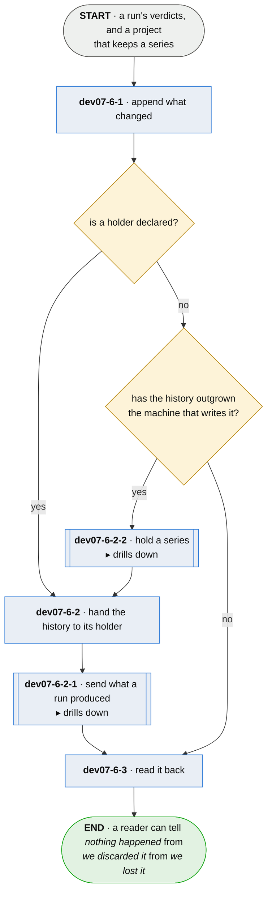

# dev07-6 · append the run to the series

**Last updated** 2026-10-26 v7

A sub-flow of [dev07 · run plumb](dev07-run-plumb.md). Entered where the project keeps a series,
carrying the run's verdicts. Exits with the run in the history and the history readable: closing
a session compares against it, and a reader asks it *when*.

Where the history lives is the project's declaration, never a second kind of history. Handing it
over is done the way everything a run produced is sent, in
[dev07-6-2-1 · send what a run produced](dev07-6-2-1-send-what-a-run-produced.md); standing up a
holder, and bounding what it may spend of its host, is
[dev07-6-2-2 · hold a series](dev07-6-2-2-hold-a-series.md).

## Nodes

### dev07-6-1 · append what changed

> **As a developer asking when this broke I want every run to leave its mark in a history, so
> that the questions one run cannot answer have somewhere to be answered from.**

#### Information

| Information | IO | Description | Required | Provenance |
|---|---|---|---|---|
| dev07-6-1-inf1 | In | `verdict` | yes | parent |
| dev07-6-1-inf2 | In | `config.series` | yes | parent |
| dev07-6-1-inf3 | Out | `series` | yes | derived |
| dev07-6-1-inf4 | Out | `run_marker` | yes | observed |

#### User Requirements
  * dev07-6-1-ur1 - the series accumulates what changed and never what stayed the same — an
    unchanged run writes no transition
  * dev07-6-1-ur2 - a marker is written for every run whether or not anything changed, so
    *nothing moved* and *nobody looked* stay different answers
  * dev07-6-1-ur3 - a fact that disappears is recorded as gone — absence is a transition, never
    a silent stop
  * dev07-6-1-ur4 - the origin is stamped when the series is created; a history carrying no
    stamp is reported as one of unknown extent, never as a short one
  * dev07-6-1-ur5 - an entry that cannot be read is refused, saying where it is and what shape it
    has; an unreadable history is an outcome the run reports, never a crash

#### System Requirements
  * dev07-6-1-sr1 - a history kept in the project's own tree is append-only, and transitions, run
    markers and records of discard share one order, because the ordering between them is the
    point
  * dev07-6-1-sr2 - the sequence is dense and monotonic, so a jump with no record of discard
    beside it means a record was lost rather than let go
  * dev07-6-1-sr3 - what a fact cost rides as payload and never decides a transition — a
    duration moves every run, and admitting it would write an entry per citation per run
  * dev07-6-1-sr4 - the origin stamp is generated and never recomputed — a stamp that could be
    recomputed after a loss would prove nothing about surviving one

#### Non-Functional Requirements
  * dev07-6-1-nfr1 - a history reports and never grades

#### Unknowns
  * dev07-6-1-u1 - nothing bounds a store, and nothing has measured what a series costs to
    keep; what is measurable now is what a run emits — bytes per transition at a real cadence

---

### dev07-6-2 · hand the history to its holder

> **As an adopter whose history outgrows one machine I want it held for me and handed back, so
> that the history is custodial — mine, kept elsewhere, returned.**

#### Information

| Information | IO | Description | Required | Provenance |
|---|---|---|---|---|
| dev07-6-2-inf1 | In | `series` | yes | dev07-6-1 |
| dev07-6-2-inf2 | In | `holder` | yes | authored |
| dev07-6-2-inf3 | In | `holder.spec` | optional | observed |
| dev07-6-2-inf4 | Out | `mark` | yes | observed |
| dev07-6-2-inf5 | Out | `outgoing` | yes | derived |

#### User Requirements
  * dev07-6-2-ur1 - the mark moves only on acceptance, and only ever forwards
  * dev07-6-2-ur2 - what is outstanding, when too large for one request, splits into ordered
    batches; a failed batch stops the rest, and an outage partway keeps the batches that landed
  * dev07-6-2-ur3 - the hand-over itself — what is outstanding, retrying, acknowledgement and its
    outcomes — is [dev07-6-2-1 · send what a run produced](dev07-6-2-1-send-what-a-run-produced.md)'s
  * dev07-6-2-ur4 - what would be sent can be printed with nothing sent
  * dev07-6-2-ur6 - a discarded range comes back as discarded and never as a gap, and it is the
    first thing a reader is told
  * dev07-6-2-ur7 - the name a history is filed under is read from the project asked for, or
    from the project that owns the history, and never from where it was asked; finding no owner,
    the hand-over refuses rather than guessing — a correctly delivered history must not land
    under somebody else's name

#### System Requirements
  * dev07-6-2-sr1 - what is sent and answered is the whole promise: how a holder lays out and
    stores a history is its own, promised to nobody, and an adopter reads the same answers from
    any holder
  * dev07-6-2-sr2 - a batch is sized to stay under the limit the holder publishes, with room to
    spare, because the two ends version separately and will drift
  * dev07-6-2-sr3 - what is outstanding is derived by comparing the mark to the history, never
    kept in a queue beside it — a queue beside a history is a copy free to disagree with it

#### Non-Functional Requirements
  * dev07-6-2-nfr1 - custodial, never telemetry: the adopter is the primary consumer, and what
    is held is held for them

#### Unknowns
  * dev07-6-2-u1 - one set of behaviours is owed by every way a holder may store a history, and
    who checks each of them against it is unsettled

---

### dev07-6-2-1 · send what a run produced

> **As a developer I want the history handed to the holder I chose, so that it is held there and
> what did not arrive is still here.**

#### Information

| Information | IO | Description | Required | Provenance |
|---|---|---|---|---|
| dev07-6-2-1-inf1 | In | `outgoing` | yes | dev07-6-2 |
| dev07-6-2-1-inf2 | Out | `acknowledgement` | yes | observed |

#### User Requirements

#### System Requirements

#### Non-Functional Requirements

#### Unknowns

---

### dev07-6-2-2 · hold a series

> **As an IT professional I want the team's histories held on a box we already run, so that a
> history outgrowing the machine that wrote it is kept rather than lost.**

#### Information

| Information | IO | Description | Required | Provenance |
|---|---|---|---|---|
| dev07-6-2-2-inf1 | Out | `holder` | yes | derived |

#### User Requirements

#### System Requirements

#### Non-Functional Requirements

#### Unknowns

---

### dev07-6-3 · read it back

> **As a developer holding a board I want the history to answer *when* — when it changed, when
> we last looked, and what keeps changing — so that today is readable against every day before
> it.**

#### Information

| Information | IO | Description | Required | Provenance |
|---|---|---|---|---|
| dev07-6-3-inf1 | In | `series` | yes | dev07-6-1 |
| dev07-6-3-inf2 | Out | `series.extent` | yes | derived |
| dev07-6-3-inf3 | Out | `series.role` | yes | derived |

#### User Requirements
  * dev07-6-3-ur1 - the read answers when a fact changed, when anybody last looked, and which
    subjects keep changing
  * dev07-6-3-ur2 - every copy says whether it is the history or a cache, so a copy is never
    read as a second opinion; a copy a holder has accepted from is a cache, and a cache may run
    longer than the history it was copied from
  * dev07-6-3-ur3 - no store answers a question about a range it does not hold as though it
    held it — the extent is stated on every read
  * dev07-6-3-ur4 - a copy fetched from a holder says what it is and names the holder
  * dev07-6-3-ur5 - the note that a copy was fetched belongs to that copy and is never handed
    over with it, so a holder never reads as a cache of another

#### System Requirements
  * dev07-6-3-sr1 - handing over, reading and fetching a history are the same three asks wherever
    it is held, and give the same answers
  * dev07-6-3-sr2 - fetching a history finds its holder the way handing it over does, so it is
    read back from where it was sent

#### Non-Functional Requirements

#### Unknowns

## Glossary

| Term | Meaning |
|---|---|
| Transition | One fact changing, and when. Never a snapshot — an unchanged fact writes nothing. |
| Run marker | The record every run writes, changed or not — what tells *nothing moved* from *nobody looked*. |
| Mark | The highest sequence the holder has accepted. Moves on acceptance, only forwards. |
| Holder | The one place a series lives when it lives elsewhere. |
| Cache | A local copy the history has moved past — labelled, so it is never a second opinion. |
| Record of discard | The record left in sequence where a range was let go, so *discarded* and *lost* stay different answers. |

---
