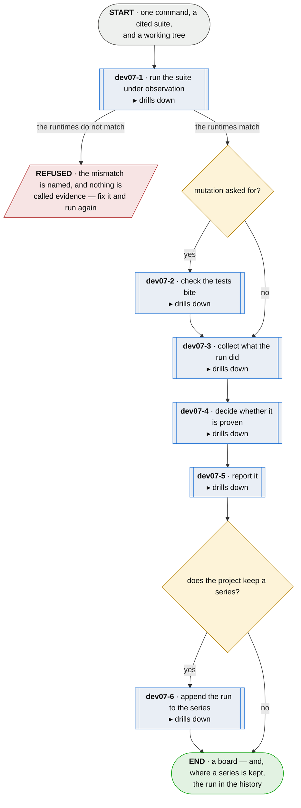

# dev07 · run plumb — the proving pipeline

**Last updated** 2026-10-26 v18

A sub-flow of [A developer's workflow](developer-day.md). Entered from `dev06 · do the work`,
carrying the configuration, the annotations and the working tree, and entered again from
`dev08 · update the plumb configuration` once the configuration is corrected. Exits to the
developer's judgement — is the proof what the story needs? — carrying a board, the manifest and,
where a series is kept, the run in its history.

## Nodes

### dev07-1 · run the suite under observation

Drills down into [dev07-1 · run the suite under observation](dev07-1-run-the-suite-under-observation.md).

> **As a developer whose test proves a behaviour I want the run to record what each test drove,
> so that a passing test is evidence of doneness.**

#### Information

| Information | IO | Description | Required | Provenance |
|---|---|---|---|---|
| dev07-1-inf01 | In | `config` | yes | parent |
| dev07-1-inf02 | In | `working_tree` | yes | parent |
| dev07-1-inf03 | In | `annotation` | yes | parent |
| dev07-1-inf04 | Out | `run` | yes | observed |
| dev07-1-inf05 | Out | `trace` | yes | observed |
| dev07-1-inf06 | Out | `runtime_report` | optional | derived |
| dev07-1-inf07 | Out | `citation.grounding` | yes | derived |
| dev07-1-inf08 | Out | `citation.entered_through` | yes | observed |
| dev07-1-inf09 | Out | `citation.reached_outside_entry` | yes | observed |
| dev07-1-inf10 | Out | `citation.elapsed` | optional | observed |
| dev07-1-inf11 | Out | `run_condition` | optional | derived |

#### User Requirements

#### System Requirements
  * dev07-1-sr1 - observing is the adapter's, in the language's own tooling
  * dev07-1-sr2 - the adapter is the one the project declares, and the core never learns which;
    an adapter that is not known fails the launch, never a verdict
  * dev07-1-sr3 - the project's declarations are resolved once, and whichever adapter runs is
    handed the same resolved answers — answers, never questions, because an adapter may run
    apart from the core

#### Non-Functional Requirements

#### Unknowns

---

### dev07-2 · check the tests bite

Drills down into [dev07-2 · check the tests bite](dev07-2-check-the-tests-bite.md).

> **As a developer whose suite is green I want to know which of my tests run the code without
> checking it, so that *passing* and *checking* stop being the same word.**

#### Information

| Information | IO | Description | Required | Provenance |
|---|---|---|---|---|
| dev07-2-inf2 | In | `trace` | yes | dev07-1 |
| dev07-2-inf3 | Out | `story.mutation` | yes | derived |
| dev07-2-inf4 | In | `story.id` | yes | parent |
| dev07-2-inf5 | In | `annotation` | yes | parent |
| dev07-2-inf6 | In | `citation.elapsed` | optional | dev07-1 |

#### User Requirements

#### System Requirements
  * dev07-2-sr1 - a fixed, closed set of mutations is applied to the language's own parse tree,
    and nothing outside it

#### Non-Functional Requirements

#### Unknowns

---

### dev07-3 · collect what the run did

Drills down into [dev07-3 · collect what the run did](dev07-3-collect-what-the-run-did.md).

> **As a developer I want the record of the run to carry facts and
> never verdicts, so that the claims can be re-derived and checked rather than taken on trust.**

#### Information

| Information | IO | Description | Required | Provenance |
|---|---|---|---|---|
| dev07-3-inf01 | In | `run` | yes | dev07-1 |
| dev07-3-inf08 | In | `annotation` | yes | parent |
| dev07-3-inf09 | In | `story.id` | yes | parent |
| dev07-3-inf10 | In | `citation.elapsed` | optional | dev07-1 |
| dev07-3-inf03 | In | `story.mutation` | optional | dev07-2 |
| dev07-3-inf05 | In | `citation.grounding` | yes | dev07-1 |
| dev07-3-inf06 | In | `citation.entered_through` | yes | dev07-1 |
| dev07-3-inf07 | In | `citation.reached_outside_entry` | yes | dev07-1 |
| dev07-3-inf04 | Out | `manifest` | yes | generated |
| dev07-3-inf11 | Out | `citation` | yes | derived |
| dev07-3-inf12 | Out | `absent_adapter` | optional | derived |

#### User Requirements
  * dev07-3-ur1 - one record per citing test

#### System Requirements

#### Non-Functional Requirements

#### Unknowns

---

### dev07-4 · decide whether it is proven

Drills down into [dev07-4 · decide whether it is proven](dev07-4-decide-whether-it-is-proven.md).

> **As a developer I want *done* derived from the recorded facts — the test ran, passed, and
> matched the kind of claim the story makes — so that I can rely on it.**

#### Information

| Information | IO | Description | Required | Provenance |
|---|---|---|---|---|
| dev07-4-inf1 | In | `manifest` | yes | dev07-3 |
| dev07-4-inf2 | In | `story.id` | yes | parent |
| dev07-4-inf4 | In | `citation` | yes | dev07-3 |
| dev07-4-inf3 | Out | `verdict` | yes | derived |

#### User Requirements

#### System Requirements
  * dev07-4-sr1 - the core reads the manifest schema versions it knows and refuses a newer one by
    name rather than guessing

#### Non-Functional Requirements

#### Unknowns

---

### dev07-5 · report it

Drills down into [dev07-5 · report it](dev07-5-report-it.md).

> **As a developer about to act on the result I want one board naming, for each story, whether it
> is proven, the rungs its tests reached and what its checks could not settle, so that what I do
> next comes from what was proven.**

#### Information

| Information | IO | Description | Required | Provenance |
|---|---|---|---|---|
| dev07-5-inf1 | In | `verdict` | yes | dev07-4 |
| dev07-5-inf2 | In | `manifest` | yes | dev07-3 |
| dev07-5-inf4 | In | `citation` | yes | dev07-3 |
| dev07-5-inf5 | In | `absent_adapter` | optional | dev07-3 |
| dev07-5-inf3 | Out | `board` | yes | derived |

#### User Requirements

#### System Requirements
  * dev07-5-sr1 - the board has one documented, versioned machine-readable format, and every
    other rendering of it is a view of that format

#### Non-Functional Requirements

#### Unknowns

---

### dev07-6 · append the run to the series

Drills down into [dev07-6 · append the run to the series](dev07-6-append-the-run-to-the-series.md).

> **As a developer asking when this broke I want every run to leave its mark in a history kept in
> my own tree, so that the history shows test status over the time dimension.**

#### Information

| Information | IO | Description | Required | Provenance |
|---|---|---|---|---|
| dev07-6-inf1 | In | `config.series` | yes | parent |
| dev07-6-inf2 | In | `verdict` | yes | dev07-4 |
| dev07-6-inf3 | Out | `series` | yes | derived |

#### User Requirements

#### System Requirements

#### Non-Functional Requirements
  * dev07-6-nfr1 - appending locally and transmitting to its holder stay separate
  * dev07-6-nfr2 - a project that declares no series skips this step, and nothing downstream may
    come to depend on it

#### Unknowns

## Glossary

| Term | Meaning |
|---|---|
| Run | One execution of the suite, observed. |
| Trace | The runtime's own per-test record of what the test drove. |
| Entry point | A declared place where the production system begins doing work for a caller — a command, a route, a handler, a job. Declared once by the project, in whatever form its adapter reads. |
| Wiring fact | What the run recorded about whether a citing test reached the production system through an entry point. Its five values are named in `dev07-1-4`. |
| Mutation | Deliberate small changes to driven code, to see whether the citing tests notice. |
| Manifest | The language-neutral record of a run that the adapters produce and the core reads: per story, its archetype and its citations. Facts, never verdicts, and the one document the core reads. |
| Annotation | The marker on a test naming the story it evidences — what a person writes, and the whole of what plumb needs to begin. |
| Citation | One citing test's recorded facts for a story: what its annotation claims, plus what the run observed. Minted at collect. |
| Verdict | Per story: its status, achieved vector, conditions, and aspects where declared. Derived each run and stored nowhere. |
| Board | What a run hands a person and their tools: per story, whether it is proven, the rungs reached, and what its checks could not settle. Not the sprint backlog. |
| Series | The append-only history of runs a project chooses to keep: transitions, run markers and records of discard, in one order. |

---
