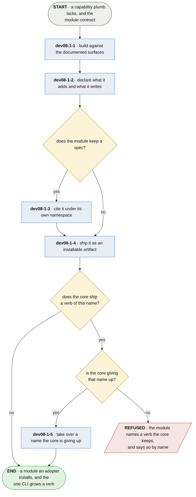

# dev08-1 · contribute a module

**Last updated** 2026-10-26 v9

What whoever builds a module does, from a capability plumb lacks to a verb an adopter can
install. Exits to [dev00-1 · bring plumb to a project](dev00-1-bring-plumb-to-a-project.md), whose
later entry mounts it. The surfaces a module builds against are the core's documented, derived
artifacts — the board, the series interface — and never the manifest, which stays the
adapters' hub and the core's own to restructure.

## Nodes

### dev08-1-1 · build against the documented surfaces

> **As whoever builds a module I want one documented contract to build against, so that adding
> my capability never means reading plumb's source or touching its core.**

#### Information

| Information | IO | Description | Required | Provenance |
|---|---|---|---|---|
| dev08-1-1-inf1 | In | `module_contract` — the documented surfaces and the mount | yes | authored |
| dev08-1-1-inf2 | In | `board_format` — the board as the core publishes and versions it | yes | authored |
| dev08-1-1-inf3 | Out | `module` | yes | derived |

#### User Requirements
  * dev08-1-1-ur1 - a module consumes the documented derived surfaces — the board, the series
    interface — each versioned, each refusing newer by name
  * dev08-1-1-ur2 - a module declares the surfaces it speaks as a map, a version per surface, so one
    surface can be refused while another is accepted
  * dev08-1-1-ur3 - a module that cannot reach what it needs is inert: its verbs report their own
    standing, and the tool stays whole

#### System Requirements
  * dev08-1-1-sr1 - the manifest stays the adapters' hub and the core's own to restructure; the
    module contract never names it

#### Non-Functional Requirements
  * dev08-1-1-nfr1 - a module reads what was proven and never moves a status; only a run moves one

#### Unknowns

---

### dev08-1-2 · declare what it adds and what it writes

> **As an adopter deciding what to install I want the module to say what verbs it adds and what
> it will write, so that trusting it is a decision about a list rather than a hope.**

#### Information

| Information | IO | Description | Required | Provenance |
|---|---|---|---|---|
| dev08-1-2-inf1 | In | `module` | yes | dev08-1-1 |
| dev08-1-2-inf2 | Out | `module.declaration` — name, verbs, surface versions, footprint | yes | authored |

#### User Requirements
  * dev08-1-2-ur1 - the verbs it mounts are named in the declaration, and none is a verb the core keeps;
    a name the core is giving up is taken over only as dev08-1-5 describes
  * dev08-1-2-ur2 - every place the module writes is a declared footprint entry with a disposition,
    so migration, removal, and whatever backup the adopter runs stay honest about what modules
    added; a secret the module keeps is its own footprint entry, with the disposition *carries a
    credential*, and never sits in the project's declaration
  * dev08-1-2-ur3 - the module names itself and its version, out of its own artifact
  * dev08-1-2-ur4 - the declaration says whether the module reaches the network, beside the verbs and
    writes it names — together, what dev00-1-5-nfr1's trust decision is made on
  * dev08-1-2-ur5 - a verb name claimed by more than one module mounts for none of them, and every
    claimant is named

#### System Requirements
  * dev08-1-2-sr1 - a module that needs configuration reads its own named table and never another's;
    the core's keys are read-only to it
  * dev08-1-2-sr2 - every declaration is held against the others before any of them is bound, so a
    contested name is a refusal the adopter reads; the tool answers for every verb that is not
    contested
  * dev08-1-2-sr3 - what the tool lists as mounted is exactly what it mounted

#### Non-Functional Requirements
  * dev08-1-2-nfr1 - which module answers a verb is never decided by an order the adopter did not
    choose and cannot see

#### Unknowns
  * dev08-1-2-u1 - how an adopter resolves a contested name is undecided; nothing here lets them
    choose one, so the remedy is to uninstall the other

---

### dev08-1-3 · cite it under its own namespace

> **As a module author who keeps a spec I want my subjects on the same board as everything
> else, so that my module's claims are proven the way the core's are.**

#### Information

| Information | IO | Description | Required | Provenance |
|---|---|---|---|---|
| dev08-1-3-inf1 | In | `module.declaration` | yes | dev08-1-2 |
| dev08-1-3-inf2 | Out | `namespace` — the module's own | yes | authored |

#### User Requirements
  * dev08-1-3-ur1 - the module's spec lives in its own namespace, and its citations coexist on one
    board with every other spec in the repository
  * dev08-1-3-ur2 - keeping a spec is the author's choice; nothing refuses a module that keeps none

#### System Requirements

#### Non-Functional Requirements

#### Unknowns

---

### dev08-1-4 · ship it as an installable artifact

> **As an adopter I want a module installed by the same gesture as any package, so that adding
> a capability never means reading a contributor's repository.**

#### Information

| Information | IO | Description | Required | Provenance |
|---|---|---|---|---|
| dev08-1-4-inf1 | In | `module.declaration` | yes | dev08-1-2 |
| dev08-1-4-inf2 | Out | `module_artifact` | yes | generated |

#### User Requirements
  * dev08-1-4-ur1 - the artifact declares its mount under the name its package registers, which is what
    an install reads to mount it (dev00-1-5-sr1)
  * dev08-1-4-ur2 - the artifact carries what its verbs need; an adopter obtains nothing separately

#### System Requirements

#### Non-Functional Requirements

#### Unknowns

---

### dev08-1-5 · take over a name the core is giving up

> **As an adopter I want a verb I already use to keep working across the release that moves it out
> of the core, so that where the capability is built is not a thing I have to notice.**

#### Information

| Information | IO | Description | Required | Provenance |
|---|---|---|---|---|
| dev08-1-5-inf1 | In | `module_artifact` | yes | dev08-1-4 |
| dev08-1-5-inf2 | In | `core_release` — the one that drops the name | yes | observed |
| dev08-1-5-inf3 | Out | `name_handover` | yes | derived |

#### User Requirements
  * dev08-1-5-ur1 - the core dropping the name and the module mounting it are one release, so no
    adopter meets a version with two of that verb or none
  * dev08-1-5-ur2 - an artifact that carries the module before the name is free does not declare its
    mount until the release that frees it
  * dev08-1-5-ur3 - what the verb does is the module's from the moment it mounts, and the core keeps no
    copy against which the module could be said to be wrong
  * dev08-1-5-ur4 - what the core wrote under that name stays exactly where it is and the module reads
    it there; the release that gives the name up moves nothing, because a conversion run by the
    half that is leaving is one nobody can run a second time

#### System Requirements
  * dev08-1-5-sr1 - the two sides are cut together and neither is released on the strength of the
    other being ready
  * dev08-1-5-sr2 - what leaves is what implemented the capability, never what the module builds on: a
    published surface stays published, because a module cannot speak a version of something the
    core stopped having, and a holder somebody runs themselves must not come to depend on the
    software of whoever answers a different capability

#### Non-Functional Requirements
  * dev08-1-5-nfr1 - a verb is never served by the core and a module at once; a core that ships a verb
    claims the capability
  * dev08-1-5-nfr2 - the moment a capability leaves is the cheapest it will ever be to leave, because
    the population using it only grows

#### Unknowns
  * dev08-1-5-u1 - what an adopter who upgrades the core and not the module meets is undecided, and
    so is whether anybody is told the two have drifted

## Glossary

| Term | Meaning |
|---|---|
| Module | An installable package that mounts verbs into plumb's one CLI and consumes the core's documented surfaces. |
| Module contract | The documented surfaces and the mount, as written for whoever builds a module: what a module receives, owes, and may never do. |
| Documented surfaces | The derived artifacts the core publishes and versions — the board, the series interface. What modules build on, so the manifest stays free to change. |
| Mount | A module's verbs appearing in the one CLI, discovered from the name the installed package registers. |
| Footprint | Everything the tool writes, module entries included — each with a disposition. |

---
