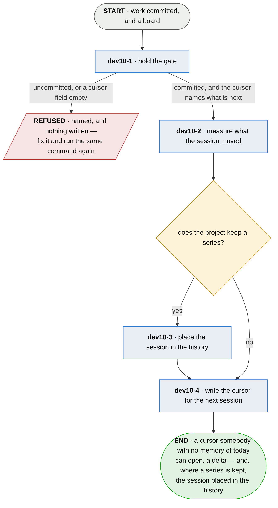

# dev10 · close the session

**Last updated** 2026-10-26 v11

A sub-flow of [A developer's workflow](developer-day.md). Entered from `dev09 · commit, naming the
story`, carrying a commit, a board and — where the project keeps a series — the opening reading. Exits to `dev11 · push and open a pull
request`, carrying a cursor the next session opens from.

## Nodes

### dev10-1 · hold the gate

> **As a developer returning to work I want the close to refuse until the work is committed and the
> cursor filled, so that I can open where it stopped.**

#### Information

| Information | IO | Description | Required | Provenance |
|---|---|---|---|---|
| dev10-1-inf1 | In | `cursor` | yes | parent |
| dev10-1-inf2 | In | `tree_state` | yes | parent |
| dev10-1-inf4 | In | `commit` | yes | parent |
| dev10-1-inf3 | Out | `gate_report` | yes | derived |

#### User Requirements
  * dev10-1-ur1 - the gate checks that work is committed and the cursor's fields are present
  * dev10-1-ur2 - each reason for a refusal is named, and so is the fact that nothing was written

#### System Requirements

#### Non-Functional Requirements
  * dev10-1-nfr1 - the gate is held before anything is spent or written, so a refusal costs only
    the time it takes to read it
  * dev10-1-nfr2 - the gate never checks that the work was good, that the delta was positive, or
    that anything was proven
  * dev10-1-nfr3 - committing is checked and pushing is not; a remote is somebody else's
    availability

#### Unknowns

---

### dev10-2 · measure what the session moved

> **As somebody accounting for a day I want the number to come from an artifact I did not write, so
> that a busy session and a productive one are told apart.**

#### Information

| Information | IO | Description | Required | Provenance |
|---|---|---|---|---|
| dev10-2-inf1 | In | `board` | yes | parent |
| dev10-2-inf2 | In | `reading` | yes | parent |
| dev10-2-inf3 | Out | `delta` | yes | derived |
| dev10-2-inf4 | Out | `delta.became` | yes | derived |
| dev10-2-inf5 | Out | `delta.lost` | yes | derived |

#### User Requirements
  * dev10-2-ur1 - the session is the difference between two readings: which stories became proven,
    which stopped being
  * dev10-2-ur2 - a story deleted since the open is not a story that broke
  * dev10-2-ur3 - a reading counts stories; a subject read per aspect is not a story that is
    unproven, and is never counted as one

#### System Requirements

#### Non-Functional Requirements
  * dev10-2-nfr1 - not commits, not lines, not elapsed time, not tasks ticked
  * dev10-2-nfr2 - a negative delta is a result and never a fault

#### Unknowns
  * dev10-2-u1 - whether a reading left by an earlier session is refused, or differenced and
    flagged as stale, is undecided

---

### dev10-3 · place the session in the history

> **As somebody reading a delta I want to know whether today was typical, so that a story that has
> flickered for a fortnight is not read as one that just moved.**

#### Information

| Information | IO | Description | Required | Provenance |
|---|---|---|---|---|
| dev10-3-inf1 | In | `reading.series_seq` | yes | parent |
| dev10-3-inf2 | In | `manifest` | yes | parent |
| dev10-3-inf3 | Out | `bracketed_transition` | yes | derived |
| dev10-3-inf4 | Out | `volatile_subject` | yes | derived |

#### User Requirements
  * dev10-3-ur1 - the session is reported as its own stretch of a history the project already keeps

#### System Requirements
  * dev10-3-sr1 - the stretch is bracketed by sequence number rather than by differencing two
    summaries that may have passed through anything in between

#### Non-Functional Requirements
  * dev10-3-nfr1 - a project that declares no history gets the delta and nothing else; nothing is
    written that the project did not ask for
  * dev10-3-nfr2 - appending locally and transmitting to its holder stay separate, so ending a
    session is never an act of disclosure

#### Unknowns

---

### dev10-4 · write the cursor for the next session

> **As a developer returning to work I want one line saying what is next and why, so that I can
> open where the last session stopped.**

#### Information

| Information | IO | Description | Required | Provenance |
|---|---|---|---|---|
| dev10-4-inf1 | In | `story.id` | yes | parent |
| dev10-4-inf2 | Out | `cursor` | yes | derived |
| dev10-4-inf3 | Out | `cursor.next_task` | yes | derived |
| dev10-4-inf4 | Out | `cursor.ref` | yes | derived |
| dev10-4-inf5 | Out | `cursor.context` | yes | authored |

#### User Requirements
  * dev10-4-ur1 - the cursor holds the next thing and the context for it, and never accumulates a
    session-by-session narrative
  * dev10-4-ur2 - `cursor.next_task` names a `story.id`

#### System Requirements
  * dev10-4-sr1 - the cursor is committed, because it travels between two sessions
  * dev10-4-sr2 - a state file the tool replaces is never read half-written, and the replacement
    stays readable by whoever could read the old one

#### Non-Functional Requirements

#### Unknowns

## Glossary

| Term | Meaning |
|---|---|
| Cursor | What a session leaves behind saying where it stopped and what is next. |
| Delta | The change between the opening reading and the closing board. |
| Reading | The board as it stood at the open, kept so the close has something to difference against. |
| Tree state | The state of each declared tree: clean, or holding work. |
