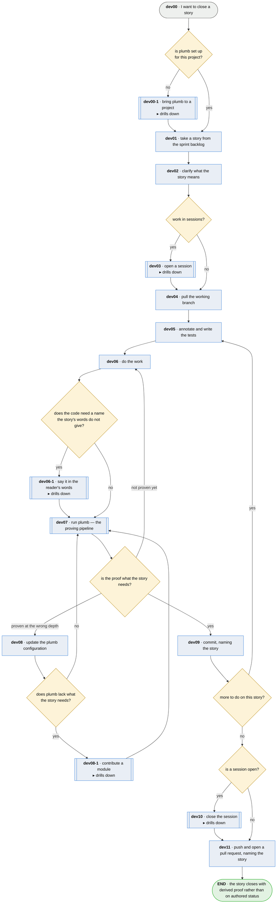

# A developer's workflow

**Last updated** 2026-10-26 v12

What a developer does, from picking up work to closing it. This is the corpus's main flow: every
other chapter expands one of its steps, and its file name says which. This is framed as an agile
process, but plumb does not require any specific methodology.

## Nodes

### dev00 · I want to close a story

> **As a developer I want to finish a piece of work and have it shown to be finished, so that what
> I hand over is complete rather than asserted.**

#### Information

| Information | IO | Description | Required | Provenance |
|---|---|---|---|---|
| dev00-inf1 | In | `sprint_backlog` | yes | authored |
| dev00-inf2 | Out | `story` | yes | authored |

#### User Requirements
  * dev00-ur1 - a story carries an identifier the team already uses
  * dev00-ur2 - the team records somewhere what is in flight
  * dev00-ur3 - the team has somewhere to ask what a story means
#### System Requirements
  * dev00-sr1 - a version control system with branches and pull requests
  * dev00-sr2 - a test runner the language supports
  * dev00-sr3 - plumb set up for the project (dev00-1), with its adapter for that language
#### Non-Functional Requirements
  * dev00-nfr1 - running plumb costs about what running the tests already costs
  * dev00-nfr2 - nothing in the flow writes a status anybody could have typed
#### Unknowns

---

### dev00-1 · bring plumb to a project

> **As a team I want plumb installed and pointed at our project without reading its repository,
> so that the first thing we see is a board answering for the stories our tests cite.**

#### Information

| Information | IO | Description | Required | Provenance |
|---|---|---|---|---|
| dev00-1-inf1 | Out | `config` | yes | derived |

#### User Requirements

#### System Requirements

#### Non-Functional Requirements

#### Unknowns

---

### dev01 · take a story from the sprint backlog

> **As a developer starting work I want to take the next thing the team agreed on, so that what I
> build is what was asked for rather than what I noticed.**

#### Information

| Information | IO | Description | Required | Provenance |
|---|---|---|---|---|
| dev01-inf1 | In | `sprint_backlog` | yes | authored |
| dev01-inf2 | Out | `story.id` | yes | derived |

#### User Requirements
  * dev01-ur1 - the story taken is named by the id the team's own list gives it, and by no id
    plumb made up

#### System Requirements

#### Non-Functional Requirements
  * dev01-nfr1 - plumb never decides what is on that list or its order

#### Unknowns

---

### dev02 · clarify what the story means

> **As a developer holding a story I want its ambiguities settled before I write anything, so that I
> am not building my own reading of it.**

#### Information

| Information | IO | Description | Required | Provenance |
|---|---|---|---|---|
| dev02-inf1 | In | `story.id` | yes | dev01 |
| dev02-inf2 | Out | `clarified_story` | yes | authored |

#### User Requirements
  * dev02-ur1 - an ambiguity is settled with whoever owns the story, before a test is written

#### System Requirements

#### Non-Functional Requirements

#### Unknowns
  * dev02-u1 - Amending a shared specification is not something one developer does alone, and nothing
    here says who agrees to it

---

### dev03 · open a session

> **As a developer returning to work I want to be told where the last session stopped and whether the
> ground moved, so that I am not re-reading my own repository to work out what I was doing.**

#### Information

| Information | IO | Description | Required | Provenance |
|---|---|---|---|---|
| dev03-inf1 | In | `config.cursor` | yes | parent |
| dev03-inf2 | In | `config.repos` | yes | parent |
| dev03-inf3 | In | `story.id` | yes | dev01 |
| dev03-inf4 | In | `board` | optional | observed |
| dev03-inf5 | Out | `cursor` | yes | derived |
| dev03-inf6 | Out | `tree_state` | yes | derived |
| dev03-inf7 | Out | `reading` | optional | observed |
| dev03-inf8 | In | `config.series` | optional | parent |

#### User Requirements
  * dev03-ur1 - opening and closing a session are optional, and no other step may come to depend on
    them

#### System Requirements
  * dev03-sr1 - where the cursor lives and which trees a session spans are the project's own
    declaration

#### Non-Functional Requirements

#### Unknowns

---

### dev04 · pull the working branch

> **As a developer about to write code I want the branch current, so that what I prove is proven
> against what everybody else already has.**

#### Information

| Information | IO | Description | Required | Provenance |
|---|---|---|---|---|
| dev04-inf1 | In | `clarified_story` | yes | dev02 |
| dev04-inf2 | Out | `working_tree` | yes | derived |

#### User Requirements
  * dev04-ur1 - a story the branch's tests cite that the pull renamed or removed is reconciled
    before new tests are written against it

#### System Requirements

#### Non-Functional Requirements

#### Unknowns

---

### dev05 · annotate and write the tests

> **As a developer I want the tests to exist before the code does, so that the work is aimed at
> something rather than described afterwards.**

#### Information

| Information | IO | Description | Required | Provenance |
|---|---|---|---|---|
| dev05-inf1 | In | `story.id` | yes | dev01 |
| dev05-inf2 | In | `working_tree` | yes | dev04 |
| dev05-inf3 | Out | `test_suite` | yes | authored |
| dev05-inf4 | Out | `annotation` | yes | authored |

#### User Requirements
  * dev05-ur1 - the annotation cites a story
  * dev05-ur2 - the cited story exists
  * dev05-ur3 - an annotated test shows derived status in the board even if the test body is empty
  * dev05-ur4 - an annotation cites an id, and the id's namespace is what places it in one
    specification rather than another — which is how several specifications co-exist in one
    repository, how a typo'd id fails rather than landing beside a real one, and what a reader
    narrows a board by

#### System Requirements

#### Non-Functional Requirements

#### Unknowns

---

### dev06 · do the work

> **As a developer I want to build the thing the story asks for, so that the end-user gets their functionality.**

#### Information

| Information | IO | Description | Required | Provenance |
|---|---|---|---|---|
| dev06-inf1 | In | `story.id` | yes | dev01 |
| dev06-inf2 | In | `test_suite` | yes | dev05 |
| dev06-inf3 | Out | `working_tree` | yes | authored |

Where the story's words and the code's names differ, the work goes through
[dev06-1 · say it in the reader's words](dev06-1-say-it-in-the-readers-words.md).

#### User Requirements
  * dev06-ur1 - the work is aimed at tests that already exist

#### System Requirements

#### Non-Functional Requirements

#### Unknowns

---

### dev06-1 · say it in the reader's words

> **As a developer I want a name for what the code holds that outlives the story's audience, so
> that the next audience to arrive does not rename the core.**

#### Information

| Information | IO | Description | Required | Provenance |
|---|---|---|---|---|
| dev06-1-inf1 | In | `story.id` | yes | dev01 |
| dev06-1-inf2 | Out | `implementation_name` | yes | derived |

#### User Requirements

#### System Requirements

#### Non-Functional Requirements

#### Unknowns

---

### dev07 · run plumb

> **As a developer who thinks the work is finished I want the tool to say whether it is proven, so
> that *done* informs my own judgement.**

#### Information

| Information | IO | Description | Required | Provenance |
|---|---|---|---|---|
| dev07-inf1 | In | `config` | yes | parent |
| dev07-inf2 | In | `annotation` | yes | dev05 |
| dev07-inf3 | In | `working_tree` | yes | dev06 |
| dev07-inf4 | Out | `board` | yes | derived |
| dev07-inf5 | Out | `manifest` | yes | generated |
| dev07-inf6 | In | `story.id` | yes | dev01 |
| dev07-inf7 | Out | `series` | optional | derived |
| dev07-inf8 | Out | `run_condition` | optional | derived |

#### User Requirements
  * dev07-ur1 - one command returns a board

#### System Requirements
  * dev07-sr1 - the proving pipeline, which this step drills into

#### Non-Functional Requirements

#### Unknowns

---

### dev08 · update the plumb configuration

> **As a developer whose proof came back at the wrong depth I want to correct what the tool was told,
> so that the answer is about my work rather than about my setup.**

#### Information

| Information | IO | Description | Required | Provenance |
|---|---|---|---|---|
| dev08-inf1 | In | `board` | yes | dev07 |
| dev08-inf2 | Out | `config` | yes | authored |

#### User Requirements
  * dev08-ur1 - the board names what to correct

#### System Requirements

#### Non-Functional Requirements
  * dev08-nfr1 - an annotation alone is enough to begin; configuring is an enhancement

#### Unknowns

---

### dev08-1 · contribute a module

> **As whoever builds a module I want to add a capability plumb lacks without forking it, so that
> a team that needs it installs it beside the tool it already has.**

#### Information

| Information | IO | Description | Required | Provenance |
|---|---|---|---|---|
| dev08-1-inf1 | In | `board_format` | yes | authored |
| dev08-1-inf2 | Out | `module_artifact` | yes | derived |
| dev08-1-inf3 | Out | `namespace` | yes | derived |

#### User Requirements

#### System Requirements

#### Non-Functional Requirements

#### Unknowns

---

### dev09 · commit, naming the story

> **As a developer whose work is proven I want the commit to name the story, so that the proof, the
> code and the claim travel together.**

#### Information

| Information | IO | Description | Required | Provenance |
|---|---|---|---|---|
| dev09-inf1 | In | `working_tree` | yes | dev06 |
| dev09-inf2 | In | `board` | yes | dev07 |
| dev09-inf3 | In | `story.id` | yes | dev01 |
| dev09-inf4 | Out | `commit` | yes | authored |

#### User Requirements
  * dev09-ur1 - the commit names the story

#### System Requirements

#### Non-Functional Requirements
  * dev09-nfr1 - the commit follows the board rather than preceding it
  * dev09-nfr2 - committing is frequent, so a working session is a sequence of proven steps

#### Unknowns

---

### dev10 · close the session

> **As a developer returning to work I want the last session to have left a cursor and committed
> its work, so that it is easy to resume where I left off.**

#### Information

| Information | IO | Description | Required | Provenance |
|---|---|---|---|---|
| dev10-inf01 | In | `cursor` | yes | dev03 |
| dev10-inf02 | In | `board` | yes | dev07 |
| dev10-inf03 | In | `reading` | optional | dev03 |
| dev10-inf04 | In | `commit` | yes | dev09 |
| dev10-inf05 | In | `tree_state` | yes | dev03 |
| dev10-inf06 | In | `manifest` | yes | dev07 |
| dev10-inf07 | In | `story.id` | yes | dev01 |
| dev10-inf08 | Out | `delta` | optional | derived |
| dev10-inf09 | Out | `cursor` | yes | derived |
| dev10-inf10 | Out | `bracketed_transition` | optional | derived |

#### User Requirements
  * dev10-ur1 - the session is measured as the change in what is proven, and by nothing else

#### System Requirements

#### Non-Functional Requirements

#### Unknowns

---

### dev11 · push and open a pull request, naming the story

> **As a developer who has finished I want the story named where the team will see it, so that its
> standing is read from what happened rather than typed by somebody.**

#### Information

| Information | IO | Description | Required | Provenance |
|---|---|---|---|---|
| dev11-inf1 | In | `commit` | yes | dev09 |
| dev11-inf2 | In | `story.id` | yes | dev01 |
| dev11-inf3 | Out | `pull_request` | yes | authored |

#### User Requirements
  * dev11-ur1 - the story id travels in the commit, the pull request and the merge

#### System Requirements

#### Non-Functional Requirements
  * dev11-nfr1 - integration with a team's story management tool is not part of plumb

#### Unknowns
  

## Glossary

| Term | Meaning |
|---|---|
| Sprint backlog | The team's own list of what is in flight. |
| Board | What plumb emits: per story, whether it is proven and how far. Not the sprint backlog. |
| Working tree | The branch as it stands on the developer's machine. |
| Annotation | The marker on a test naming the story it evidences. The whole of what plumb needs to begin. |
| Proven | Derived and checked by a run, never has to be typed. |

---
