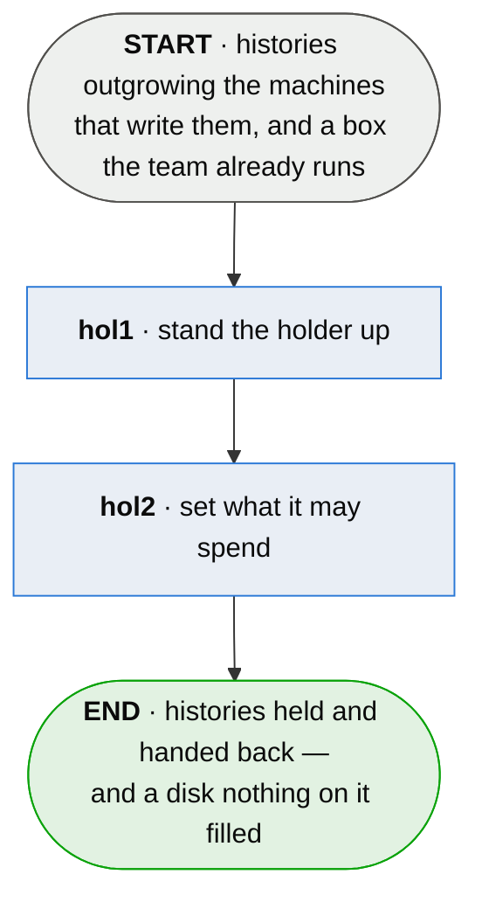

# hol · hold a series

**Last updated** 2026-09-14 v1

What an IT professional does to host their team's run histories: stand a holder up on a box the
team already runs, and bound what it may spend of that box. The projects that push to it are in
[dev07-6 · append the run to the series](dev07-6-append-the-run-to-the-series.md); the endpoint
this flow stands up is the `holder` an adopter declares there.

## Nodes

### hol1 · stand the holder up

> **As an IT professional whose team's histories outgrow their machines I want one service that
> holds them and hands them back, so that custody is something we run rather than something we
> owe anybody.**

#### Information

| Information | IO | Description | Required | Provenance |
|---|---|---|---|---|
| hol1-inf1 | In | `store_path` | yes | authored |
| hol1-inf2 | In | `bind_address` | yes | authored |
| hol1-inf3 | Out | `holder` | yes | derived |
| hol1-inf4 | Out | `holder.spec` | yes | derived |

#### User Requirements
  * hol1-ur1 - what the holder accepts — routes, the batch cap, which refusal means what — is
    served from the holder itself
  * hol1-ur2 - a store on storage the system clears without warning is named at startup

#### System Requirements
  * hol1-sr1 - it binds to the local interface and expects the host's own proxy for transport
    security
  * hol1-sr2 - a hand-over is appended verbatim and renumbered onto this store's own sequence
  * hol1-sr3 - a refusal says which kind it is: too large is split and resent, unreadable is
    terminal, no room is retryable
  * hol1-sr4 - two runs of one project arriving together exclude each other per subject, and
    housekeeping holds the same lock

#### Non-Functional Requirements
  * hol1-nfr1 - the series surface touches no manifest, fills no slot and moves no story's
    status
  * hol1-nfr2 - it authenticates nobody, by design rather than omission; what it protects is a
    disk
  * hol1-nfr3 - it depends on the standard library alone — no dependency tree to keep patched,
    no build step to host
  * hol1-nfr4 - the reply never waits for housekeeping; compaction, measured at 2.7 seconds on a
    large log, runs after it

#### Unknowns

---

### hol2 · set what it may spend

> **As an IT professional sharing a volume with things that matter more I want the bounds to be
> mine, so that holding histories can never take out what else lives on the host.**

#### Information

| Information | IO | Description | Required | Provenance |
|---|---|---|---|---|
| hol2-inf1 | In | `reserve` | yes | authored |
| hol2-inf2 | In | `pool` | yes | authored |
| hol2-inf3 | In | `compact_ratio` | optional | authored |
| hol2-inf4 | Out | `startup_report` | yes | derived |

#### User Requirements
  * hol2-ur1 - the headroom left for the rest of the host is the operator's number, read from
    the disk on every write
  * hol2-ur2 - under the reserve the holder stops accepting and never starts discarding
  * hol2-ur3 - the pool is one bound over everything held; a pool at or above the whole
    filesystem is named as no bound
  * hol2-ur4 - startup says what is free, what writes are refused under, and the most it will
    hold

#### System Requirements
  * hol2-sr1 - eviction drops whole subjects, least-recently-retrieved first — reading a history
    is what keeps it
  * hol2-sr2 - a subject already reduced to its record of discard is never an eviction
    candidate, and its bytes stay counted
  * hol2-sr3 - a discarded series is replaced by the record that it was discarded, staged and
    renamed
  * hol2-sr4 - compaction fires on a write once a log stores more than the ratio of what it
    says, and never fails a held record
  * hol2-sr5 - an unreadable disk reading refuses nothing

#### Non-Functional Requirements
  * hol2-nfr1 - the compaction policy lives in one place, and the numbers it needs are asked of
    the holder

#### Unknowns

## Glossary

| Term | Meaning |
|---|---|
| Holder | The service this flow stands up: it keeps series for the projects that push to it and hands them back. |
| Subject | The name a project's series is held under — one series, one lock, one log. |
| Pool | The one bound over everything held, whoever it belongs to. |
| Reserve | The free space owed to whatever else lives on the host; below it, writes are refused as retryable. |
| Eviction | Dropping a whole subject to bring the pool under its bound, least-recently-retrieved first. |
| Compaction | Collapsing a log to what it still says, leaving a fresh base of the same facts. |
| Record of discard | The single line a discarded series is replaced by, so *discarded* and *lost* stay different answers. |
| Provenance | The fifth column of an Information table: where an input came from, or how an output was made. |
| Authored | Written by a person. An input nothing produces, or an output somebody typed. |
| Derived | Computed by this step from what it took in. |
| Observed | Read off a run, a tree or the world as it stands. |
| Generated | Made by a tool rather than by a person. |
| Parent | On a sub-flow's input: handed in by the chapter this one drills into. |

---

## Working notes — not part of the chapter

**The actor split, per o5.** The holder's operator is a different person from the developer whose
run pushes to it, so the holder's side of the wire lives here and the client's side stays in
dev07-6-2. `holder` crosses: authored into dev07-6-2 as the declaration, produced here as the
running fact, and `holder.spec` is what the producer batches against.

**What this chapter deliberately does not hold:** accounts, credentials, admission, metering per
anybody, or a correspondence about records. A holder that admits strangers is a different service
with different obligations, and its spec lives with the module that provides it.
