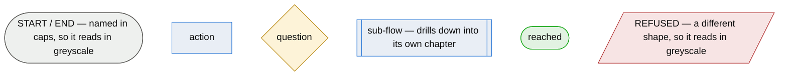

# Legend — what a shape means

One legend for every flow in this corpus. Each chapter's diagram carries its own `classDef` lines,
so a flow can be copied and rendered on its own; the shapes those classes stand for are here.

Shape carries the role, so a flow reads in greyscale and in print.

Six shapes, and the set is closed. What is undecided, what is constrained and what is imposed are
**not** shapes: they carry ids under the node they affect, where a reader meets them beside the step
rather than in the margin of a picture.
