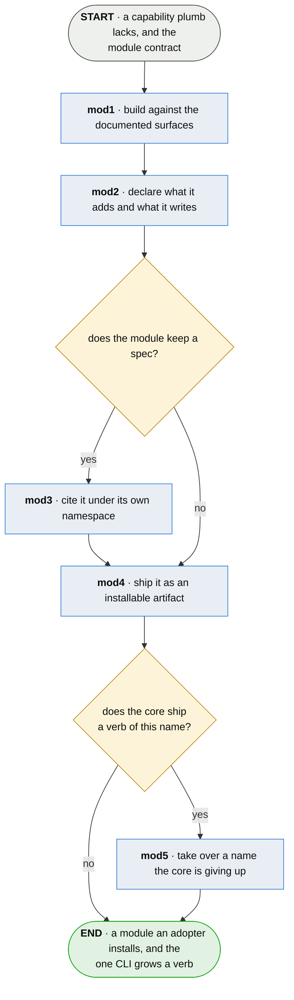

# mod · contribute a module

**Last updated** 2026-10-26 v8

What whoever builds a module does, from a capability plumb lacks to a verb an adopter can
install. Exits to [ado · bring plumb to a project](ado-bring-plumb-to-a-project.md), whose
later entry mounts it. The surfaces a module builds against are the core's documented, derived
artifacts — the board, the series interface — and never the manifest, which stays the
adapters' hub and the core's own to restructure.

## Nodes

### mod1 · build against the documented surfaces

> **As whoever builds a module I want one documented contract to build against, so that adding
> my capability never means reading plumb's source or touching its core.**

#### Information

| Information | IO | Description | Required | Provenance |
|---|---|---|---|---|
| mod1-inf1 | In | `module_contract` — the documented surfaces and the mount | yes | authored |
| mod1-inf2 | In | `board` — the versioned neutral format | yes | authored |
| mod1-inf3 | Out | `module` | yes | derived |

#### User Requirements
  * mod1-ur1 - a module consumes the documented derived surfaces — the board, the series
    interface — each versioned, each refusing newer by name
  * mod1-ur2 - a module declares the surfaces it speaks as a map, a version per surface — one
    number cannot refuse on three axes
  * mod1-ur3 - a module that cannot reach what it needs is inert: its verbs report their own
    standing, and the tool stays whole

#### System Requirements
  * mod1-sr1 - the manifest stays the adapters' hub and the core's own to restructure; the
    module contract never names it

#### Non-Functional Requirements
  * mod1-nfr1 - a module reads what was proven and can never move a status — the proof graph
    has one set of writers, and a module is not among them

#### Unknowns

---

### mod2 · declare what it adds and what it writes

> **As an adopter deciding what to install I want the module to say what verbs it adds and what
> it will write, so that trusting it is a decision about a list rather than a hope.**

#### Information

| Information | IO | Description | Required | Provenance |
|---|---|---|---|---|
| mod2-inf1 | In | `module` | yes | mod1 |
| mod2-inf2 | Out | `module.declaration` — name, verbs, surface versions, footprint | yes | authored |

#### User Requirements
  * mod2-ur1 - the verbs it mounts are named in the declaration, and none is a core verb
  * mod2-ur2 - every place the module writes is a declared footprint entry with a disposition,
    so migration, removal, and whatever backup the adopter runs stay honest about what modules
    added; a secret rests in the module's state home with the disposition *carries a credential*,
    never in a configuration table
  * mod2-ur3 - the module names itself and its version, out of its own artifact
  * mod2-ur4 - the declaration says whether the module reaches the network, so the install's
    trust decision is over verbs, writes and reach together
  * mod2-ur5 - a verb name claimed by more than one module mounts for none of them, and every
    claimant is named, so an adopter is told a name is contested rather than handed one of the
    two; a verb that answers from somewhere they did not choose writes their data somewhere they
    did not choose

#### System Requirements
  * mod2-sr1 - a module that needs configuration reads its own named table and never another's;
    the core's keys are read-only to it
  * mod2-sr2 - every declaration is held against the others before any of them is bound, so a
    contested name is a refusal the adopter reads and never an error raised out of building the
    parser; the tool answers for every verb that is not contested
  * mod2-sr3 - what the tool lists is what the tool mounted, read off the mount itself and never
    computed a second time against a different question; a listing that says *mounted* where the
    tool refuses is worse than no listing, because the trust decision is made on it

#### Non-Functional Requirements
  * mod2-nfr1 - picking a winner is the failure that cannot be seen: discovery order is the entry
    point's name, a string neither author chose for this and no adopter reads, so *which module
    answers* would be decided by alphabetical accident and look exactly like working

#### Unknowns
  * mod2-u1 - how an adopter resolves a contested name is undecided; nothing here lets them
    choose one, so the remedy is to uninstall the other

---

### mod5 · take over a name the core is giving up

> **As an adopter I want a verb I already use to keep working across the release that moves it out
> of the core, so that where the capability is built is not a thing I have to notice.**

#### Information

| Information | IO | Description | Required | Provenance |
|---|---|---|---|---|
| mod5-inf1 | In | `module_artifact` | yes | mod4 |
| mod5-inf2 | In | `core_release` — the one that drops the name | yes | observed |
| mod5-inf3 | Out | `name_handover` | yes | derived |

#### User Requirements
  * mod5-ur1 - the core dropping the name and the module mounting it are one release, so no
    adopter meets a version with two of that verb or none
  * mod5-ur2 - an artifact that carries the module before the name is free withholds its entry
    point rather than shipping a mount that will be refused; a refused module states its refusal
    on every invocation, and that is a worse artifact than one release of waiting
  * mod5-ur3 - what the verb does is the module's from the moment it mounts, and the core keeps no
    copy against which the module could be said to be wrong
  * mod5-ur4 - what the core wrote under that name stays exactly where it is and the module reads
    it there; the release that gives the name up moves nothing, because a conversion run by the
    half that is leaving is one nobody can run a second time

#### System Requirements
  * mod5-sr1 - the two sides are cut together and neither is released on the strength of the
    other being ready
  * mod5-sr2 - what leaves is what implemented the capability, never what the module builds on: a
    published surface stays published, because a module cannot speak a version of something the
    core stopped having, and a holder somebody runs themselves must not come to depend on the
    software of whoever answers a different capability

#### Non-Functional Requirements
  * mod5-nfr1 - the alternative is coexistence, and the cost of it is not two implementations but
    one wrong claim: a core that still ships a verb is a core that still claims the capability, and
    the surviving name goes on telling adopters something the project does not do
  * mod5-nfr2 - the moment a capability leaves is the cheapest it will ever be to leave, because
    the population using it only grows

#### Unknowns
  * mod5-u1 - what an adopter who upgrades the core and not the module meets is undecided; today
    nothing checks either for an update, so the two versions drift with nobody told

---

### mod3 · cite it under its own namespace

> **As a module author who keeps a spec I want my subjects on the same board as everything
> else, so that my module's claims are proven the way the core's are.**

#### Information

| Information | IO | Description | Required | Provenance |
|---|---|---|---|---|
| mod3-inf1 | In | `module.declaration` | yes | mod2 |
| mod3-inf2 | Out | `namespace` — the module's own | yes | authored |

#### User Requirements
  * mod3-ur1 - the module's spec lives in its own namespace, and its citations coexist on one
    board with every other spec in the repository
  * mod3-ur2 - keeping a spec is the author's choice; nothing refuses a module that keeps none

#### System Requirements

#### Non-Functional Requirements

#### Unknowns

---

### mod4 · ship it as an installable artifact

> **As an adopter I want a module installed by the same gesture as any package, so that adding
> a capability never means reading a contributor's repository.**

#### Information

| Information | IO | Description | Required | Provenance |
|---|---|---|---|---|
| mod4-inf1 | In | `module.declaration` | yes | mod2 |
| mod4-inf2 | Out | `module_artifact` | yes | generated |

#### User Requirements
  * mod4-ur1 - the artifact declares its mount in the package's own entry-point mechanism, so
    installing it is the whole of enabling it
  * mod4-ur2 - the artifact carries what its verbs need; an adopter obtains nothing separately

#### System Requirements

#### Non-Functional Requirements

#### Unknowns

## Glossary

| Term | Meaning |
|---|---|
| Module | An installable package that mounts verbs into plumb's one CLI and consumes the core's documented surfaces. |
| Module contract | The documented twin of the adapter contract: what a module receives, owes, and may never do. |
| Documented surfaces | The derived artifacts the core publishes and versions — the board, the series interface. What modules build on, so the manifest stays free to change. |
| Mount | A module's verbs appearing in the one CLI, discovered from the installed package's declaration. |
| Footprint | Everything the tool writes, module entries included — each with a disposition. |
| Provenance | The fifth column of an Information table: where an input came from, or how an output was made. |
| Authored | Written by a person. An input nothing produces, or an output somebody typed. |
| Derived | Computed by this step from what it took in. |
| Observed | Read off a run, a tree or the world as it stands. |
| Generated | Made by a tool rather than by a person. |
| Parent | On a sub-flow's input: handed in by the chapter this one drills into. |

---

## Working notes — not part of the chapter

**Why this exists** (operator, 2026-09-13): one CLI, extended by contributed modules; the
supported product becomes the first module rather than a fork. The symmetry: contributors
supply adapters into the manifest; the core derives documented surfaces; modules consume them.

**Module candidates already in the corpus:** the SARIF envelope and platform bindings
(dev07-5-3-sr1/sr2 — "opt-in, outside the core"), remote custody push, and the supported
product's support client and accounts.
