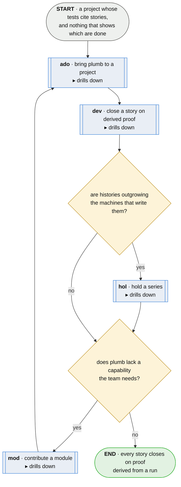

# plumb · a project's stories, shown done

**Last updated** 2026-10-26 v1

The one flow this corpus starts from. A team brings plumb to its project; its developers close
stories on proof derived from a run rather than on a status somebody typed; where histories outgrow
the machines that write them, somebody stands up a holder; and where plumb lacks a capability the
team needs, somebody builds it as a module and the team mounts it. Every other flow is one of these
steps or is entered from inside one: [snd · send what a run produced](snd-send-what-a-run-produced.md)
from the series a run appends to, and [lex · say it in the reader's words](lex-say-it-in-the-readers-words.md)
from the work a story asks for.

## Nodes

### ado · bring plumb to a project

> **As a team I want plumb installed and pointed at our project without reading its repository,
> so that the first thing we see is a board answering for the stories our tests cite.**

#### Information

| Information | IO | Description | Required | Provenance |
|---|---|---|---|---|
| ado-inf1 | In | `module_artifact` | optional | mod |
| ado-inf2 | Out | `config` | yes | derived |

#### User Requirements

#### System Requirements

#### Non-Functional Requirements

#### Unknowns

---

### dev · close a story on derived proof

> **As a developer I want to finish a piece of work and have it shown to be finished, so that what
> I hand over is complete rather than asserted.**

#### Information

| Information | IO | Description | Required | Provenance |
|---|---|---|---|---|
| dev-inf1 | In | `config` | yes | ado |
| dev-inf2 | Out | `board` | yes | derived |
| dev-inf3 | Out | `pull_request` | yes | derived |

#### User Requirements
  * dev-ur1 - a story carries an identifier the team already uses
  * dev-ur2 - the team records somewhere what is in flight
  * dev-ur3 - the team has somewhere to ask what a story means

#### System Requirements
  * dev-sr1 - a version control system with branches and pull requests
  * dev-sr2 - a test runner the language supports
  * dev-sr3 - plumb installed, and its adapter for that language

#### Non-Functional Requirements
  * dev-nfr1 - running plumb costs about what running the tests already costs
  * dev-nfr2 - nothing in the flow writes a status anybody could have typed

#### Unknowns

---

### hol · hold a series

> **As an IT professional I want the team's histories held on a box we already run, so that a
> history outgrowing the machine that wrote it is kept rather than lost.**

#### Information

| Information | IO | Description | Required | Provenance |
|---|---|---|---|---|
| hol-inf1 | Out | `holder` | yes | derived |

#### User Requirements

#### System Requirements

#### Non-Functional Requirements

#### Unknowns

---

### mod · contribute a module

> **As whoever builds a module I want to add a capability plumb lacks without forking it, so that
> a team that needs it installs it beside the tool it already has.**

#### Information

| Information | IO | Description | Required | Provenance |
|---|---|---|---|---|
| mod-inf1 | In | `board` | yes | dev |
| mod-inf2 | Out | `module_artifact` | yes | derived |
| mod-inf3 | Out | `namespace` | yes | derived |

#### User Requirements

#### System Requirements

#### Non-Functional Requirements

#### Unknowns

## Glossary

| Term | Meaning |
|---|---|
| Main flow | The one flow the corpus starts from. Its steps are the corpus's other flows, named by their own sigils. |
| Derived proof | A story shown done by a run that reached the system through its entry point, never by a status somebody typed. |
| Module | A capability built outside the core and mounted as a verb of the one CLI. |
