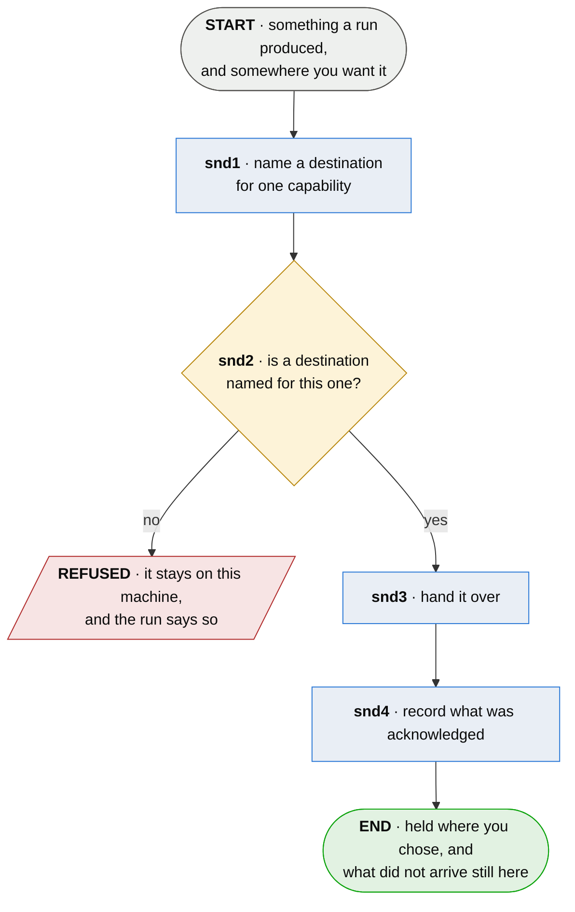

# snd · send what a run produced

**Last updated** 2026-10-20 v2

What a developer does to get what their run produced somewhere they chose — a history to a holder
their team runs, a record to a service that answers them. The holder this reaches is
[hol · hold a series](hol-hold-a-series.md); what is sent to it is appended in
[dev07-6 · append the run to the series](dev07-6-append-the-run-to-the-series.md). This flow is the
part between having something and it being held elsewhere, and it is the same part whichever
capability is doing the sending.

**Decision `snd-D1` — a destination belongs to a capability, not to the machine.** Known and
restricting: one credential and one base URL for everything the tool sends makes a person choose
between self-hosting a holder and being answered by a support service, because both hang off the
same address. A capability names its own destination, and a project may name as many as it has
capabilities.

## Nodes

### snd1 · name a destination for one capability

> **As a developer I want to say where one kind of thing goes and who I am there, so that hosting
> my own history costs me nothing about who answers my questions.**

#### Information

| Information | IO | Description | Required | Provenance |
|---|---|---|---|---|
| snd1-inf1 | In | `capability` | yes | authored |
| snd1-inf2 | In | `destination.url` | yes | authored |
| snd1-inf3 | In | `destination.credential` | yes | authored |
| snd1-inf4 | Out | `destination` | yes | derived |

#### User Requirements
  * snd1-ur1 - a destination is named for one capability, and a project names as many as it uses
  * snd1-ur2 - naming one is the whole of enabling it, and there is no second setting that turns
    sending on
  * snd1-ur3 - every field of a destination is readable from the environment, so a runner needs no
    file in a working tree

#### System Requirements
  * snd1-sr1 - a destination carries where to send, the credential to send with, and which store
    that credential owns
  * snd1-sr2 - a destination says nothing about a relationship with whoever runs it; who the sender
    is to a service is the service's to decide from the credential it authenticated
  * snd1-sr3 - two capabilities naming the same address are two destinations that happen to agree,
    and neither reads the other's

#### Non-Functional Requirements
  * snd1-nfr1 - a credential in a file in a working tree is collectable by an artifact upload or a
    cache step written for something else, so the environment is the route a runner is offered
  * snd1-nfr2 - a single address for everything reads as simpler until the first person self-hosts
    one capability, at which point it is not configuration but a choice between two products

#### Unknowns
  * snd1-u1 - whether a destination may also be named per project rather than only per machine is
    undecided; a repository that pushes to its team's holder and one that pushes nowhere are the
    same machine

---

### snd2 · is a destination named for this one?

> **As a developer I want nothing to leave this machine unless I said where it goes, so that
> installing the tool is not a decision about my data.**

#### Information

| Information | IO | Description | Required | Provenance |
|---|---|---|---|---|
| snd2-inf1 | In | `destination` | optional | snd1 |
| snd2-inf2 | In | `outgoing` | yes | observed |
| snd2-inf3 | Out | `addressed` | optional | derived |
| snd2-inf4 | Out | `refusal` | optional | derived |

#### User Requirements
  * snd2-ur1 - with no destination named for a capability, what that capability produced stays on
    this machine and the run says so
  * snd2-ur2 - a destination named for one capability never addresses another's

#### System Requirements
  * snd2-sr1 - the absence of a destination is the ordinary state and is never an error
  * snd2-sr2 - what is addressed is what has not been acknowledged, and never what a run happened
    to produce most recently

#### Non-Functional Requirements
  * snd2-nfr1 - *nothing leaves without being told where* is a guarantee only while absence is the
    default; a default address would make it a promise about somebody's configuration instead
  * snd2-nfr2 - a run that transmits silently and a run that transmits nothing look identical from
    the outside, so the one that transmitted nothing is the one that has to say so

#### Unknowns

---

### snd3 · hand it over

> **As a developer I want what I send to go with the credential its destination names, so that
> where something goes and what it is sent under are decided in one place.**

#### Information

| Information | IO | Description | Required | Provenance |
|---|---|---|---|---|
| snd3-inf1 | In | `addressed` | yes | snd2 |
| snd3-inf2 | Out | `handover` | yes | derived |

#### User Requirements
  * snd3-ur1 - what is handed over is presented with the credential of the destination it is
    addressed to

#### Unknowns

---

### snd4 · record what was acknowledged

> **As a developer I want a retry to send what did not arrive and nothing else, so that a service
> that was down for an hour does not become a service holding six copies of everything.**

#### Information

| Information | IO | Description | Required | Provenance |
|---|---|---|---|---|
| snd4-inf1 | In | `handover` | yes | snd3 |
| snd4-inf2 | Out | `acknowledgement` | yes | observed |
| snd4-inf3 | Out | `outstanding` | yes | derived |

#### User Requirements
  * snd4-ur1 - what the receiver acknowledged is recorded against what was sent, so a retry carries
    only what is outstanding
  * snd4-ur2 - a receiver that has stopped answering is distinguishable from having nothing to send

#### System Requirements
  * snd4-sr1 - an acknowledgement is keyed on something the receiver honours; where a receiver
    assigns its own name for what it took, that name is what is recorded
  * snd4-sr2 - a second arrival of one thing is the same thing sent twice and is not an error

#### Non-Functional Requirements
  * snd4-nfr1 - an acknowledgement keyed on something the receiver does not honour leaves an outbox
    that never clears and a sender that re-sends what already arrived, and the duplicates land on
    the person who was helping
  * snd4-nfr2 - an outbox that never empties reads as a service that has stopped answering, so the
    reader draws the wrong conclusion about somebody else's system

#### Unknowns
  * snd4-u1 - whether an outstanding item should expire is undecided; something unacknowledged for
    a month is either a receiver that moved or a sender nobody will read again

## Glossary

| Term | Meaning |
|---|---|
| Capability | One thing the tool can send — a run history, a record for a service. Named, so a destination can belong to it rather than to the whole installation |
| Destination | Where one capability's output goes, the credential it goes with, and which store there it owns. Not a relationship with whoever runs it |
| Enrolment | Being admitted to somebody's programme, which is how a destination for that programme comes to exist. A thing the programme's own software does, not this flow |
| Handover | What is actually sent: the content and its credential, addressed to one destination |
| Outstanding | What was handed over and not acknowledged. The only thing a retry carries |
| Provenance | The fifth column of an Information table: where an input came from, or how an output was made |
| Authored | Written by a person. An input nothing produces, or an output somebody typed |
| Derived | Computed by this step from what it took in |
| Observed | Read off a run, a tree or the world as it stands |
